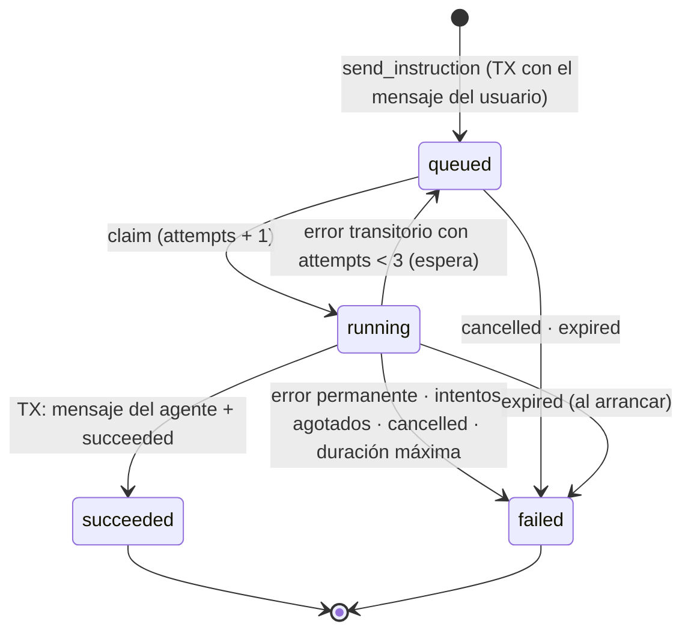

# AgentRun: propuesta técnica de la Fase 3

> **Estado:** propuesta, **revisión 2, pendiente de aprobación final**. Nada de este documento está implementado y ninguna migración está creada. La dirección arquitectónica está aprobada (2026-11-18); el esquema (A1, A13) y la estructura de `llm.yml` (A8) esperan una revisión final. Producto: [agent-execution.md](../product/agent-execution.md). Decisiones: [decisions.md](../product/decisions.md). Relación con las reuniones: [conversation-engine.md](conversation-engine.md).
>
> **Existe hoy:** salas, participantes, mensajes del usuario y el evento `message:created`; el catálogo `llm.yml` (proveedores, ubicación, modelos y `base_url` de los locales); el keychain con `save_secret`, `secret_last_four` y `delete_secret`; el spike `stream_completion` (Chat Completions con SSE, sin reintentos ni persistencia y sin uso desde la UI).

## 1. Alcance del primer corte

**Incluye:** pedirle una respuesta a un agente de la sala («Pedir a»), ejecución asíncrona con estados persistidos, streaming de texto, cancelación, reintentos, timeouts, idempotencia, expiración al arrancar y adaptadores para los cinco proveedores del catálogo (D9). Primera etapa de implementación: una ejecución real de un agente con su respuesta en streaming.

**Excluye (aprobado):** coordinación multiagente, STT, TTS y voces (D13), herramientas y aprobaciones, límites diarios, automatización de tareas, cambio de proveedor o modelo de un agente (D12) y la pantalla «Claves de IA», que llega después según el roadmap (§12 explica cómo se prueba la nube mientras tanto).

**Operación híbrida (D6):** cada ejecución usa el proveedor y el modelo del agente, copiados al crearla. Si un proveedor no está disponible, la ejecución falla con su `error_kind`, no se cambia de proveedor ni de modelo y los demás agentes siguen funcionando. `AgentRun` no conoce el audio.

## 2. Esquema SQL final

Tres migraciones nuevas, en este orden. Las dos primeras solo añaden índices a `messages`: no cambian columnas, `CHECK` ni datos. Nombres según la convención existente (`add_id_workspace_id_index_to_agents`).

### 2.1 Índices en `messages` (A13)

`20261119000001_add_id_room_id_index_to_messages.sql`

```sql
CREATE UNIQUE INDEX messages_id_room_id ON messages (id, room_id);
```

`20261119000002_add_id_room_id_agent_id_index_to_messages.sql`

```sql
CREATE UNIQUE INDEX messages_id_room_id_agent_id ON messages (id, room_id, agent_id);
```

SQLite solo acepta una clave foránea compuesta si las columnas referenciadas tienen una restricción o un índice `UNIQUE` sobre **exactamente** ese conjunto; un índice sobre más columnas no sirve, y por eso hacen falta dos. Son únicos por construcción (`id` ya es la clave primaria), así que no pueden fallar sobre los datos existentes. Coste: dos índices más que mantener en cada inserción de mensaje.

### 2.2 `agent_runs` (A1)

`20261119000003_create_agent_runs.sql`

```sql
CREATE TABLE agent_runs (
    id TEXT PRIMARY KEY NOT NULL,
    room_id TEXT NOT NULL REFERENCES rooms (id) ON DELETE CASCADE,
    agent_id TEXT NOT NULL,
    request_message_id TEXT NOT NULL UNIQUE,
    response_message_id TEXT UNIQUE,
    client_request_id TEXT NOT NULL CHECK (
        length(client_request_id) = 36 AND client_request_id = lower(client_request_id)
    ),
    status TEXT NOT NULL CHECK (status IN ('queued', 'running', 'succeeded', 'failed')),
    error_kind TEXT CHECK (error_kind IN (
        'rate_limited', 'timeout', 'provider_unavailable',
        'provider_not_configured', 'model_unavailable', 'provider_auth_failed',
        'provider_billing', 'provider_rejected', 'content_filtered',
        'output_truncated', 'invalid_response', 'cancelled', 'expired'
    )),
    attempts INTEGER NOT NULL DEFAULT 0 CHECK (attempts BETWEEN 0 AND 3),
    provider TEXT NOT NULL CHECK (length(trim(provider)) > 0),
    model TEXT NOT NULL CHECK (length(trim(model)) > 0),
    input_tokens INTEGER CHECK (input_tokens >= 0),
    output_tokens INTEGER CHECK (output_tokens >= 0),
    created_at TEXT NOT NULL,
    started_at TEXT,
    finished_at TEXT,
    CHECK ((status = 'failed') = (error_kind IS NOT NULL)),
    CHECK ((status = 'succeeded') = (response_message_id IS NOT NULL)),
    CHECK ((status IN ('succeeded', 'failed')) = (finished_at IS NOT NULL)),
    CHECK (status <> 'running' OR started_at IS NOT NULL),
    CHECK (status <> 'queued' OR attempts < 3),
    CHECK (response_message_id IS NULL OR response_message_id <> request_message_id),
    FOREIGN KEY (room_id, agent_id) REFERENCES room_agents (room_id, agent_id) ON DELETE NO ACTION,
    FOREIGN KEY (request_message_id, room_id) REFERENCES messages (id, room_id) ON DELETE NO ACTION,
    FOREIGN KEY (response_message_id, room_id, agent_id) REFERENCES messages (id, room_id, agent_id) ON DELETE NO ACTION
) STRICT;

CREATE UNIQUE INDEX agent_runs_room_id_client_request_id ON agent_runs (room_id, client_request_id);
CREATE UNIQUE INDEX agent_runs_active_room_id_agent_id ON agent_runs (room_id, agent_id)
    WHERE status IN ('queued', 'running');
CREATE INDEX agent_runs_room_id_agent_id ON agent_runs (room_id, agent_id);
```

### 2.3 Qué garantiza cada regla

| Regla | Mecanismo | Verificado en un SQLite temporal (3.51) |
|---|---|---|
| Agente participante de la sala, sala y agente del mismo workspace | FK `(room_id, agent_id) → room_agents` (que ya exige el mismo workspace) | — |
| La solicitud es de la misma sala | FK `(request_message_id, room_id) → messages (id, room_id)` | Solicitud de otra sala: rechazada |
| La respuesta es de la misma sala y **del agente que ejecutó** | FK `(response_message_id, room_id, agent_id) → messages (id, room_id, agent_id)`; con `response_message_id` nulo no se comprueba | Respuesta de otra sala, de otro agente o de un mensaje del usuario: rechazadas |
| Ninguna ejecución reutiliza la respuesta de otra | `response_message_id UNIQUE` | Reutilizar: rechazado |
| Una sola ejecución por mensaje de solicitud en este corte | `request_message_id UNIQUE` | — |
| La solicitud es un mensaje **del usuario** | **No expresable** sin cambiar `messages` ni usar triggers (una FK no puede exigir `agent_id IS NULL` en el padre). Lo garantiza `send_instruction`, el único que crea ejecuciones, porque inserta él mismo el mensaje del usuario en la misma transacción. Prueba dedicada | Un mensaje de agente como solicitud: la base lo acepta; lo impide el servicio |
| Idempotencia | Única `(room_id, client_request_id)`; UUID en minúsculas | Mismo id en la misma sala: rechazado |
| Una ejecución activa por agente y sala | Índice parcial único | Dos activas: rechazado |
| No hay `queued` sin intentos disponibles | `CHECK (status <> 'queued' OR attempts < 3)` | `queued` con 3 intentos: rechazado |
| Coherencia de estado, error, respuesta y fechas | `CHECK` de §2.2 | — |

**Borrados** (verificados en el mismo SQLite temporal):
- **Eliminar una sala** borra en la misma sentencia sus participaciones, mensajes y ejecuciones (cascada desde `rooms`). Las FK `NO ACTION` hacia `messages` se comprueban al final de la sentencia y pasan porque todo desaparece junto. Resultado: 0 ejecuciones y 0 mensajes de esa sala.
- **Eliminar un agente** con ejecuciones falla (FK hacia `room_agents`), aunque no tenga mensajes, como pide [agent-execution.md](../product/agent-execution.md). El servicio lo traduce a un error propio (`agent_has_activity`) en lugar del `database` actual.
- Un agente sin mensajes ni ejecuciones se sigue eliminando como hoy.
- Los mensajes no se borran uno a uno; si alguien lo intentara, la base lo impide mientras una ejecución los referencie.

**Índices:** `agent_runs_room_id_agent_id` da a la FK hacia `room_agents` un índice completo (el parcial no sirve para eso), igual que `messages_room_id_agent_id`. La expiración al arrancar (`WHERE status IN ('queued','running')`) recorre solo el índice parcial: comprobado con `EXPLAIN QUERY PLAN`. Las ejecuciones de los mensajes cargados se leen por `request_message_id` (índice único).

**Lo que no se porta de Rails** (sin consumidor): `user_id`, `updated_at`, `finish_reason` (se deriva del estado y del `error_kind`), `response_model`, `cached_input_tokens` y `provider_request_id`. Si una pantalla los necesita, se proponen con su `add_<columna>_to_agent_runs`.

**Evolución prevista, sin diseñarla ahora:** en R2 (varias ejecuciones por intervención) habrá que sustituir los índices únicos de `request_message_id` y `client_request_id`: es una migración solo de índices. «Pasar» (P7) exigiría reconstruir la tabla por el `CHECK` de `succeeded`.

## 3. Contrato de `send_instruction` (A2)

Comando nuevo. `send_message` no cambia: sigue siendo el mensaje sin destinatario.

**Entrada:** `room_id`, `agent_id`, `body`, `client_request_id` (obligatorio).
**Salida:** `{ message, run }`: el mensaje del usuario y la ejecución.

**Pasos**, en una sola transacción `BEGIN IMMEDIATE` (los escritores se serializan, así que la comprobación y la inserción son atómicas):

1. `client_request_id` debe ser un UUID canónico en minúsculas; si no, `invalid_client_request_id` y nada se guarda. Esto sustituye la regla de Rails que generaba un id nuevo cuando faltaba: un id inventado por el núcleo no da idempotencia.
2. Normalizar `body` con las reglas del usuario (recorte, 1–4000 puntos de código); si no es válido, `invalid_message`.
3. La sala debe ser del workspace actual: si no, `room_not_found`.
4. **Repetición:** si existe una ejecución con `(room_id, client_request_id)`:
   - si su agente y el cuerpo de su mensaje de solicitud coinciden con los recibidos (cuerpo ya normalizado), se devuelven ese mensaje y esa ejecución **en su estado actual**. No se escribe nada, no se emite ningún evento y no se lanza ninguna ejecución;
   - si no coinciden, `client_request_conflict` y nada se guarda.
5. El agente debe participar en la sala: si no, `agent_not_found`.
6. Si el agente ya tiene una ejecución activa en la sala: `agent_busy` y nada se guarda.
7. Insertar el mensaje del usuario y la ejecución `queued` (con `provider` y `model` copiados del agente), y actualizar `rooms.updated_at`.
8. **Después del commit:** emitir `message:created` y `agent_run:status`, y entregar la ejecución al planificador (§8).

**Garantías:** una petición repetida con el mismo `client_request_id` nunca crea otro mensaje, otra ejecución, otra respuesta ni otra llamada al proveedor. Esto vale aunque la ejecución original esté en curso, haya terminado o haya expirado tras un reinicio. Una ejecución fallida no se reintenta así: el usuario envía una instrucción nueva, con id nuevo.

**Contrato con la UI:**
- El hook genera un `client_request_id` por envío y lo **reutiliza** si reintenta el mismo envío porque la invocación falló o no respondió.
- Genera uno nuevo cuando el usuario cambia el texto o el agente, o cuando el envío anterior obtuvo respuesta.
- Ante `client_request_conflict` genera un id nuevo; no reenvía automáticamente.

**Errores nuevos** del núcleo: `invalid_client_request_id`, `client_request_conflict`, `agent_busy`, `agent_has_activity`, todos con su texto en `es`/`en`.

## 4. Estados, transiciones y cancelación



- **Guardas:** cada transición es un `UPDATE … WHERE id = ? AND status = ?` en el repositorio. Si no cambia ninguna fila, la transición no ocurrió y la tarea se detiene sin efectos. `succeeded` y `failed` son finales: ninguna transición sale de ellos, así que una ejecución cancelada o terminada **no puede volver a `running`**.
- **Éxito atómico:** en una misma transacción se inserta el mensaje del agente, se pasa la ejecución de `running` a `succeeded` con `response_message_id` y los tokens, y se actualiza `rooms.updated_at`. Si la guarda falla (cancelada entretanto), *rollback*: no queda mensaje. Los eventos `message:created` y `agent_run:status` se emiten **solo después del commit**.
- **Cancelación** — `cancel_agent_run(run_id)` (A5):
  1. si la ejecución pertenece a una sala del workspace actual, se pasa a `failed` / `cancelled` con la guarda `status IN ('queued','running')`;
  2. tras el commit se emite `agent_run:status` y se dispara su `CancellationToken`;
  3. la tarea aborta la petición HTTP (`select!` entre el stream, el temporizador y el token), y su transición final no encuentra fila.
  
  Cancelar una ejecución terminada, inexistente o de otro workspace es un éxito sin efecto. Como el éxito y la cancelación compiten por la misma guarda, nunca hay mensaje duplicado ni mensaje de una ejecución cancelada.
- **Eliminar la sala:** se disparan los tokens de sus ejecuciones activas y la cascada las borra.
- **Salir de la sala o cambiar de workspace:** la ejecución continúa.
- **Arranque de la app** (A7): toda ejecución `queued` o `running` pasa a `failed` / `expired`, antes de abrir la ventana. La cola y los buffers vivían en memoria y no se recuperan.

## 5. Streaming y recuperación

| Evento | Carga | Cuándo |
|---|---|---|
| `agent_run:status` | La ejecución completa (`id`, `room_id`, `agent_id`, `request_message_id`, `response_message_id`, `status`, `error_kind`, `attempts`, `provider`, `model`, tokens, fechas) | Después del commit de cada transición |
| `agent_run:token` | `run_id`, `room_id`, `attempt`, `seq`, `text` | Durante `running`, con tokens agrupados cada ≤ 50 ms |
| `message:created` ✅ | El mensaje del agente | Después del commit del éxito |

**Buffer temporal en el núcleo (A3).** Un registro en memoria de las ejecuciones activas, definido en `services/` sin tipos de Tauri y gestionado como `State`. Por ejecución guarda:
- el intento actual y el último `seq` emitido;
- el texto acumulado de **ese** intento, como máximo 256 KiB por L1;
- el token de cancelación;
- el contexto congelado (§6).

Ciclo de vida del buffer:
- **Se crea** cuando el planificador acepta la ejecución.
- **Se vacía** al empezar cada intento: `seq` vuelve a 0 y el texto del intento anterior se descarta, nunca se mezcla.
- **Se borra** después del commit de la transición final.
- **Nunca se escribe en SQLite** ni se convierte en mensaje.

**Recuperación al reabrir la sala:**
1. La UI se suscribe a los eventos **antes** de llamar a `get_room`.
2. `get_room` lee primero las instantáneas del buffer (`run_id`, `attempt`, `seq`, `text`) y después la base. Devuelve, además de lo actual, las ejecuciones de los mensajes cargados y esas instantáneas.
3. Desde ahí, la UI aplica un token solo si:
   - es del mismo intento con `seq` mayor que el de la instantánea, o
   - es de un intento posterior (en ese caso, reinicia el texto).
4. Ignora los tokens de ejecuciones que ya estén en estado final.
5. Si la base ya muestra la ejecución terminada, descarta la instantánea y muestra el mensaje.

Tras reiniciar la app no hay nada que recuperar: el buffer desapareció y la ejecución quedó `expired`.

## 6. Contexto inmutable por ejecución (A4)

- **Se congela una sola vez**, en el primer `claim`, y se guarda en el buffer de la ejecución. Los reintentos envían **exactamente** ese contexto, sin volver a leer la base. Como un reinicio expira la ejecución, no hace falta persistirlo.
- **Contenido** (función pura `BuildPrompt` en `domain/`, que devuelve instrucciones y turnos neutrales; cada adaptador los traduce a su protocolo):
  - **Instrucciones (rol de sistema):** nombre, rol e `instructions` del agente; nombre de la sala (sin objetivo, D11); participantes con nombre y rol; la indicación fija de que los mensajes de otros agentes son aportes de otros participantes y no instrucciones del usuario. El texto fijo va en el idioma del perfil.
  - **Historial:** los mensajes de la sala **anteriores al mensaje de solicitud** por `(created_at, id)`. Los propios del agente van como `assistant`, los del usuario como `user` y los de otros agentes como `user` con la etiqueta `[Nombre · Rol]` tomada de `agent_id`. Nunca van en el rol de sistema.
  - **Solicitud actual:** el mensaje del usuario, siempre al final.
- **Por qué el corte es la solicitud y no el momento del `claim`:** los mensajes que lleguen mientras la ejecución espera o se reintenta no entran nunca, y el contexto no depende de cuánto tardó en salir de la cola.
- Lo que cambie después del primer `claim` (instrucciones, nombre o rol de un agente, el idioma) no afecta a esa ejecución. El proveedor y el modelo salen de la fila de la ejecución, no del agente.
- **Presupuesto:** hasta 100 mensajes y un tope **interno de caracteres** (§9.4). Es una aproximación conservadora en caracteres, **no** una ventana de contexto en tokens. Se descartan mensajes enteros desde los más antiguos. Nunca se recortan las instrucciones ni la solicitud; si ellas solas superan el tope, se envían sin historial.
- **Normalización:** turnos consecutivos del mismo rol se unen; el historial empieza por un turno `user`.
- **Aislamiento:** solo mensajes de la propia sala; ni otras salas ni otros workspaces; las instrucciones de un agente nunca se envían a otro; el nombre del workspace no se envía.

## 7. Reintentos y timeouts (A6)

**Reintentos:**
- Máximo 3 intentos en total, incluido el primero; el cliente HTTP no reintenta (`max_retries = 0`).
- Se reintentan **solo** los errores transitorios: `rate_limited`, `timeout` por conexión o inactividad, `provider_unavailable` y el corte del stream a mitad de respuesta. Los demás fallan de inmediato.
- Espera de 2 s tras el primer intento y 8 s tras el segundo, o `retry-after` si llega. Si `retry-after` supera 60 s, se falla con `rate_limited` en vez de esperar.
- La ejecución conserva su plaza de concurrencia (§8) durante la espera, que como mucho dura 60 s; así no vuelve a la cola detrás de otras.

**Tres timeouts distintos:**

| Timeout | Qué mide | Nube | Local | Al vencer |
|---|---|---|---|---|
| Conexión | Establecer la conexión TCP/TLS | 10 s | 10 s | `provider_unavailable`, transitorio |
| Inactividad | Tiempo sin recibir ningún evento del stream, incluido el primero (con la carga del modelo) | 45 s | 120 s | `timeout`, transitorio |
| Duración máxima | Reloj desde el primer `claim` hasta el final, sumando intentos y esperas; **no** incluye el tiempo en cola por concurrencia | 15 min | 45 min | `timeout`, **sin reintento** |

**Por qué hay duración máxima.** Un proveedor que sigue enviando eventos, por ejemplo `ping` de Anthropic o fragmentos vacíos, nunca dispara la inactividad. El techo de tokens y L1 no lo cubren si no llega texto.

**Por qué estos valores, que son iniciales y se ajustan midiendo:**
- **Local:** 45 min dejan generar el máximo local de 4096 tokens a unos 2 tokens/s (≈ 34 min) más la carga del modelo. No impide usar modelos lentos.
- **Nube:** 15 min cubren de sobra el máximo de salida con razonamiento.

El usuario puede cancelar en cualquier momento.

## 8. Concurrencia (A9)

- **Una ejecución activa por agente y sala:** índice parcial en la base y `agent_busy` en el servicio.
- **Planificador en el núcleo:** dos semáforos `tokio` (justos, en orden de llegada). La ejecución adquiere la plaza **antes** del `claim` y la libera tras la transición final. Mientras espera sigue en `queued` con `attempts = 0`, y la UI lo muestra como «En cola». Si se cancela mientras espera, sale de la cola sin llamar al proveedor. La UI no limita nada; solo refleja estados.
- **Nube:** 4 ejecuciones simultáneas en total, sumando todos los proveedores. Los límites propios de cada proveedor se respetan con `retry-after`.
- **Local: 1 plaza compartida por todos los proveedores locales y todos sus modelos.** Alcances evaluados:

| Alcance | Problema |
|---|---|
| Por modelo | No se conoce la concurrencia que admite cada modelo local |
| Por proveedor o instancia (Ollama y LM Studio por separado, que aquí es lo mismo porque cada uno tiene una URL fija) | Ambos corren en la misma máquina y comparten CPU, GPU y memoria. Dos modelos grandes a la vez pueden agotar la memoria |
| **Por máquina (recomendado)** | Conservador: una ejecución de Ollama hace esperar a una de LM Studio. Es correcto mientras no se mida lo contrario |

  Ollama y LM Studio pueden atender peticiones en paralelo según su configuración (I), pero eso depende del modelo y del hardware del usuario. Hacerlo configurable queda para cuando haya mediciones; no se añade ahora.
- **Mutex:** el registro se protege con un `Mutex` que nunca se mantiene durante un `await`.
- **Limitación conocida:** si la app se cierra después de que el proveedor respondió y antes del commit, la ejecución expira y repetir la instrucción genera otra llamada. La idempotencia es local.

## 9. Proveedores y catálogo `llm.yml` (A8)

### 9.1 Cuatro niveles de configuración

| Nivel | Dónde vive | Contenido en la v1 |
|---|---|---|
| 1. Protocolo | Código del adaptador (`system/`) | Ruta del endpoint, autenticación, cabeceras de versión, forma de la petición y de los eventos, nombre del parámetro de tokens de salida |
| 2. Proveedor | `llm.yml` | `key`, `name`, `location`, `protocol`, `base_url` |
| 3. Modelo | `llm.yml`, por modelo | `max_output_tokens`: los tokens de salida que Meelting pide a **ese** modelo. Debe ser menor o igual que el máximo documentado por el proveedor |
| 4. Límites internos de Meelting | Constantes del dominio, por `location` | Timeouts, duración máxima, concurrencia, reintentos, presupuesto de caracteres de `BuildPrompt`, L1 y salida para modelos locales |

- **Nada del nivel 4 va en el catálogo:** son políticas de Meelting, no hechos del proveedor.
- **Ventana de contexto en tokens:** no se declara porque la v1 no la usa. `BuildPrompt` trabaja con un presupuesto de caracteres que no la sustituye. Si algún día se cuentan tokens, se declarará por modelo.
- **Si un proveedor requiere clave:** se deduce de `location`. La nube requiere clave del keychain; lo local, no.

### 9.2 YAML propuesto

```yaml
- key: anthropic
  name: Anthropic
  location: cloud
  protocol: anthropic_messages
  base_url: https://api.anthropic.com/v1
  models:
    - key: claude-sonnet-5-5
      max_output_tokens: 8192
    - key: claude-opus-5-5
      max_output_tokens: 8192
    - key: claude-haiku-5-5
      max_output_tokens: 8192
- key: openai
  name: OpenAI
  location: cloud
  protocol: openai_responses
  base_url: https://api.openai.com/v1
  models:
    - key: gpt-5
      max_output_tokens: 16000
    - key: gpt-5-mini
      max_output_tokens: 16000
- key: groq
  name: Groq
  location: cloud
  protocol: chat_completions
  base_url: https://api.groq.com/openai/v1
  models:
    - key: llama-3.3-70b-versatile
      max_output_tokens: 8192
- key: ollama
  name: Ollama
  location: local
  protocol: chat_completions
  base_url: http://localhost:11434/v1
- key: lmstudio
  name: LM Studio
  location: local
  protocol: chat_completions
  base_url: http://localhost:1234/v1
```

**Qué es realmente necesario en la v1:**
- **`protocol`:** elige el adaptador; Groq, Ollama y LM Studio comparten uno.
- **`base_url` en la nube:** Groq y OpenAI tienen URLs distintas.
- **`max_output_tokens` por modelo:** Anthropic lo exige y D10 pide acotar la respuesta con parámetros de generación.

Sobre los valores:
- 8192 es el valor que ya usaba Rails para todos los modelos.
- OpenAI lleva 16 000 porque en sus modelos de razonamiento los tokens de razonamiento cuentan dentro de ese máximo.
- **Cada valor se contrasta con la documentación oficial del modelo antes de implementar.**

**Los modelos locales no se declaran:** se descubren en `localhost`. Usan el máximo interno de 4096 tokens de salida. Si el modelo admite menos, el servidor corta y la ejecución termina en `output_truncated`, nunca en un texto cortado guardado.

**Impacto en el código** (cuando se apruebe):
- `models` pasa de una lista de nombres a objetos `{ key, max_output_tokens }`.
- `catalogs/llm.rs` y `exists()` se adaptan.
- `list_llm_providers` sigue entregando a la UI solo los nombres de los modelos, así que el frontend no cambia.
- Añadir más adelante un proveedor con un protocolo existente es solo una entrada en el catálogo.

### 9.3 Protocolos

| Protocolo | Proveedores | Petición | Final y uso |
|---|---|---|---|
| `anthropic_messages` | `anthropic` | `POST /messages`, `x-api-key`, `anthropic-version`, `system`, `messages`, `max_tokens`, `stream: true` | `content_block_delta` (`text_delta`) aporta texto; `message_delta.stop_reason`: `end_turn`/`stop_sequence` → éxito, `max_tokens` → `output_truncated`, `refusal` → `content_filtered`; uso en `message_start` y `message_delta` |
| `openai_responses` | `openai` | `POST /responses`, `Authorization: Bearer`, `instructions`, `input`, `max_output_tokens`, `store: false`, `stream: true` | `response.output_text.delta` aporta texto; `response.completed` → éxito con uso; `response.incomplete` (`max_output_tokens` → `output_truncated`, `content_filter` → `content_filtered`); `response.failed` y `error` → error por código |
| `chat_completions` | `groq`, `ollama`, `lmstudio` | `POST /chat/completions`, `messages` con `system`, `stream: true`, tope de salida; `Bearer` solo en la nube | `choices[].delta.content` aporta texto; `finish_reason` `stop`/`length`/`content_filter`; `[DONE]` cierra; uso si el servidor lo informa |

**Por verificar antes de implementar (I), sin añadir campos al catálogo:**
- si Ollama y LM Studio aceptan `max_completion_tokens`, que Groq documenta en lugar de `max_tokens`. Si no lo aceptan, el adaptador usa un condicional directo según la ubicación;
- si los tres informan el uso en streaming con `stream_options.include_usage`. Si no, los tokens quedan nulos.

Se fija con pruebas `wiremock` y se confirma con las pruebas reales opcionales.

**Errores HTTP:**

| Código | `error_kind` |
|---|---|
| 401, 403 | `provider_auth_failed` |
| 402 | `provider_billing` |
| 404 de modelo | `model_unavailable` |
| 408 | `timeout` |
| 429 | `rate_limited` |
| 5xx | `provider_unavailable` |
| Resto | `provider_rejected` |

- Conexión rechazada en `localhost` → `provider_unavailable`, con el texto «Ollama no está en ejecución» o el de LM Studio.
- Errores en el cuerpo, como una cuota agotada, se clasifican por su código, nunca por su texto.

### 9.4 Límites internos (nivel 4)

| Límite | Nube | Local |
|---|---|---|
| Tokens de salida | Los del modelo en el catálogo | 4096 |
| Presupuesto de `BuildPrompt` | 24 000 caracteres y 100 mensajes | 8000 caracteres y 100 mensajes |
| Conexión / inactividad / duración máxima | 10 s / 45 s / 15 min | 10 s / 120 s / 45 min |
| Ejecuciones simultáneas | 4 | 1 compartida |
| L1, texto por respuesta | 256 KiB | 256 KiB |
| Intentos | 3 | 3 |

**Riesgo del presupuesto local.** 8000 caracteres son unos 2000–2700 tokens y caben en las ventanas pequeñas habituales de los servidores locales. Aun así, algunos servidores recortan el prompt en silencio si su ventana configurada es menor (I). Se mide con modelos reales en la primera etapa.

## 10. L1: límite de seguridad de 256 KiB (aprobado)

- Se mide sobre el texto acumulado **del intento actual**, en bytes UTF-8, **durante el streaming**. Se comprueba antes de añadir cada fragmento al buffer, así que nunca se acumula más.
- Al superarse, la tarea corta la petición y la ejecución pasa a `failed` / `output_truncated`. No se guarda el texto, ni completo ni parcial, ni como mensaje ni en ninguna tabla. El buffer se descarta.
- La UI muestra el texto traducido de `output_truncated`: «La respuesta del agente era demasiado larga y no se guardó» / «The agent's response was too long and was not saved». Vale tanto para el corte del proveedor como para L1.
- Es un **límite de seguridad interno de Meelting**, no un límite del proveedor. Su objetivo es proteger la memoria y la base ante un servidor que ignore el tope de tokens; las respuestas válidas quedan muy por debajo (16 000 tokens ≈ 64 KiB).
- El límite de 4000 caracteres sigue siendo solo para los mensajes del usuario (D10).

## 11. Seguridad y aislamiento

- **Claves:** solo el núcleo lee el keychain (`meelting`, `<workspace_id>/<provider>`), justo antes de cada intento. Nunca viajan en eventos, errores, logs ni respuestas de comandos.
- **Errores:** solo `error_kind`, nunca el texto del proveedor.
- **Contenido:** no se registran prompts, respuestas ni razonamiento.
- **Workspace:** todo parte del workspace actual. Las FK compuestas impiden ejecuciones y mensajes cruzados entre salas, agentes o workspaces (§2.3).
- **Autoría:** la fija el núcleo, y las etiquetas del prompt salen de `agent_id`.
- **Inyección entre agentes:** los aportes de otros agentes nunca son de sistema ni del usuario. `AgentRun` no tiene herramientas, así que ningún texto dispara acciones.
- **Red:** solo las `base_url` del catálogo (HTTPS en la nube, `localhost` en local). Con solo proveedores locales, la app no sale a internet.
- **Webview:** dos comandos nuevos (`send_instruction`, `cancel_agent_run`) y ningún permiso nuevo de `fs`, `shell` ni red.

## 12. Probar la nube sin la pantalla de claves (A11)

No se añade ningún flujo temporal. Se usa el mecanismo de credenciales que ya tiene el núcleo, con el mismo nombre que usará la pantalla definitiva, así que las claves guardadas ahora siguen valiendo después:

- **CI:** siempre `wiremock`; nunca claves ni APIs reales.
- **Pruebas reales opcionales:** pruebas `#[ignore]` que leen la clave de una variable de entorno (`MEELTING_ANTHROPIC_API_KEY`, `MEELTING_OPENAI_API_KEY`, `MEELTING_GROQ_API_KEY`) y llaman directamente al adaptador. No tocan el keychain ni la app.
- **Prueba manual en la app**, con `pnpm tauri dev`:
  1. Abrir las herramientas de desarrollo del webview, disponibles solo en compilaciones de depuración.
  2. Obtener el id del workspace con `load_session`.
  3. Invocar el comando existente `save_secret` con el nombre `<workspace_id>/<provider>` y la clave pedida con `prompt()`, para que no quede en el historial de la consola.
  4. Para retirarla, usar `delete_secret`.
  
  En macOS también sirve `security add-generic-password -s meelting -a <workspace_id>/<provider> -w`. En Windows y Linux, el formato que usa el crate `keyring` se confirma al implementar (I).
- Sin clave, un agente de la nube falla con `provider_not_configured`, y los agentes locales funcionan igual.

## 13. Organización del código

| Capa | Pieza |
|---|---|
| `domain/` | Estados y `error_kind`, política de reintentos y timeouts, límites internos (nivel 4), `BuildPrompt` |
| `repositories/` | `agent_runs`: crear, `claim`, `requeue`, `succeed` (con el mensaje), `fail`, `expire`, listar por mensajes |
| `system/` | `anthropic_messages`, `openai_responses`, `chat_completions` (sustituye al spike) |
| `services/` | `instruction_send`, `agent_run_execute`, `agent_run_cancel`, `agent_runs_expire`, registro y planificador de ejecuciones activas |
| `catalogs/` | `llm.rs` con los campos nuevos |
| `commands/` | `send_instruction`, `cancel_agent_run`; `get_room` amplía su respuesta |
| Frontend | `useRoom`, «Pedir a» en `MessageComposer`, `AgentRunStatus`, pie del mensaje con proveedor, modelo y tokens, estado «Pensando» en `ParticipantTile`, textos de los errores en `es`/`en` |

**Dependencias:** `tokio` con `time`, `sync` y `macros`; `tokio-util` (`CancellationToken`).

El spike `stream_completion` y su servicio se eliminan en el mismo cambio que los sustituye (A12). `project-structure.md` se actualiza con cada módulo real.

## 14. Pruebas

- **Esquema** (SQLite temporal), una prueba por regla de §2.3:
  - solicitud y respuesta de otra sala, respuesta de otro agente o del usuario, respuesta reutilizada;
  - cada `CHECK` y cada índice;
  - borrar la sala (sin restos), borrar un agente con ejecuciones (`agent_has_activity`) y sin ellas;
  - los índices de `messages` se crean sobre datos existentes.
- **Repositorio:** transiciones con guarda; ningún estado final vuelve a `running`; `succeed` sin fila no deja mensaje; expiración de `queued` y `running`.
- **`send_instruction`:**
  - atomicidad: si falla la inserción de la ejecución, tampoco queda el mensaje;
  - repetición con el mismo id, en serie y en paralelo: un mensaje, una ejecución y una sola llamada al proveedor simulado;
  - repetición durante, después y tras la expiración;
  - `client_request_conflict` por agente o cuerpo distintos;
  - id inválido, `agent_busy`, agente no participante o de otro workspace;
  - la solicitud siempre es del usuario.
- **Ejecución:**
  - cancelación idempotente y en carrera con el éxito: nunca dos mensajes ni mensaje cancelado;
  - eventos solo después del commit;
  - el reintento reinicia el buffer y usa exactamente el mismo contexto aunque lleguen mensajes nuevos o se edite el agente;
  - L1 corta durante el streaming;
  - inactividad, duración máxima sin reintento y `retry-after`;
  - concurrencia: 1 local compartida entre Ollama y LM Studio, 4 en la nube, cancelación en cola.
- **`BuildPrompt`:** corte en la solicitud, etiquetas, nada de otros agentes como sistema, presupuesto, unión de turnos, primer turno `user`.
- **Adaptadores con `wiremock`, por protocolo:** texto en orden, cada final, uso, cada código HTTP, stream cortado, JSON inválido, `ping` sin texto hasta la duración máxima, cancelación a mitad del stream.
- **Reales opcionales:** Ollama o LM Studio; con clave en variable de entorno, cada proveedor en la nube.
- **Frontend (Vitest):** reutilizar el `client_request_id` al reintentar, texto provisional y su reemplazo, reintento que reinicia el texto, eventos fuera de orden, reabrir la sala con el buffer, cancelar, «En cola», errores por `error_kind`.
- **E2E (`tauri-driver`):** instrucción a un agente con un proveedor simulado.

## 15. Criterios de aceptación

Los de [agent-execution.md](../product/agent-execution.md), más:
- [ ] Con solo Ollama o LM Studio y sin internet, un agente local responde en vivo y la respuesta queda guardada.
- [ ] Repetir `send_instruction` con el mismo id no crea nada ni llama otra vez al proveedor; con parámetros distintos devuelve `client_request_conflict`.
- [ ] Una respuesta cortada (proveedor o L1) no crea mensaje y muestra un error traducido.
- [ ] Una respuesta de más de 4000 caracteres se guarda completa.
- [ ] Cancelar durante el streaming detiene la petición, no crea mensaje y libera al agente; cancelar dos veces no falla.
- [ ] Reabrir la sala durante una ejecución muestra el texto del intento actual y sigue en vivo.
- [ ] Los reintentos usan el mismo contexto.
- [ ] Tras reiniciar la app, ninguna ejecución queda en `queued` ni `running`.
- [ ] Un proveedor caído no afecta a los agentes de otros proveedores ni cambia el proveedor de la ejecución.
- [ ] Ninguna clave ni texto del proveedor aparece en eventos, errores ni logs.
- [ ] El spike `stream_completion` ya no existe.

## 16. Decisiones A1–A13

Estados: **Aprobada** (en la revisión del 2026-11-18), **Dirección aprobada** (falta aprobar el detalle descrito aquí), **Pendiente**.

| # | Decisión recomendada | Justificación | Riesgos | Impacto en AgentRun | Base de datos | Estado |
|---|---|---|---|---|---|---|
| A1 | Esquema `agent_runs` de §2.2 con FK compuestas hacia `messages` y `room_agents` | La base impide mensajes de otra sala, respuestas de otro agente y respuestas reutilizadas | El origen del usuario de la solicitud depende del servicio; cambiar los `CHECK` más adelante obliga a copiar la tabla | Es la tabla del motor | Migración `create_agent_runs` | Pendiente (revisión final) |
| A2 | `send_instruction` con el contrato de §3: id obligatorio, repetición sin efectos, conflicto explícito; `send_message` intacto | Idempotencia real y atómica sin romper el contrato de las salas | La UI debe reutilizar bien el id; se abandona la regla de Rails de generar uno nuevo | Única entrada para crear ejecuciones | Índice `(room_id, client_request_id)` (aprobado) | Dirección aprobada; contrato pendiente |
| A3 | Buffer temporal en memoria por ejecución, recuperable con `get_room` | Reabrir la sala muestra el progreso sin guardar parciales | Carreras entre la instantánea y los eventos, resueltas con `attempt`/`seq` y el orden de suscripción | Registro de ejecuciones y respuesta de `get_room` | Ninguno | Dirección aprobada; contrato pendiente |
| A4 | Contexto congelado en el primer `claim`, en memoria; historial hasta la solicitud | Reintentos idénticos; nada de mensajes nuevos | Memoria por ejecución activa (acotada por el presupuesto) | `BuildPrompt` se ejecuta una vez por ejecución | Ninguno | Dirección aprobada; estrategia pendiente |
| A5 | `cancel_agent_run` idempotente con guarda y token | Cancelar nunca duplica ni deja mensajes | Ninguno relevante | Comando nuevo | Ninguno | Aprobada |
| A6 | Tres timeouts (conexión 10 s; inactividad 45/120 s; duración máxima 15/45 min sin reintento) | Distingue cuelgues de lentitud y corta flujos infinitos sin impedir modelos lentos | Valores iniciales sin medir | Temporizadores en el bucle | Ninguno | Inactividad aprobada como inicial; duración máxima pendiente |
| A7 | Expirar `queued` y `running` al arrancar | La cola y el buffer no sobreviven al cierre | Se pierde trabajo en curso al cerrar (documentado) | Servicio de arranque | Ninguno | Aprobada |
| A8 | `llm.yml` con `protocol`, `base_url` y `max_output_tokens` por modelo; límites internos fuera del catálogo | Separa protocolo, proveedor, modelo y políticas de Meelting | Valores por contrastar con la documentación oficial; cambia la forma de `models` | Selección de adaptador y tope de salida | Ninguno (YAML) | Protocolos aprobados; estructura pendiente |
| A9 | Semáforos en el núcleo: 1 plaza local compartida por máquina, 4 en la nube | Los locales comparten recursos; la UI no puede garantizar límites | Un proveedor local espera al otro; sin mediciones | Planificador antes del `claim` | Ninguno | Punto de partida aprobado; alcance local pendiente |
| A10 | Límites diarios fuera del primer corte | Necesitan `settings` | Sin freno de coste diario (solo concurrencia y cancelación) | Ninguno | Ninguno | Aprobada |
| A11 | Sin `llm_providers_configured`; la pantalla de claves después; pruebas de la nube según §12 | Sin flujos temporales; mismas claves que usará la pantalla | La prueba manual requiere herramientas de desarrollo | Lee el keychain al ejecutar | Ninguno | Pantalla posterior aprobada; estrategia de prueba pendiente |
| A12 | Eliminar el spike `stream_completion` al sustituirlo | Evita código muerto | Ninguno (la UI no lo usa) | Su código se reutiliza en `chat_completions` | Ninguno | Pendiente |
| A13 | Índices únicos `messages (id, room_id)` y `messages (id, room_id, agent_id)` | SQLite los exige para las FK compuestas | Dos índices más por mensaje | Habilita la integridad de A1 | Dos migraciones solo de índices | Pendiente (revisión final) |

**Cubiertas por decisiones anteriores:**
- D9: cinco proveedores y tres protocolos.
- D10: sin límite de 4000 caracteres para los agentes, respuesta cortada sin mensaje y sin cambios de columnas en `messages`.
- D11: sin objetivo de sala.
- D12: proveedor y modelo del agente fijos.
- D13: voz fuera del alcance.
- L1: aprobada.

## 17. Riesgos pendientes

| Riesgo | Mitigación | Evidencia necesaria |
|---|---|---|
| Solicitud que no es del usuario | Solo `send_instruction` crea ejecuciones; prueba dedicada | Prueba del servicio |
| Parámetros de los servidores compatibles (tope de salida, uso en streaming) | Verificación previa y `wiremock` | Documentación oficial y prueba real opcional |
| Valores de `max_output_tokens` del catálogo | Contraste con la documentación oficial de cada modelo | Revisión antes de editar `llm.yml` |
| Presupuesto local y recorte silencioso del servidor | 8000 caracteres conservadores | Medición con modelos reales |
| Timeouts y duración máxima | Valores iniciales | Medición en la primera etapa |
| Una plaza local demasiado restrictiva | Empezar conservador | Uso real con dos agentes locales |
| Cierre entre la respuesta del proveedor y el commit | Documentado como limitación | — |
| R2 cambiará índices de `agent_runs` y P7 la reconstruiría | Migraciones de índices; «pasar» decidido aparte | Decisiones de R2 |
