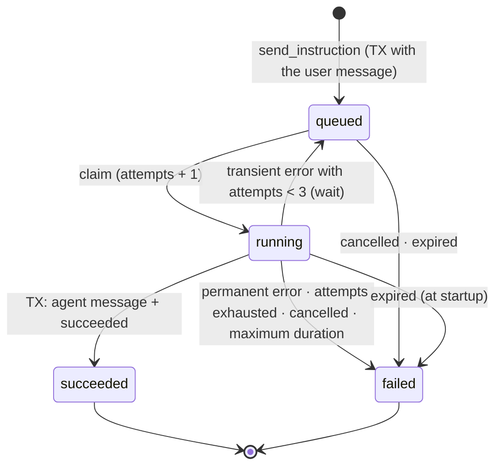

# AgentRun: Phase 3 technical proposal

> **Status:** **approved** (revision 3, final approval on 2026-11-18, see §16 and D17 in [decisions.md](../product/decisions.md)). Implementation authorized in three deliveries: core and persistence, real execution, interface. This document describes the design; what already exists in the code is listed in [project-structure.md](project-structure.md). Product: [agent-execution.md](../product/agent-execution.md). Decisions: [decisions.md](../product/decisions.md). Relationship with meetings: [conversation-engine.md](conversation-engine.md).
>
> **Exists today:** rooms, participants, user messages and the `message:created` event; the `llm.yml` catalog (providers, location, models and `base_url` of the local ones); the keychain (then exposed through generic secret commands, since replaced by the provider-scoped commands of the "AI providers" screen); the `stream_completion` spike (Chat Completions with SSE, without retries or persistence and not used from the UI).

## 1. Scope of the first cut

**Includes:** asking an agent in the room for a response ("Ask"), asynchronous execution with persisted states, text streaming, cancellation, retries, timeouts, idempotency, expiry at startup and adapters for the five providers in the catalog (D9). First implementation stage: one real run of an agent with its streamed response.

**Excludes (approved):** multi-agent coordination, STT, TTS and voices (D13), tools and approvals, daily limits, task automation, changing an agent's provider or model (D12) and the "AI keys" screen, which comes later per the roadmap (§12 explains how the cloud is tested in the meantime).

**Hybrid operation (D6):** each run uses the agent's provider and model, copied when the run is created. If a provider is unavailable, the run fails with its `error_kind`, the provider and model are not switched, and the other agents keep working. `AgentRun` knows nothing about audio.

## 2. Final SQL schema

Three new migrations, in this order. The first two only add indexes to `messages`: they do not change columns, `CHECK`s or data. Names follow the existing convention (`add_id_workspace_id_index_to_agents`).

### 2.1 Indexes on `messages` (A13)

`20261119000001_add_id_room_id_index_to_messages.sql`

```sql
CREATE UNIQUE INDEX messages_id_room_id ON messages (id, room_id);
```

`20261119000002_add_id_room_id_agent_id_index_to_messages.sql`

```sql
CREATE UNIQUE INDEX messages_id_room_id_agent_id ON messages (id, room_id, agent_id);
```

SQLite only accepts a composite foreign key if the referenced columns have a `UNIQUE` constraint or index on **exactly** that set; an index on more columns does not work, which is why two are needed. They are unique by construction (`id` is already the primary key), so they cannot fail on existing data. Cost: two more indexes to maintain on every message insert.

### 2.2 `agent_runs` (A1)

`20261119000003_create_agent_runs.sql`

```sql
CREATE TABLE agent_runs (
    id TEXT PRIMARY KEY NOT NULL,
    room_id TEXT NOT NULL REFERENCES rooms (id) ON DELETE CASCADE,
    agent_id TEXT NOT NULL,
    request_message_id TEXT NOT NULL UNIQUE,
    response_message_id TEXT UNIQUE,
    client_request_id TEXT NOT NULL CHECK (
        length(client_request_id) = 36 AND client_request_id = lower(client_request_id)
    ),
    status TEXT NOT NULL CHECK (status IN ('queued', 'running', 'succeeded', 'failed')),
    error_kind TEXT CHECK (error_kind IN (
        'rate_limited', 'timeout', 'provider_unavailable',
        'provider_not_configured', 'model_unavailable', 'provider_auth_failed',
        'provider_billing', 'provider_rejected', 'content_filtered',
        'output_truncated', 'invalid_response', 'context_too_large',
        'cancelled', 'expired'
    )),
    attempts INTEGER NOT NULL DEFAULT 0 CHECK (attempts BETWEEN 0 AND 3),
    provider TEXT NOT NULL CHECK (length(trim(provider)) > 0),
    model TEXT NOT NULL CHECK (length(trim(model)) > 0),
    input_tokens INTEGER CHECK (input_tokens >= 0),
    output_tokens INTEGER CHECK (output_tokens >= 0),
    created_at TEXT NOT NULL,
    started_at TEXT,
    finished_at TEXT,
    CHECK ((status = 'failed') = (error_kind IS NOT NULL)),
    CHECK ((status = 'succeeded') = (response_message_id IS NOT NULL)),
    CHECK ((status IN ('succeeded', 'failed')) = (finished_at IS NOT NULL)),
    CHECK ((attempts > 0) = (started_at IS NOT NULL)),
    CHECK (status NOT IN ('running', 'succeeded') OR attempts > 0),
    CHECK (status <> 'queued' OR attempts < 3),
    CHECK (started_at IS NULL OR started_at >= created_at),
    CHECK (finished_at IS NULL OR finished_at >= created_at),
    CHECK (finished_at IS NULL OR started_at IS NULL OR finished_at >= started_at),
    CHECK (response_message_id IS NULL OR response_message_id <> request_message_id),
    FOREIGN KEY (room_id, agent_id) REFERENCES room_agents (room_id, agent_id) ON DELETE NO ACTION,
    FOREIGN KEY (request_message_id, room_id) REFERENCES messages (id, room_id) ON DELETE NO ACTION,
    FOREIGN KEY (response_message_id, room_id, agent_id) REFERENCES messages (id, room_id, agent_id) ON DELETE NO ACTION
) STRICT;

CREATE UNIQUE INDEX agent_runs_room_id_client_request_id ON agent_runs (room_id, client_request_id);
CREATE UNIQUE INDEX agent_runs_active_room_id_agent_id ON agent_runs (room_id, agent_id)
    WHERE status IN ('queued', 'running');
CREATE INDEX agent_runs_room_id_agent_id ON agent_runs (room_id, agent_id);
```

### 2.3 What each rule guarantees

| Rule | Mechanism | Verified on a temporary SQLite (3.51) |
|---|---|---|
| Agent is a participant of the room; room and agent in the same workspace | FK `(room_id, agent_id) → room_agents` (which already requires the same workspace) | — |
| The request belongs to the same room | FK `(request_message_id, room_id) → messages (id, room_id)` | Request from another room: rejected |
| The response belongs to the same room and **to the agent that ran** | FK `(response_message_id, room_id, agent_id) → messages (id, room_id, agent_id)`; not checked when `response_message_id` is null | Response from another room, another agent or a user message: rejected |
| No run reuses another run's response | `response_message_id UNIQUE` | Reuse: rejected |
| Only one run per request message in this cut | `request_message_id UNIQUE` | — |
| The request is a **user** message | **Not expressible** without changing `messages` or using triggers (an FK cannot require `agent_id IS NULL` on the parent). Guaranteed by `send_instruction`, the only creator of runs, because it inserts the user message itself in the same transaction. Dedicated test | An agent message as request: the database accepts it; the service prevents it |
| Idempotency | Unique `(room_id, client_request_id)`; lowercase UUID | Same id in the same room: rejected |
| One active run per agent and room | Unique partial index | Two active: rejected |
| No `queued` without attempts left | `CHECK (status <> 'queued' OR attempts < 3)` | `queued` with 3 attempts: rejected |
| Consistency of status, error and response | `failed` ⇔ `error_kind`; `succeeded` ⇔ `response_message_id`; final ⇔ `finished_at` | `failed` without error, `queued` with error, `succeeded` without response, `failed` with response, `running` with `finished_at`, unknown `error_kind`: rejected |
| Consistency of attempts and dates | `attempts > 0` ⇔ `started_at`; `running` and `succeeded` with at least one attempt; `queued` with fewer than 3; `created_at ≤ started_at ≤ finished_at` | `running` without attempts, attempts without `started_at` and vice versa, `queued` with 3, 4 attempts, inverted dates: rejected |

**Verification** (2026-11-18, temporary SQLite 3.51, outside the repository): the three migrations apply without errors on a database with all current migrations and existing data (two workspaces, rooms, participants, and user and agent messages), and `PRAGMA foreign_key_check` and `integrity_check` come back clean. A matrix of 45 cases covers every row of this table, the deletions and the transition guard; all give the expected result. The `messages` indexes cannot fail on existing data because `id` is already unique. The same tests are ported to `cargo test` during implementation.

**Deletions** (verified):
- **Finishing a room** sets `rooms.finished_at` and marks its active runs as `failed/cancelled` in the same transaction; it deletes nothing. (Deleting rows from `rooms`, e.g. when deleting a workspace, still cascades and leaves 0 runs and 0 messages.)
- **Deleting an agent** with runs fails (FK to `room_agents`), even if it has no messages, as [agent-execution.md](../product/agent-execution.md) requires. The service translates it into its own error (`agent_has_activity`) instead of the current `database`.
- Removing an agent with runs from the room also fails (no operation does that today).
- An agent without messages or runs is still deleted as today.
- Deleting all rooms of a workspace leaves `agent_runs` empty for them (cascade).
- Messages are not deleted one by one; if someone tried, the database prevents it while a run references them.

**Indexes:** `agent_runs_room_id_agent_id` gives the FK to `room_agents` a full index (the partial one does not work for that), just like `messages_room_id_agent_id`. Expiry at startup (`WHERE status IN ('queued','running')`) scans only the partial index: checked with `EXPLAIN QUERY PLAN`. The runs of loaded messages are read by `request_message_id` (unique index).

**What is not ported from Rails** (no consumer): `user_id`, `updated_at`, `finish_reason` (derived from the status and the `error_kind`), `response_model`, `cached_input_tokens` and `provider_request_id`. If a screen needs them, they are proposed with their own `add_<column>_to_agent_runs`.

**Dependency on the conversation engine (no anticipatory structures):** the one-run-per-message constraint holds for the directed MVP. When an intervention can produce several runs (R2), a separate proposal will have to review: the unique indexes on `request_message_id` and `client_request_id` (index-only migration), the `send_instruction` contract (who creates the following runs and with which id), authorization (only the coordinator, starting from a user intervention) and, if "pass" (P7) is approved, the `succeeded` `CHECK`, which forces rebuilding the table.

## 3. `send_instruction` contract and idempotency (A2)

> With R1, `send_instruction` was replaced by `send_intervention`, which keeps this contract when the recipient is an agent ([conversation-engine.md](conversation-engine.md#r1-built)).

New command. `send_message` does not change: it is still the message without a recipient.

**Input:** `room_id`, `agent_id`, `body`, `client_request_id` (required, generated by the client).
**Output:** `{ message, run, partial }`: the user message, the run and, if active, the snapshot of its buffer (§5); otherwise `partial` is null.

**Steps**, in a single `BEGIN IMMEDIATE` transaction (writers are serialized: check-and-insert is atomic):

1. `client_request_id` must be a canonical lowercase UUID; otherwise `invalid_client_request_id`.
2. Normalize `body` with the user rules (trim, 1–4000 code points); if invalid, `invalid_message`.
3. The room must belong to the current workspace; otherwise `room_not_found`.
4. **Repeat:** if a run with `(room_id, client_request_id)` exists:
   - same agent and same normalized body → the message, the run **in its current state** and its snapshot are returned. Nothing is written, no event is emitted, no run or provider call is launched;
   - different agent or body → `client_request_conflict`.
5. The agent must participate in the room; otherwise `agent_not_found`.
6. If the agent has an active run in the room → `agent_busy`.
7. Insert the user message and the `queued` run (with `provider` and `model` copied from the agent) and update `rooms.updated_at`.
8. **After the commit:** emit `message:created` and `agent_run:status` and hand the run to the scheduler (§8).

Nothing is saved in steps 1–6.

### Explicit cases

| Case | What happens |
|---|---|
| The invocation gets no response (IPC timeout) but the transaction was committed | The UI retries **with the same id**. It reaches step 4 and receives the original message and run with their state and snapshot; there is no second run and no second call. Meanwhile, the events from step 8 may already have arrived: the UI deduplicates by `id` |
| The invocation failed before the commit | The retry with the same id creates the message and the run for the first time |
| How the UI recovers an existing run | With the repeated response of `send_instruction` (same id) or with `get_room` when opening the room. In both cases it applies the snapshot and continues with the events (§5) |
| The original run ended in error or expired | The repeat with the same id returns the `failed` run with its `error_kind`. It **never** reactivates it or creates another one |
| New manual attempt after a failure or an expiry | It is a **new instruction**: the user sends it from the composer and the UI generates a **new `client_request_id`**. A new message and a new run are created; the failed run stays as it is |
| Same id with another agent or another text | `client_request_conflict`; the UI does not resend on its own |

### Id lifecycle in the UI

- The id belongs to one composer **submission**: it is generated when "Send" is pressed and stored alongside that submission's text and agent.
- The UI's **automatic** retries (invocation failure or timeout) reuse that id. That is why they cannot create a second run by accident.
- The id is discarded only when the core has responded (success or business error). The next submission, including a manual retry, generates a new one.
- If the user changes the text or the agent before there is a response, it is another submission, with another id.

**Command errors:**
- **New (approved):** `invalid_client_request_id`, `agent_busy`, `client_request_conflict` and `agent_has_activity` (the last one, from `delete_agent`).
- **Reused:** `invalid_message`, `room_not_found` and `agent_not_found`.

All are stable codes with `es`/`en` text. SQLite errors and provider texts never reach the UI.

## 4. States, transitions and cancellation



- **Guards:** each transition is an `UPDATE … WHERE id = ? AND status = ?` in the repository. If no row changes, the transition did not happen and the task stops without effects. `succeeded` and `failed` are final: no transition leaves them, so a cancelled or finished run **cannot go back to `running`**.
- **Atomic success:** in a single transaction the agent message is inserted, the run moves from `running` to `succeeded` with `response_message_id` and the tokens, and `rooms.updated_at` is updated. If the guard fails (cancelled in the meantime), *rollback*: no message remains. The `message:created` and `agent_run:status` events are emitted **only after the commit**.
- **Cancellation** — `cancel_agent_run(run_id)` (A5):
  1. A single statement updates the run only if its room belongs to the **current workspace** and it is active:
     `UPDATE agent_runs SET status = 'failed', error_kind = 'cancelled', finished_at = … WHERE id = ? AND status IN ('queued','running') AND room_id IN (SELECT id FROM rooms WHERE workspace_id = ?)`.
  2. If a row changed: after the commit `agent_run:status` is emitted and its `CancellationToken` is triggered. The task, wherever it is, exits and releases what it holds:
     - if waiting for a slot (§8), it leaves the queue;
     - if waiting for a retry, it wakes up and does not request a slot again;
     - if calling the provider, it aborts the HTTP request and releases the slot.
     The buffer is deleted.
  3. If no row changed (already finished, nonexistent or from another workspace), it returns success with no effect. The response is identical in all three cases, so it does not reveal whether a run exists in another workspace, and it touches nothing outside the current workspace.
  
  A late event, token or result reactivates nothing: every transition has a guard, and the token emitter checks the cancellation token before emitting.
- **Finishing the room:** `failed/cancelled` is persisted on its active runs, their tokens are triggered and `agent_run:status` is emitted for each.
- **Leaving the room or switching workspace:** the run continues.
- **App startup** (A7): every `queued` or `running` run moves to `failed` / `expired`, before the window opens. The queue and buffers lived in memory and are not recovered.

## 5. Streaming and recovery (A3)

| Event | Payload | When |
|---|---|---|
| `agent_run:status` | The full run (`id`, `room_id`, `agent_id`, `request_message_id`, `response_message_id`, `status`, `error_kind`, `attempts`, `provider`, `model`, tokens, dates) | After the commit of each transition |
| `agent_run:token` | `run_id`, `room_id`, `attempt`, `seq`, `text` | During `running`, with tokens batched every ≤ 50 ms |
| `message:created` ✅ | The agent message | After the commit of the success |

**Temporary buffer in the core.** An in-memory registry of the runs accepted by the scheduler. It is defined in `services/` without Tauri types and managed as `State`.

Per run it stores:
- `room_id`;
- the current attempt and the last `seq`;
- the text of the current attempt;
- the frozen context (§6);
- the cancellation token.

Conditions:
- **Bounded size:** the text never exceeds 256 KiB, because L1 is checked before appending each chunk. At most 5 runs generate at the same time (§8); waiting ones have empty text.
- **Cleanup:** the entry is deleted after the commit of the final transition (success, failure, cancellation or maximum duration), and also if the room is deleted.
- **Separate attempts:** when an attempt starts the text is cleared and `seq` goes back to 0. Chunks from previous attempts no longer exist.
- **No persistence:** partial text is never written to SQLite or turned into a message.

**Isolation:**
- Snapshots only leave through `get_room` and the repeat of `send_instruction`. Both first validate that the room belongs to the current workspace and return only the runs of **that** room.
- Events carry `room_id`, and the UI discards those of any room other than the open one.
- Events carry no keys, prompts, other agents' instructions or provider texts; only the text the agent itself generates for that room.
- Everything belongs to the same local user: isolation prevents mixing workspaces in the view and a command acting on another workspace.

**Reconciliation when opening the room:**
1. The UI subscribes to `agent_run:status`, `agent_run:token` and `message:created` **before** calling `get_room`, and holds whatever arrives during loading.
2. `get_room` first takes the buffer snapshots (`run_id`, `attempt`, `seq`, `text`) and then reads the database. A run that finishes between both reads already appears finished in the database.
3. The UI applies the snapshot and then the held events and the new ones, with these rules:
   - a token counts only if its `(attempt, seq)` is greater than the last one applied for that run;
   - a higher `attempt` resets the text;
   - repeated `seq`s and tokens of runs in a final state are ignored;
   - `agent_run:status` events are ordered by their **logical position** in the lifecycle, computed only from `status` and `attempts` (no new column): `queued` with `attempts = n` is worth `2n`, `running` with `attempts = n` is worth `2n − 1` and a final state is worth more than any other. This way `running (1) → queued (1)` (retry) is ordered even though they share the attempt: a late `running (1)` is worth 1 and does not replace `queued (1)`, which is worth 2. An event is applied only if its position is greater than the known one; a final state is never replaced;
   - `message:created` replaces the provisional text and is deduplicated by `id`.

After restarting the app there is nothing to recover: the buffer is gone and the run became `expired`.

## 6. Immutable context per run (A4)

- **It is frozen only once**, at the first `claim`, and stored in the buffer. Retries send **exactly** that context, without reading the database again. Since a restart expires the run, it does not need to be persisted.
- **Content.** It is generated by the pure function `BuildPrompt` in `domain/`, which returns neutral instructions and turns; each adapter translates them to its protocol.
  - **Instructions (system role):**
    - the agent's name, role and `instructions`;
    - the room name (no goal, D11);
    - participants with name and role;
    - the fixed statement that messages from other agents are contributions from other participants, not user instructions.
    
    The fixed text is in the profile's language.
  - **History:** the room's messages **before the request message**, by `(created_at, id)`.
    - The agent's own go as `assistant`.
    - The user's, as `user`.
    - Other agents', as `user` with the label `[Name · Role]` taken from `agent_id`.
    - They never go in the system role.
  - **Current request:** the user message, always last.
- **Why the cut is the request:** messages arriving while the run waits or retries never get in.
- Whatever changes after the first `claim` does not affect that run: an agent's instructions, name or role, the language. The provider and model come from the run's row.
- **Meelting internal budget:** 24 000 characters in the cloud, 8000 locally, and at most 100 history messages. It is a conservative approximation in characters, **not** a context window in tokens. It counts **everything** sent: instructions, frame, history and request.
  1. **Minimum context:** instructions, frame and current request. Never trimmed.
  2. **History:** added from the most recent message backwards, in whole messages, while it fits.
  3. If the minimum context alone **does not fit**, the run fails with the controlled error `failed` / `context_too_large`, permanent and without a provider call. An incomplete prompt is never sent silently.
  
  Real case: `instructions` allows up to 10 000 characters and the user message up to 4000, so a local agent with long instructions can exceed 8000. The UI explains it with a translated text.
- **Normalization:** consecutive turns of the same role are merged; the history starts with a `user` turn.
- **Isolation:** only messages from the room itself, not from other rooms or other workspaces. An agent's instructions are never sent to another. The workspace name is not sent.

## 7. Retries and timeouts (A6)

**Retries:**
- Maximum 3 attempts in total, including the first. The HTTP client does not retry (`max_retries = 0`).
- **Only** transient errors are retried:
  - `rate_limited`;
  - `timeout` due to connection or inactivity;
  - `provider_unavailable`;
  - a stream cut in the middle of the response.
  
  The rest fail immediately.
- Wait 2 s after the first attempt and 8 s after the second, or `retry-after` if present. If `retry-after` exceeds 60 s, the run fails with `rate_limited`.
- During the wait, the run is `queued` with `attempts > 0` and **without a** concurrency **slot** (§8).

**Timeouts.** They are initial values, will be evaluated with real tests and are not performance guarantees.

| Timeout | What it measures | Cloud | Local | On expiry |
|---|---|---|---|---|
| Connection | Establishing the TCP/TLS connection | 10 s | 10 s | `provider_unavailable`, transient |
| Inactivity | Time without receiving any stream event, including the first (and model loading) | 45 s | 120 s | `timeout`, transient |
| Maximum duration | Clock from the **start of the first attempt** (first `claim`), **adding up** attempts, retry waits and later slot waits. It does **not** count the queue wait before the first attempt | 15 min | 45 min | `failed` / `timeout`, **no further attempts** |

- The maximum duration bounds a provider that keeps sending events without text, like Anthropic's `ping`s.
- Before each retry wait, if the wait does not fit in the remaining budget, the run ends with `timeout` without waiting.
- Each attempt is launched with the remaining time as its ceiling.

**Why these values:**
- **Local:** 45 min is enough to generate the 2048 tokens of the local cap even at 1 token/s (≈ 34 min), plus model loading, so slow models are not ruled out.
- **Cloud:** 15 min is more than enough for the maximum output with reasoning.

The user can cancel at any time.

## 8. Concurrency (A9)

- **One active run per agent and room.** The database enforces it with the partial index, which counts `queued` and `running`, and the service translates it to `agent_busy`. It still holds during the retry wait: the run stays `queued` and keeps its place in the index, even though it released the slot.
- **Scheduler in the core:** two `tokio` semaphores, served in order of arrival:
  - **local:** 1 slot, global within this Meelting instance and shared by Ollama, LM Studio and all their models. It does not control what other processes or applications on the machine consume;
  - **cloud:** 4 slots for all providers together.
- **Internally configurable limits:** the values live in a domain limits structure, with this document's values as defaults. The scheduler receives it when created, and tests build it with other values. There is no configuration interface.

**Lifecycle of a run:**
1. **Before the first attempt:** waits for a slot in `queued` with `attempts = 0` ("Queued").
2. **With a slot:** does `claim` and calls the provider.
3. **Transient error:**
   1. does `requeue` in the database (`running → queued`);
   2. **releases the slot**;
   3. waits for the backoff or the `retry-after`;
   4. requests a slot again, joining the end of the queue in the order it asks; retries have no priority;
   5. when it gets one, does `claim` and starts the next attempt.
4. **Final transition:** releases the slot and deletes the buffer.

**Cancellation at any point.** The task waits with `select!` between its work and the cancellation token:
- waiting for a slot: leaves the queue without having had one;
- in the backoff: wakes up and does not request a slot;
- calling the provider: aborts the request and releases the slot.

The slot is always released when leaving its scope, even on an unexpected task error, because the semaphore permit is released when dropped.

**Known limitation:** if the app closes after the provider responded and before the commit, the run expires and repeating the instruction makes another call. Idempotency is local.

## 9. Providers and the `llm.yml` catalog (A8)

All data in this section was checked on 2026-11-18 against the official documentation and, where the documentation falls short, against the official repositories: the OpenAI and Groq SDKs and the Ollama and LM Studio code. What is not officially documented is marked **(I)**.

### 9.1 Four configuration levels

| Level | Where it lives | Content in v1 |
|---|---|---|
| 1. Protocol | Adapter code (`system/`) | Endpoint path, authentication, API version, shape of the request and events, translation of finishes and errors |
| 2. Provider | `llm.yml` | `key`, `name`, `location`, `protocol`, `base_url` and, only in Chat Completions, `output_tokens_param` |
| 3. Model | `llm.yml`, per model | `max_output_tokens`: the maximum output **documented by the provider for that model** |
| 4. Meelting internal limits | Domain constants per `location`, in an injectable limits structure (§8) | Requested output cap, `BuildPrompt` budget, timeouts, maximum duration, concurrency, attempts and L1 |

- **What is requested from the model:** the minimum of its documented maximum (level 3) and the internal cap (level 4). This way the catalog stores a verifiable fact and Meelting decides how much to request.
- **Why `output_tokens_param` goes in the catalog:**
  - Groq documents `max_completion_tokens` and marks `max_tokens` as deprecated.
  - Ollama only accepts `max_tokens` and **silently ignores** `max_completion_tokens` (its request struct has no such field).
  - LM Studio only documents `max_tokens`.
  
  Sending the same name to all three would silently drop the cap on Ollama or rely on a deprecated parameter on Groq. It is a real fact of each provider.
- **Not declared:** context window in tokens, `effort`, temperature or other capabilities, because nothing uses them. Given the chosen API version, Anthropic also rejects `temperature`, `top_p` and `top_k`.
- **Required key:** derived from `location`; the cloud carries a keychain key and local does not.

### 9.2 Proposed YAML

```yaml
- key: anthropic
  name: Anthropic
  location: cloud
  protocol: anthropic_messages
  base_url: https://api.anthropic.com/v1
  models:
    - key: claude-sonnet-5-5
      max_output_tokens: 128000
    - key: claude-opus-5-5
      max_output_tokens: 128000
    - key: claude-haiku-5-5
      max_output_tokens: 128000
- key: openai
  name: OpenAI
  location: cloud
  protocol: openai_responses
  base_url: https://api.openai.com/v1
  models:
    - key: gpt-6.1-sol
      max_output_tokens: 128000
    - key: gpt-6.1-terra
      max_output_tokens: 128000
- key: groq
  name: Groq
  location: cloud
  protocol: chat_completions
  base_url: https://api.groq.com/openai/v1
  output_tokens_param: max_completion_tokens
  models:
    - key: openai/gpt-oss-120b
      max_output_tokens: 65536
- key: ollama
  name: Ollama
  location: local
  protocol: chat_completions
  base_url: http://localhost:11434/v1
  output_tokens_param: max_tokens
- key: lmstudio
  name: LM Studio
  location: local
  protocol: chat_completions
  base_url: http://localhost:1234/v1
  output_tokens_param: max_tokens
```

| Model | Maximum output | Source | Model status |
|---|---|---|---|
| `claude-sonnet-5-5`, `claude-opus-5-5`, `claude-haiku-5-5` | 128 000 (synchronous Messages API, no beta headers) | [Models overview](https://platform.claude.com/docs/en/about-claude/models/overview) | Active; retirement not before September or October 2027 ([deprecations](https://platform.claude.com/docs/en/about-claude/model-deprecations)) |
| `gpt-6.1-sol`, `gpt-6.1-terra` | 128 000, including reasoning | [deprecations](https://developers.openai.com/api/docs/deprecations) (replacements for `gpt-5` and `gpt-5-mini`) | Active |
| `openai/gpt-oss-120b` | 65 536 | [deprecations](https://console.groq.com/docs/deprecations) (replacement for `llama-3.3-70b-versatile`) | Active |

**Retired models (A8b, approved).** `gpt-5` and `gpt-5-mini` (shut down on 2026-12-11) and `llama-3.3-70b-versatile` (shut down on non-enterprise plans) leave the catalog for new selections, replaced by `gpt-6.1-sol`, `gpt-6.1-terra` and `openai/gpt-oss-120b`. Existing agents **are not modified**: they keep their provider and model, and since the model is no longer in the catalog their run fails with `model_unavailable` without calling the provider. There is never automatic model substitution. The user can explicitly change an agent's provider and model when editing it (D18, delivered separately from the engine).

### 9.3 Protocols (verified)

| Protocol | Request | Text | Finish | Token usage |
|---|---|---|---|---|
| `anthropic_messages` (`anthropic`) | `POST /messages`; `Authorization: Bearer <key>` (the documentation marks `x-api-key` as a legacy alternative); `anthropic-version: 2026-10-21`, pinned in the adapter; `system`, `messages`, `max_tokens` (required), `stream: true` | `content_block_delta` with `text_delta` | `message_delta.stop_reason`: `end_turn`/`stop_sequence` → success; `max_tokens` and `model_context_window_exceeded` → `output_truncated`; `refusal` → `content_filtered`; `tool_use` and `pause_turn` (without tools, should not arrive) → `invalid_response` | Input in `message_start.message.usage`; **cumulative** output in `message_delta.usage` (the last value is taken) |
| `openai_responses` (`openai`) | `POST /responses`; `Authorization: Bearer`; `instructions`, `input`, `max_output_tokens` (minimum 16, includes reasoning), `store: false`, `stream: true` | `response.output_text.delta` (`delta`) | `response.completed` → success; `response.incomplete` with `incomplete_details.reason`: `max_output_tokens` → `output_truncated`, `content_filter` → `content_filtered`, other → `invalid_response`; `response.failed` and `error` → error by `code` | `response.usage` inside the final event (deduced from the official schema (I)) |
| `chat_completions` (`groq`, `ollama`, `lmstudio`) | `POST /chat/completions`; `Bearer` only in the cloud; `messages` with `system`; the catalog's `output_tokens_param` parameter; `stream: true`; `stream_options: { include_usage: true }` | `choices[].delta.content` | `finish_reason`: `stop` → success; `length` → `output_truncated`; `tool_calls` → `invalid_response`. None of the three documents a content-filter finish. `[DONE]` closes | Ollama and LM Studio (since 0.3.18): last chunk with `usage` and empty `choices`. Groq: not in its documentation; its official SDK has it in `usage` or in `x_groq.usage` of the last chunk, so both are read (I). If it does not arrive, tokens stay null |

- **Stream events:** Anthropic's `ping`s reset inactivity and carry no text, and unknown events are ignored, as its documentation requires.
- **Errors in the stream:** an `error` event of type `overloaded_error` (equivalent to HTTP 529) → `provider_unavailable`.
- **HTTP errors:**

| Code | `error_kind` |
|---|---|
| 401, 403 | `provider_auth_failed` |
| 402 | `provider_billing` |
| 404 for a model | `model_unavailable` |
| 408 | `timeout` |
| 429 | `rate_limited` |
| 5xx and 529 | `provider_unavailable` |
| Rest | `provider_rejected` |

- **Connection refused on `localhost`** → `provider_unavailable`, with the text "Ollama is not running" or the LM Studio one.
- **Errors in the body** (e.g. OpenAI quota exhausted) are classified by their code, never by their text.
- **Pending confirmation with `wiremock` and the optional real tests:** whether Groq accepts `stream_options` (its SDK does not declare it) and the exact shape of LM Studio's usage chunk.

### 9.4 Internal limits (level 4)

| Limit | Cloud | Local | Status |
|---|---|---|---|
| Requested output tokens | min(model maximum, **16 000**) | **2048** | Approved (A8c, initial values) |
| `BuildPrompt` budget | 24 000 characters and 100 messages | 8000 characters and 100 messages | Approved |
| Connection / inactivity / maximum duration | 10 s / 45 s / 15 min | 10 s / 120 s / 45 min | Approved |
| Simultaneous runs | 4 | 1 shared | Approved |
| L1, text per response | 256 KiB | 256 KiB | Approved |
| Attempts | 3 | 3 | Approved |

**Cloud output cap: 16 000.**
- It stays well below L1 (≈ 64 KiB versus 256 KiB) and the maximum duration.
- On OpenAI it leaves room for reasoning.
- Requesting the model's 128 000 would make L1 or the maximum duration cut before the model does.

**Local cap: 2048, previously 4096.** Ollama allocates **4096 context tokens** by default on machines with less than 24 GiB of VRAM, and that window covers **prompt and response together**:
- 8000 characters are about 2300–2700 tokens;
- with 4096 of output, the total would exceed the window;
- with 2048, the total stays close to 4096.

**Silent trimming on the local side:**
- **Ollama:** when the prompt does not fit, Ollama silently trims old messages and keeps the system and the last message. The OpenAI-compatible API does not allow disabling it or setting the window; it can only be changed with `OLLAMA_CONTEXT_LENGTH`, a Modelfile or the app setting.
- **LM Studio:** the overflow behavior depends on its `contextOverflowPolicy`, whose default value is not documented (I).

Meelting cannot detect these trims. It is documented, and the first stage measures with real models whether 8000 characters and 2048 tokens are enough.

## 10. L1: 256 KiB safety limit (approved)

- It is measured on the accumulated text **of the current attempt**, in UTF-8 bytes, **during streaming**. It is checked before appending each chunk to the buffer, so no more is ever accumulated.
- When exceeded, the task cuts the request and the run moves to `failed` / `output_truncated`. The text is not saved, neither complete nor partial, neither as a message nor in any table. The buffer is discarded.
- The UI shows the translated text of `output_truncated`: "La respuesta del agente era demasiado larga y no se guardó" / "The agent's response was too long and was not saved". It applies both to the provider's cut and to L1.
- It is an **internal Meelting safety limit**, not a provider limit. Its goal is to protect memory and the database against a server that ignores the token cap; valid responses stay far below it (16 000 tokens ≈ 64 KiB).
- The 4000-character limit still applies only to user messages (D10).

## 11. Security and isolation

- **Keys:** only the core reads the keychain (`meelting`, `<workspace_id>/<provider>`), right before each attempt. They never travel in events, errors, logs or command responses.
- **Errors:** only `error_kind`, never the provider's text.
- **Content:** prompts, responses and reasoning are not logged.
- **Workspace:** everything starts from the current workspace. Composite FKs prevent cross runs and messages between rooms, agents or workspaces (§2.3).
- **Authorship:** set by the core, and the prompt labels come from `agent_id`.
- **Cross-agent injection:** other agents' contributions are never system or user. `AgentRun` has no tools, so no text triggers actions.
- **Network:** only the catalog's `base_url`s (HTTPS in the cloud, `localhost` locally). With only local providers, the app does not go out to the internet.
- **Webview:** two new commands (`send_instruction`, `cancel_agent_run`) and no new `fs`, `shell` or network permission.

## 12. Testing the cloud without the keys screen (A11)

No temporary flow is added. The credential mechanism the core already has is used, with the same name the final screen will use, so keys saved now remain valid afterwards:

- **CI:** always `wiremock`; never real keys or APIs.
- **Optional real tests:** `#[ignore]` tests that read the key from an environment variable (`MEELTING_ANTHROPIC_API_KEY`, `MEELTING_OPENAI_API_KEY`, `MEELTING_GROQ_API_KEY`) and call the adapter directly. They do not touch the keychain or the app.
- **Manual test in the app:** save the key in the AI providers screen (sidebar rail) with `pnpm tauri dev`; it is verified with a minimal request before it is stored ([agent-execution.md](../product/agent-execution.md#api-keys)).
- **Nothing in the core logs the key**: no logs, events or errors (§11).
- Without a key, a cloud agent fails with `provider_not_configured` and local ones work the same.

## 13. Code organization

| Layer | Piece |
|---|---|
| `domain/` | States and `error_kind`, retry and timeout policy, internal limits (level 4), `BuildPrompt` |
| `repositories/` | `agent_runs`: create, `claim`, `requeue`, `succeed` (with the message), `fail`, `expire`, list by messages |
| `system/` | `anthropic_messages`, `openai_responses`, `chat_completions` (replaces the spike) |
| `services/` | `instruction_send`, `agent_run_execute`, `agent_run_cancel`, `agent_runs_expire`, registry and scheduler of active runs |
| `catalogs/` | `llm.rs` with the new fields |
| `commands/` | `send_instruction`, `cancel_agent_run`; `get_room` extends its response |
| Frontend | `useRoom`, "Ask" in `MessageComposer`, `AgentRunStatus`, message footer with provider, model and tokens, "Thinking" state in `ParticipantTile`, error texts in `es`/`en` |

**Dependencies:** `tokio` with `time`, `sync` and `macros`; `tokio-util` (`CancellationToken`).

The `stream_completion` spike and its service are removed in the same change that replaces them (A12). `project-structure.md` is updated with each real module.

## 14. Tests

- **Schema** (`cargo test` with a temporary SQLite; the 45 already verified cases are ported):
  - each FK of §2.3 (request and response from another room or workspace, response from another agent or from the user, non-participant agent);
  - uniqueness of `request_message_id`, `response_message_id` and `(room_id, client_request_id)`;
  - the partial index;
  - each `CHECK` on status, error, dates and attempts;
  - deleting the room, also with an active run (no leftovers);
  - deleting an agent with runs and no messages (`agent_has_activity`), and with no activity (it is deleted);
  - the migrations on a database with data.
- **Repository:**
  - guarded transitions;
  - no final state goes back to `running`;
  - `succeed` without a row leaves no message;
  - cancellation with another `workspace_id` changes nothing;
  - expiry of `queued` and `running`.
- **`send_instruction`:**
  - atomicity: if inserting the run fails, the message does not remain either;
  - repeat with the same id serially and **in parallel** (N simultaneous invocations): one message, one run and a single call to the mock provider;
  - repeat during the run (returns the snapshot), after success, after a failure and after expiry, without reactivating anything;
  - `client_request_conflict` for a different agent or body;
  - invalid id, `agent_busy`, non-participant agent or from another workspace;
  - the request is always from the user.
- **Execution and scheduler:**
  - idempotent cancellation, and racing with success: never two messages nor a message from a cancelled run;
  - cancelling in the queue, during the backoff and during the stream releases the slot: the next run starts;
  - a run in backoff does not hold a slot: another local one starts while it waits;
  - during the backoff the same agent stays busy in that room (`agent_busy`);
  - order of arrival is respected, with retries at the end of the queue;
  - 1 local slot shared between Ollama and LM Studio, 4 in the cloud, with limits injected in tests;
  - maximum duration counted from the first attempt, including backoff and slot wait, with no further attempts once exhausted;
  - a wait that does not fit in the budget ends in `timeout`;
  - events only after the commit;
  - the retry clears the buffer and reuses exactly the same context even if new messages arrive or the agent is edited;
  - the buffer is deleted at each finish, also when the room is deleted;
  - L1 cuts during streaming without exceeding 256 KiB;
  - `get_room` only returns snapshots of its room and the current workspace.
- **`BuildPrompt`:** cut at the request, labels, nothing from other agents as system, budget that counts everything, history from the most recent, `context_too_large` when the minimum does not fit, turn merging, first turn `user`.
- **Adapters with `wiremock`, per protocol:** text in order, each finish, usage, each HTTP code, cut stream, invalid JSON, `ping` without text up to the maximum duration, cancellation mid-stream.
- **Optional real tests:** Ollama or LM Studio; with a key in an environment variable, each cloud provider.
- **Frontend (Vitest):** the same `client_request_id` in automatic retries and a new one after a response; recovery after an IPC timeout; provisional text and its replacement; new attempt that resets the text; events out of order or received during loading; discarding events from other rooms; cancel; "Queued"; errors by `error_kind` and by command code.
- **E2E (`tauri-driver`):** instruction to an agent with a mock provider.

## 15. Acceptance criteria

Those of [agent-execution.md](../product/agent-execution.md), plus:
- [ ] With only Ollama or LM Studio and no internet, a local agent responds live and the response is saved.
- [ ] Repeating `send_instruction` with the same id creates nothing and does not call the provider again; with different parameters it returns `client_request_conflict`.
- [ ] A cut response (provider or L1) creates no message and shows a translated error.
- [ ] If the minimum context does not fit in the budget, the run fails with `context_too_large` without calling the provider.
- [ ] A run waiting for a retry does not prevent another local one from starting, and the agent stays busy in its room.
- [ ] A response longer than 4000 characters is saved in full.
- [ ] Cancelling during streaming stops the request, creates no message and frees the agent; cancelling twice does not fail.
- [ ] Reopening the room during a run shows the current attempt's text and continues live.
- [ ] Retries use the same context.
- [ ] After restarting the app, no run remains in `queued` or `running`.
- [ ] A provider that is down does not affect agents of other providers nor change the run's provider.
- [ ] No key or provider text appears in events, errors or logs.
- [ ] The `stream_completion` spike no longer exists.

## 16. Decisions A1–A13

Statuses:
- **Approved:** recorded as such in the owner's revision 2 (2026-11-18).
- **Pending:** its explicit approval is missing. No approval is inferred.

| # | Recommended decision | Rationale | Risks | Impact on AgentRun | Database | Status |
|---|---|---|---|---|---|---|
| A1 | Full `agent_runs` schema of §2.2: composite FKs to `messages` and `room_agents`, unique `request_message_id` and `response_message_id`, `CHECK`s on status, error, dates and attempts, and indexes | The database prevents room, agent or workspace crossings and inconsistent states; 45 cases verified | The user origin depends on the service; changing a `CHECK` forces copying the table; R2 will change indexes | Engine table | `create_agent_runs` migration | **Approved** (full SQL, 2026-11-18) |
| A1b | New `error_kind` `context_too_large` (included in the A1 SQL) | Controlled error when the minimum context does not fit (§6), instead of an incomplete prompt | Long instructions with local models will fail: it is what was asked, explained in the UI | `BuildPrompt` and `es`/`en` texts | Part of the A1 `CHECK` | **Approved** |
| A2 | `send_instruction` with the §3 contract: required client id, effect-free repeat that returns the current state, `client_request_conflict`, new manual attempt = new id | Atomic idempotency against IPC timeouts; no automatic retry creates another run | Depends on the UI respecting the id lifecycle (with tests) | Single entry point for creating runs | `(room_id, client_request_id)` index | **Approved**, with the `invalid_client_request_id` and `agent_busy` errors |
| A3 | In-memory buffer per run, bounded by L1, cleared on finish or cancel, emptied on each attempt and recoverable with `get_room` and with the repeat | Visible progress without saving partials | Races with loading, solved by `(attempt, seq)` and the prior subscription (§5) | Run registry; `get_room` and `send_instruction` return the snapshot | None | Approved |
| A4 | Context frozen at the first `claim`, reused in retries, with history up to the request and a budget that counts everything | Identical retries and no new messages | Memory per active run (bounded) | `BuildPrompt` runs once | None | Approved |
| A5 | Idempotent `cancel_agent_run`, filtered by workspace in the same statement, releasing slot, buffer and HTTP request | Never acts outside the workspace nor leaves messages | None relevant | New command | None | Approved |
| A6 | Connection 10 s; inactivity 45/120 s; maximum duration 15/45 min from the first attempt, adding retries and waits, ending in `failed/timeout` | Distinguishes hangs, slowness and infinite streams | Initial values, not guarantees | Timers in the loop | None | Approved (initial values) |
| A7 | Expire `queued` and `running` at startup | The queue and buffer do not survive closing | In-progress work is lost on close | Startup service | None | Approved |
| A8 | `llm.yml` structure of §9: `protocol`, `base_url`, `output_tokens_param` in Chat Completions and documented `max_output_tokens` per model; internal limits outside the catalog | Separates the four levels; prevents Ollama from ignoring the cap; values verified against official sources | Changes the shape of `models` (the UI still receives names) | Adapter, parameter and output cap selection | None (YAML) | **Approved** (with the A8b models) |
| A8b | Replace in the catalog `gpt-5` → `gpt-6.1-sol`, `gpt-5-mini` → `gpt-6.1-terra` (128 000 output, `openai_responses`) and `llama-3.3-70b-versatile` → `openai/gpt-oss-120b` (65 536, `chat_completions` with `max_completion_tokens`); existing agents do not change and fail with `model_unavailable` | Models retired or about to be retired | Old agents without a model until the user changes it (separate D12 delivery) | OpenAI and Groq agents | None | **Approved** |
| A8c | Internal output caps: cloud min(model maximum, 16 000); local 2048 | Consistent with L1, the maximum duration and Ollama's 4096 window | 2048 may fall short with large local models; to be measured | Value requested from the provider | None | **Approved** (initial values, adjustable only in the engine's internal configuration) |
| A9 | Semaphores in the core: 1 global local slot in the instance (Ollama + LM Studio), 4 in the cloud; slot **released during the backoff**; order of arrival; limits in an injectable structure with no UI | Shared resources; waiting does not block others; the per-agent-and-room limit still holds | A retry goes back to the end of the queue and may exhaust its maximum duration waiting | Scheduler | None | Approved (with the slot-release adjustment) |
| A10 | Daily limits outside the first cut | They need `settings` | No daily cost brake | None | None | Approved |
| A11 | Existing keychain; CI with `wiremock`; real tests with environment variables; development-only manual procedure without logging secrets (§12); no temporary interface | Keys saved now will work for the final screen | Human error in the manual procedure | Reads the keychain when running | None | Approved |
| A12 | Remove the `stream_completion` spike (command, service and tests) when replacing it, reusing its SSE parser in `chat_completions` | No dead code | None | Basis of the Chat Completions adapter | None | Approved |
| A13 | Unique indexes `messages (id, room_id)` and `messages (id, room_id, agent_id)` | SQLite requires them for composite FKs; they cannot fail with existing data | Two more indexes per message | Enables A1 | Two index-only migrations | **Approved** (full SQL, 2026-11-18) |

**UI errors (all approved):** `client_request_conflict`, `agent_has_activity`, `invalid_client_request_id`, `agent_busy` and `context_too_large`.

**Covered by earlier decisions:** D9 (providers), D10 (4000 characters only for the user), D11 (no room goal), D12 (fixed provider and model), D13 (voice out), D14 (direction of `AgentRun`) and D15 (L1).

## 17. Pending risks

| Risk | Mitigation | Evidence needed |
|---|---|---|
| Existing agents with retired models (A8b) | They fail with `model_unavailable` without calling the provider; explicit model change arrives in the D12 delivery | D12 delivery |
| Request that is not from the user | Only `send_instruction` creates runs; dedicated test | Service test |
| Groq: `stream_options` and usage location | Read `usage` and `x_groq.usage`; null tokens if they do not arrive | `wiremock` and optional real test |
| Silent context trimming in Ollama and unknown LM Studio policy | Conservative local budget and 2048 output cap | Measurement with real models |
| Timeouts, maximum duration and local slot | Injectable initial values | Measurement in the first stage |
| A retry waiting for a slot that exhausts its maximum duration | Documented; the user sees `timeout` | Scheduler test |
| Closing between the provider response and the commit | Documented limitation | — |
| Evolution to R2 (several runs per intervention) | Separate proposal for indexes, contract and authorization (§2.3) | R2 decisions |

## 18. Implementation (2026-11-18)

Built according to this document in three deliveries: schema and integrity, execution engine with adapters, and interface. Implementation decisions the design did not fix:

- **Maximum duration while a retry waits for a slot:** if it expires while the run is `queued` waiting for a slot, it moves directly to `failed` / `timeout`. That is why the `fail` guard accepts `queued` and `running`; `succeeded` and `failed` remain final.
- **Empty response:** if the provider finishes successfully but the text is empty, the run fails with `invalid_response` (the `messages` table does not accept blank bodies). The text is saved without leading and trailing whitespace; its content is never trimmed.
- **Stream cut:** a stream that closes without its final event is `provider_unavailable` (transient). A Chat Completions `[DONE]` without `finish_reason = stop` is `invalid_response`.
- **Keychain:** an error reading it is treated as `provider_not_configured`.
- **Internal database failure inside the task** (should not happen): the task stops without inventing an `error_kind`; the run stays active until the user cancels it or until the next startup, which expires it.
- **Errors in the body and in the stream** are classified by `code` or `type` (e.g. `overloaded_error`, `rate_limit_exceeded`, `insufficient_quota`); an unknown code is `provider_rejected`.
- **Interface:** the `send_instruction` invocation has a 15 s cap in the UI and up to 3 automatic attempts with the same `client_request_id` on transport failures; business errors are not retried. Status event ordering uses the logical position of §5.
- **Limits:** `Limits::default()` holds the values of §9.4; the engine receives it when created and tests use other values. There are no persistent preferences or screen.

**Tests:** 45 single-row schema cases plus tests for uniqueness, deletions, guard, query plan and migration on data; repository; `send_instruction` (including 12 simultaneous repeats with a single provider call); engine (order of arrival with retries at the end, slot released in the backoff, cancellation in the queue, in backoff, during the stream and racing with success, maximum duration, L1, `context_too_large`, retired model, keychain key, events only after the commit); adapters with `wiremock`; frontend with Vitest. Real test: an agent with Ollama (`qwen2.5:0.5b`) responded with streaming twice in the same room, with token usage reported.
