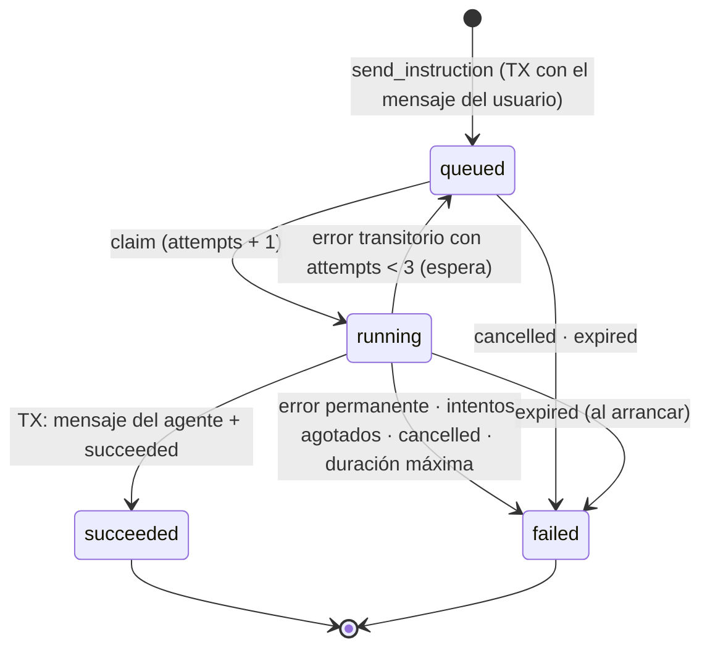

# AgentRun: propuesta técnica de la Fase 3

> **Estado:** **aprobada** (revisión 3, aprobación final del 2026-11-18, ver §16 y D17 en [decisions.md](../product/decisions.md)). Implementación autorizada en tres entregas: núcleo y persistencia, ejecución real, interfaz. Este documento describe el diseño; lo que ya existe en el código se indica en [project-structure.md](project-structure.md). Producto: [agent-execution.md](../product/agent-execution.md). Decisiones: [decisions.md](../product/decisions.md). Relación con las reuniones: [conversation-engine.md](conversation-engine.md).
>
> **Existe hoy:** salas, participantes, mensajes del usuario y el evento `message:created`; el catálogo `llm.yml` (proveedores, ubicación, modelos y `base_url` de los locales); el keychain con `save_secret`, `secret_last_four` y `delete_secret`; el spike `stream_completion` (Chat Completions con SSE, sin reintentos ni persistencia y sin uso desde la UI).

## 1. Alcance del primer corte

**Incluye:** pedirle una respuesta a un agente de la sala («Pedir a»), ejecución asíncrona con estados persistidos, streaming de texto, cancelación, reintentos, timeouts, idempotencia, expiración al arrancar y adaptadores para los cinco proveedores del catálogo (D9). Primera etapa de implementación: una ejecución real de un agente con su respuesta en streaming.

**Excluye (aprobado):** coordinación multiagente, STT, TTS y voces (D13), herramientas y aprobaciones, límites diarios, automatización de tareas, cambio de proveedor o modelo de un agente (D12) y la pantalla «Claves de IA», que llega después según el roadmap (§12 explica cómo se prueba la nube mientras tanto).

**Operación híbrida (D6):** cada ejecución usa el proveedor y el modelo del agente, copiados al crearla. Si un proveedor no está disponible, la ejecución falla con su `error_kind`, no se cambia de proveedor ni de modelo y los demás agentes siguen funcionando. `AgentRun` no conoce el audio.

## 2. Esquema SQL final

Tres migraciones nuevas, en este orden. Las dos primeras solo añaden índices a `messages`: no cambian columnas, `CHECK` ni datos. Nombres según la convención existente (`add_id_workspace_id_index_to_agents`).

### 2.1 Índices en `messages` (A13)

`20261119000001_add_id_room_id_index_to_messages.sql`

```sql
CREATE UNIQUE INDEX messages_id_room_id ON messages (id, room_id);
```

`20261119000002_add_id_room_id_agent_id_index_to_messages.sql`

```sql
CREATE UNIQUE INDEX messages_id_room_id_agent_id ON messages (id, room_id, agent_id);
```

SQLite solo acepta una clave foránea compuesta si las columnas referenciadas tienen una restricción o un índice `UNIQUE` sobre **exactamente** ese conjunto; un índice sobre más columnas no sirve, y por eso hacen falta dos. Son únicos por construcción (`id` ya es la clave primaria), así que no pueden fallar sobre los datos existentes. Coste: dos índices más que mantener en cada inserción de mensaje.

### 2.2 `agent_runs` (A1)

`20261119000003_create_agent_runs.sql`

```sql
CREATE TABLE agent_runs (
    id TEXT PRIMARY KEY NOT NULL,
    room_id TEXT NOT NULL REFERENCES rooms (id) ON DELETE CASCADE,
    agent_id TEXT NOT NULL,
    request_message_id TEXT NOT NULL UNIQUE,
    response_message_id TEXT UNIQUE,
    client_request_id TEXT NOT NULL CHECK (
        length(client_request_id) = 36 AND client_request_id = lower(client_request_id)
    ),
    status TEXT NOT NULL CHECK (status IN ('queued', 'running', 'succeeded', 'failed')),
    error_kind TEXT CHECK (error_kind IN (
        'rate_limited', 'timeout', 'provider_unavailable',
        'provider_not_configured', 'model_unavailable', 'provider_auth_failed',
        'provider_billing', 'provider_rejected', 'content_filtered',
        'output_truncated', 'invalid_response', 'context_too_large',
        'cancelled', 'expired'
    )),
    attempts INTEGER NOT NULL DEFAULT 0 CHECK (attempts BETWEEN 0 AND 3),
    provider TEXT NOT NULL CHECK (length(trim(provider)) > 0),
    model TEXT NOT NULL CHECK (length(trim(model)) > 0),
    input_tokens INTEGER CHECK (input_tokens >= 0),
    output_tokens INTEGER CHECK (output_tokens >= 0),
    created_at TEXT NOT NULL,
    started_at TEXT,
    finished_at TEXT,
    CHECK ((status = 'failed') = (error_kind IS NOT NULL)),
    CHECK ((status = 'succeeded') = (response_message_id IS NOT NULL)),
    CHECK ((status IN ('succeeded', 'failed')) = (finished_at IS NOT NULL)),
    CHECK ((attempts > 0) = (started_at IS NOT NULL)),
    CHECK (status NOT IN ('running', 'succeeded') OR attempts > 0),
    CHECK (status <> 'queued' OR attempts < 3),
    CHECK (started_at IS NULL OR started_at >= created_at),
    CHECK (finished_at IS NULL OR finished_at >= created_at),
    CHECK (finished_at IS NULL OR started_at IS NULL OR finished_at >= started_at),
    CHECK (response_message_id IS NULL OR response_message_id <> request_message_id),
    FOREIGN KEY (room_id, agent_id) REFERENCES room_agents (room_id, agent_id) ON DELETE NO ACTION,
    FOREIGN KEY (request_message_id, room_id) REFERENCES messages (id, room_id) ON DELETE NO ACTION,
    FOREIGN KEY (response_message_id, room_id, agent_id) REFERENCES messages (id, room_id, agent_id) ON DELETE NO ACTION
) STRICT;

CREATE UNIQUE INDEX agent_runs_room_id_client_request_id ON agent_runs (room_id, client_request_id);
CREATE UNIQUE INDEX agent_runs_active_room_id_agent_id ON agent_runs (room_id, agent_id)
    WHERE status IN ('queued', 'running');
CREATE INDEX agent_runs_room_id_agent_id ON agent_runs (room_id, agent_id);
```

### 2.3 Qué garantiza cada regla

| Regla | Mecanismo | Verificado en un SQLite temporal (3.51) |
|---|---|---|
| Agente participante de la sala, sala y agente del mismo workspace | FK `(room_id, agent_id) → room_agents` (que ya exige el mismo workspace) | — |
| La solicitud es de la misma sala | FK `(request_message_id, room_id) → messages (id, room_id)` | Solicitud de otra sala: rechazada |
| La respuesta es de la misma sala y **del agente que ejecutó** | FK `(response_message_id, room_id, agent_id) → messages (id, room_id, agent_id)`; con `response_message_id` nulo no se comprueba | Respuesta de otra sala, de otro agente o de un mensaje del usuario: rechazadas |
| Ninguna ejecución reutiliza la respuesta de otra | `response_message_id UNIQUE` | Reutilizar: rechazado |
| Una sola ejecución por mensaje de solicitud en este corte | `request_message_id UNIQUE` | — |
| La solicitud es un mensaje **del usuario** | **No expresable** sin cambiar `messages` ni usar triggers (una FK no puede exigir `agent_id IS NULL` en el padre). Lo garantiza `send_instruction`, el único que crea ejecuciones, porque inserta él mismo el mensaje del usuario en la misma transacción. Prueba dedicada | Un mensaje de agente como solicitud: la base lo acepta; lo impide el servicio |
| Idempotencia | Única `(room_id, client_request_id)`; UUID en minúsculas | Mismo id en la misma sala: rechazado |
| Una ejecución activa por agente y sala | Índice parcial único | Dos activas: rechazado |
| No hay `queued` sin intentos disponibles | `CHECK (status <> 'queued' OR attempts < 3)` | `queued` con 3 intentos: rechazado |
| Coherencia de estado, error y respuesta | `failed` ⇔ `error_kind`; `succeeded` ⇔ `response_message_id`; final ⇔ `finished_at` | `failed` sin error, `queued` con error, `succeeded` sin respuesta, `failed` con respuesta, `running` con `finished_at`, `error_kind` desconocido: rechazados |
| Coherencia de intentos y fechas | `attempts > 0` ⇔ `started_at`; `running` y `succeeded` con al menos un intento; `queued` con menos de 3; `created_at ≤ started_at ≤ finished_at` | `running` sin intentos, intentos sin `started_at` y viceversa, `queued` con 3, 4 intentos, fechas invertidas: rechazados |

**Verificación** (2026-11-18, SQLite 3.51 temporal, fuera del repositorio): las tres migraciones se aplican sobre una base con todas las migraciones actuales y datos existentes (dos workspaces, salas, participantes y mensajes de usuario y de agentes) sin errores, y `PRAGMA foreign_key_check` e `integrity_check` quedan limpios. Una matriz de 45 casos cubre todas las filas de esta tabla, los borrados y la guarda de transición; todos dan el resultado esperado. Los índices de `messages` no pueden fallar sobre datos existentes porque `id` ya es único. Las mismas pruebas se portan a `cargo test` al implementar.

**Borrados** (verificados):
- **Finalizar una sala** marca `rooms.finished_at` y marca como `failed/cancelled` sus ejecuciones activas en la misma transacción; no borra nada. (Borrar filas de `rooms`, p. ej. al eliminar un workspace, sigue en cascada y deja 0 ejecuciones y 0 mensajes.)
- **Eliminar un agente** con ejecuciones falla (FK hacia `room_agents`), aunque no tenga mensajes, como pide [agent-execution.md](../product/agent-execution.md). El servicio lo traduce a un error propio (`agent_has_activity`) en lugar del `database` actual.
- Quitar de la sala a un agente con ejecuciones también falla (hoy no hay operación que lo haga).
- Un agente sin mensajes ni ejecuciones se sigue eliminando como hoy.
- Borrar todas las salas de un workspace deja `agent_runs` vacía para ellas (cascada).
- Los mensajes no se borran uno a uno; si alguien lo intentara, la base lo impide mientras una ejecución los referencie.

**Índices:** `agent_runs_room_id_agent_id` da a la FK hacia `room_agents` un índice completo (el parcial no sirve para eso), igual que `messages_room_id_agent_id`. La expiración al arrancar (`WHERE status IN ('queued','running')`) recorre solo el índice parcial: comprobado con `EXPLAIN QUERY PLAN`. Las ejecuciones de los mensajes cargados se leen por `request_message_id` (índice único).

**Lo que no se porta de Rails** (sin consumidor): `user_id`, `updated_at`, `finish_reason` (se deriva del estado y del `error_kind`), `response_model`, `cached_input_tokens` y `provider_request_id`. Si una pantalla los necesita, se proponen con su `add_<columna>_to_agent_runs`.

**Dependencia con el motor conversacional (sin estructuras anticipadas):** la restricción de una ejecución por mensaje vale para el MVP dirigido. Cuando una intervención pueda originar varias ejecuciones (R2), habrá que revisar en una propuesta propia: los índices únicos de `request_message_id` y `client_request_id` (migración solo de índices), el contrato de `send_instruction` (quién crea las ejecuciones siguientes y con qué id), la autorización (solo el coordinador, a partir de una intervención del usuario) y, si se aprueba «pasar» (P7), el `CHECK` de `succeeded`, que obliga a reconstruir la tabla.

## 3. Contrato de `send_instruction` e idempotencia (A2)

> Con R1, `send_instruction` se sustituyó por `send_intervention`, que mantiene este contrato cuando el destinatario es un agente ([conversation-engine.md](conversation-engine.md#r1-implementado)).

Comando nuevo. `send_message` no cambia: sigue siendo el mensaje sin destinatario.

**Entrada:** `room_id`, `agent_id`, `body`, `client_request_id` (obligatorio, generado por el cliente).
**Salida:** `{ message, run, partial }`: el mensaje del usuario, la ejecución y, si está activa, la instantánea de su buffer (§5); si no, `partial` es nulo.

**Pasos**, en una sola transacción `BEGIN IMMEDIATE` (los escritores se serializan: comprobar e insertar es atómico):

1. `client_request_id` debe ser un UUID canónico en minúsculas; si no, `invalid_client_request_id`.
2. Normalizar `body` con las reglas del usuario (recorte, 1–4000 puntos de código); si no es válido, `invalid_message`.
3. La sala debe ser del workspace actual; si no, `room_not_found`.
4. **Repetición:** si existe una ejecución con `(room_id, client_request_id)`:
   - mismo agente y mismo cuerpo normalizado → se devuelven el mensaje, la ejecución **en su estado actual** y su instantánea. No se escribe nada, no se emite ningún evento, no se lanza ninguna ejecución ni llamada al proveedor;
   - agente o cuerpo distintos → `client_request_conflict`.
5. El agente debe participar en la sala; si no, `agent_not_found`.
6. Si el agente tiene una ejecución activa en la sala → `agent_busy`.
7. Insertar el mensaje del usuario y la ejecución `queued` (con `provider` y `model` copiados del agente) y actualizar `rooms.updated_at`.
8. **Después del commit:** emitir `message:created` y `agent_run:status` y entregar la ejecución al planificador (§8).

En los pasos 1–6 no se guarda nada.

### Casos explícitos

| Caso | Qué pasa |
|---|---|
| La invocación se queda sin respuesta (timeout del IPC) pero la transacción se confirmó | La UI reintenta **con el mismo id**. Llega al paso 4 y recibe el mensaje y la ejecución originales con su estado y su instantánea; no hay segunda ejecución ni segunda llamada. Mientras tanto, los eventos del paso 8 ya pudieron llegar: la UI deduplica por `id` |
| La invocación falló antes del commit | El reintento con el mismo id crea el mensaje y la ejecución por primera vez |
| Cómo recupera la UI una ejecución existente | Con la respuesta repetida de `send_instruction` (mismo id) o con `get_room` al abrir la sala. En ambos casos aplica la instantánea y sigue con los eventos (§5) |
| La ejecución original terminó en error o expiró | La repetición con el mismo id devuelve la ejecución `failed` con su `error_kind`. **Nunca** la reactiva ni crea otra |
| Nuevo intento manual tras un fallo o una expiración | Es una **instrucción nueva**: el usuario la envía desde el compositor y la UI genera un **`client_request_id` nuevo**. Se crean un mensaje y una ejecución nuevos; la ejecución fallida queda como está |
| Mismo id con otro agente u otro texto | `client_request_conflict`; la UI no reenvía sola |

### Ciclo de vida del id en la UI

- El id pertenece a un **envío** del compositor: se genera al pulsar «Enviar» y se guarda junto al texto y el agente de ese envío.
- Los reintentos **automáticos** de la UI (fallo o timeout de la invocación) reutilizan ese id. Por eso no pueden crear una segunda ejecución por accidente.
- El id se descarta solo cuando el núcleo respondió (éxito o error de negocio). El siguiente envío, también el de un reintento manual, genera uno nuevo.
- Si el usuario cambia el texto o el agente antes de que haya respuesta, es otro envío, con otro id.

**Errores del comando:**
- **Nuevos (aprobados):** `invalid_client_request_id`, `agent_busy`, `client_request_conflict` y `agent_has_activity` (este último, de `delete_agent`).
- **Reutilizados:** `invalid_message`, `room_not_found` y `agent_not_found`.

Todos son códigos estables con texto en `es`/`en`. Los errores de SQLite y los textos de los proveedores nunca llegan a la UI.

## 4. Estados, transiciones y cancelación



- **Guardas:** cada transición es un `UPDATE … WHERE id = ? AND status = ?` en el repositorio. Si no cambia ninguna fila, la transición no ocurrió y la tarea se detiene sin efectos. `succeeded` y `failed` son finales: ninguna transición sale de ellos, así que una ejecución cancelada o terminada **no puede volver a `running`**.
- **Éxito atómico:** en una misma transacción se inserta el mensaje del agente, se pasa la ejecución de `running` a `succeeded` con `response_message_id` y los tokens, y se actualiza `rooms.updated_at`. Si la guarda falla (cancelada entretanto), *rollback*: no queda mensaje. Los eventos `message:created` y `agent_run:status` se emiten **solo después del commit**.
- **Cancelación** — `cancel_agent_run(run_id)` (A5):
  1. Una sola sentencia actualiza la ejecución solo si su sala pertenece al **workspace actual** y está activa:
     `UPDATE agent_runs SET status = 'failed', error_kind = 'cancelled', finished_at = … WHERE id = ? AND status IN ('queued','running') AND room_id IN (SELECT id FROM rooms WHERE workspace_id = ?)`.
  2. Si cambió una fila: tras el commit se emite `agent_run:status` y se dispara su `CancellationToken`. La tarea, esté donde esté, sale y libera lo que tenga:
     - si espera plaza (§8), abandona la cola;
     - si espera un reintento, despierta y no vuelve a pedir plaza;
     - si llama al proveedor, aborta la petición HTTP y libera la plaza.
     El buffer se borra.
  3. Si no cambió ninguna fila (ya terminada, inexistente o de otro workspace), devuelve éxito sin efecto. La respuesta es idéntica en los tres casos, así que no revela si existe una ejecución en otro workspace, y no toca nada fuera del workspace actual.
  
  Un evento, token o resultado tardío no reactiva nada: todas las transiciones llevan guarda, y el emisor de tokens comprueba el token de cancelación antes de emitir.
- **Finalizar la sala:** se persiste `failed/cancelled` en sus ejecuciones activas, se disparan sus tokens y se emite `agent_run:status` por cada una.
- **Salir de la sala o cambiar de workspace:** la ejecución continúa.
- **Arranque de la app** (A7): toda ejecución `queued` o `running` pasa a `failed` / `expired`, antes de abrir la ventana. La cola y los buffers vivían en memoria y no se recuperan.

## 5. Streaming y recuperación (A3)

| Evento | Carga | Cuándo |
|---|---|---|
| `agent_run:status` | La ejecución completa (`id`, `room_id`, `agent_id`, `request_message_id`, `response_message_id`, `status`, `error_kind`, `attempts`, `provider`, `model`, tokens, fechas) | Después del commit de cada transición |
| `agent_run:token` | `run_id`, `room_id`, `attempt`, `seq`, `text` | Durante `running`, con tokens agrupados cada ≤ 50 ms |
| `message:created` ✅ | El mensaje del agente | Después del commit del éxito |

**Buffer temporal en el núcleo.** Un registro en memoria de las ejecuciones aceptadas por el planificador. Está definido en `services/` sin tipos de Tauri y se gestiona como `State`.

Por ejecución guarda:
- `room_id`;
- el intento actual y el último `seq`;
- el texto del intento actual;
- el contexto congelado (§6);
- el token de cancelación.

Condiciones:
- **Tamaño acotado:** el texto nunca pasa de 256 KiB, porque L1 se comprueba antes de añadir cada fragmento. Como mucho hay 5 ejecuciones generando a la vez (§8); las que esperan tienen el texto vacío.
- **Limpieza:** la entrada se borra tras el commit de la transición final (éxito, fallo, cancelación o duración máxima), y también si la sala se elimina.
- **Intentos separados:** al empezar un intento se vacía el texto y `seq` vuelve a 0. Los fragmentos de intentos anteriores ya no existen.
- **Sin persistencia:** el texto parcial nunca se escribe en SQLite ni se convierte en mensaje.

**Aislamiento:**
- Las instantáneas solo salen por `get_room` y por la repetición de `send_instruction`. Ambos validan antes que la sala es del workspace actual y devuelven únicamente las ejecuciones de **esa** sala.
- Los eventos llevan `room_id`, y la UI descarta los de cualquier sala que no sea la abierta.
- Los eventos no llevan claves, prompts, instrucciones de otros agentes ni textos del proveedor; solo el texto que el propio agente genera para esa sala.
- Todo es del mismo usuario local: el aislamiento evita mezclar workspaces en la vista y que un comando actúe sobre otro workspace.

**Reconciliación al abrir la sala:**
1. La UI se suscribe a `agent_run:status`, `agent_run:token` y `message:created` **antes** de llamar a `get_room`, y guarda en espera lo que llegue durante la carga.
2. `get_room` toma primero las instantáneas del buffer (`run_id`, `attempt`, `seq`, `text`) y después lee la base. Una ejecución que termine entre ambas lecturas aparece ya terminada en la base.
3. La UI aplica la instantánea y después los eventos en espera y los nuevos, con estas reglas:
   - un token cuenta solo si su `(attempt, seq)` es mayor que el último aplicado para esa ejecución;
   - un `attempt` mayor reinicia el texto;
   - se ignoran los `seq` repetidos y los tokens de ejecuciones en estado final;
   - los `agent_run:status` se ordenan por su **posición lógica** en el ciclo de vida, calculada solo con `status` y `attempts` (sin columna nueva): `queued` con `attempts = n` vale `2n`, `running` con `attempts = n` vale `2n − 1` y un estado final vale más que cualquier otro. Así `running (1) → queued (1)` (reintento) queda ordenado aunque tengan el mismo intento: un `running (1)` tardío vale 1 y no sustituye a `queued (1)`, que vale 2. Un evento solo se aplica si su posición es mayor que la conocida; un estado final nunca se sustituye;
   - `message:created` sustituye el texto provisional y se deduplica por `id`.

Tras reiniciar la app no hay nada que recuperar: el buffer desapareció y la ejecución quedó `expired`.

## 6. Contexto inmutable por ejecución (A4)

- **Se congela una sola vez**, en el primer `claim`, y se guarda en el buffer. Los reintentos envían **exactamente** ese contexto, sin volver a leer la base. Como un reinicio expira la ejecución, no hace falta persistirlo.
- **Contenido.** Lo genera la función pura `BuildPrompt` en `domain/`, que devuelve instrucciones y turnos neutrales; cada adaptador los traduce a su protocolo.
  - **Instrucciones (rol de sistema):**
    - nombre, rol e `instructions` del agente;
    - nombre de la sala (sin objetivo, D11);
    - participantes con nombre y rol;
    - la indicación fija de que los mensajes de otros agentes son aportes de otros participantes, no instrucciones del usuario.
    
    El texto fijo va en el idioma del perfil.
  - **Historial:** los mensajes de la sala **anteriores al mensaje de solicitud**, por `(created_at, id)`.
    - Los propios del agente van como `assistant`.
    - Los del usuario, como `user`.
    - Los de otros agentes, como `user` con la etiqueta `[Nombre · Rol]` tomada de `agent_id`.
    - Nunca van en el rol de sistema.
  - **Solicitud actual:** el mensaje del usuario, siempre al final.
- **Por qué el corte es la solicitud:** los mensajes que llegan mientras la ejecución espera o se reintenta nunca entran.
- Lo que cambie después del primer `claim` no afecta a esa ejecución: instrucciones, nombre o rol de un agente, el idioma. El proveedor y el modelo salen de la fila de la ejecución.
- **Presupuesto interno de Meelting:** 24 000 caracteres en la nube, 8000 en local, y como máximo 100 mensajes de historial. Es una aproximación conservadora en caracteres, **no** una ventana de contexto en tokens. Cuenta **todo** lo que se envía: instrucciones, marco, historial y solicitud.
  1. **Contexto mínimo:** instrucciones, marco y solicitud actual. Nunca se recorta.
  2. **Historial:** se añade desde el mensaje más reciente hacia atrás, en mensajes enteros, mientras quepa.
  3. Si el contexto mínimo solo **no cabe**, la ejecución falla con el error controlado `failed` / `context_too_large`, permanente y sin llamada al proveedor. Nunca se envía un prompt incompleto en silencio.
  
  Caso real: `instructions` admite hasta 10 000 caracteres y el mensaje del usuario hasta 4000, así que un agente local con instrucciones largas puede superar los 8000. La UI lo explica con un texto traducido.
- **Normalización:** turnos consecutivos del mismo rol se unen; el historial empieza por un turno `user`.
- **Aislamiento:** solo mensajes de la propia sala, ni de otras salas ni de otros workspaces. Las instrucciones de un agente nunca se envían a otro. El nombre del workspace no se envía.

## 7. Reintentos y timeouts (A6)

**Reintentos:**
- Máximo 3 intentos en total, incluido el primero. El cliente HTTP no reintenta (`max_retries = 0`).
- Se reintentan **solo** los errores transitorios:
  - `rate_limited`;
  - `timeout` por conexión o por inactividad;
  - `provider_unavailable`;
  - un corte del stream a mitad de la respuesta.
  
  Los demás fallan de inmediato.
- Espera de 2 s tras el primer intento y de 8 s tras el segundo, o `retry-after` si llega. Si `retry-after` supera 60 s, la ejecución falla con `rate_limited`.
- Durante la espera, la ejecución está en `queued` con `attempts > 0` y **sin plaza** de concurrencia (§8).

**Timeouts.** Son valores iniciales, se evaluarán con pruebas reales y no son garantías de rendimiento.

| Timeout | Qué mide | Nube | Local | Al vencer |
|---|---|---|---|---|
| Conexión | Establecer la conexión TCP/TLS | 10 s | 10 s | `provider_unavailable`, transitorio |
| Inactividad | Tiempo sin recibir ningún evento del stream, incluido el primero (y la carga del modelo) | 45 s | 120 s | `timeout`, transitorio |
| Duración máxima | Reloj desde el **inicio del primer intento** (primer `claim`), **sumando** intentos, esperas de reintento y esperas de plaza posteriores. **No** cuenta la espera en cola antes del primer intento | 15 min | 45 min | `failed` / `timeout`, **sin más intentos** |

- La duración máxima es la cota de un proveedor que sigue enviando eventos sin texto, como los `ping` de Anthropic.
- Antes de cada espera de reintento, si la espera no cabe en el presupuesto restante, la ejecución termina con `timeout` sin esperar.
- Cada intento se lanza con el plazo restante como techo.

**Por qué estos valores:**
- **Local:** 45 min alcanzan para generar los 2048 tokens del tope local incluso a 1 token/s (≈ 34 min), más la carga del modelo, así que no se impide usar modelos lentos.
- **Nube:** 15 min sobran para el máximo de salida con razonamiento.

El usuario puede cancelar en cualquier momento.

## 8. Concurrencia (A9)

- **Una ejecución activa por agente y sala.** La base la impone con el índice parcial, que cuenta `queued` y `running`, y el servicio la traduce a `agent_busy`. Se sigue cumpliendo durante la espera de reintento: la ejecución sigue `queued` y ocupa su lugar en el índice, aunque haya soltado la plaza.
- **Planificador en el núcleo:** dos semáforos `tokio`, que atienden en orden de llegada:
  - **local:** 1 plaza, global dentro de esta instancia de Meelting y compartida por Ollama, LM Studio y todos sus modelos. No controla lo que consuman otros procesos o aplicaciones de la máquina;
  - **nube:** 4 plazas para todos los proveedores juntos.
- **Límites configurables internamente:** los valores viven en una estructura de límites del dominio, con los valores por defecto de este documento. El planificador la recibe al crearse, y las pruebas la construyen con otros valores. No hay interfaz de configuración.

**Ciclo de una ejecución:**
1. **Antes del primer intento:** espera plaza en `queued` con `attempts = 0` («En cola»).
2. **Con plaza:** hace `claim` y llama al proveedor.
3. **Error transitorio:**
   1. hace `requeue` en la base (`running → queued`);
   2. **suelta la plaza**;
   3. espera el backoff o el `retry-after`;
   4. vuelve a pedir plaza, entrando al final de la cola en el orden en que la pide; los reintentos no tienen prioridad;
   5. cuando la obtiene, hace `claim` y empieza el siguiente intento.
4. **Transición final:** suelta la plaza y borra el buffer.

**Cancelación en cualquier punto.** La tarea espera con `select!` entre su trabajo y el token de cancelación:
- esperando plaza: sale de la cola sin haberla tenido;
- en el backoff: despierta y no pide plaza;
- llamando al proveedor: aborta la petición y suelta la plaza.

La plaza se libera siempre al salir de su ámbito, también ante un error inesperado de la tarea, porque el permiso del semáforo se suelta al destruirse.

**Limitación conocida:** si la app se cierra después de que el proveedor respondió y antes del commit, la ejecución expira y repetir la instrucción genera otra llamada. La idempotencia es local.

## 9. Proveedores y catálogo `llm.yml` (A8)

Todos los datos de esta sección se contrastaron el 2026-11-18 con la documentación oficial y, donde la documentación no alcanza, con los repositorios oficiales: los SDK de OpenAI y Groq y el código de Ollama y LM Studio. Se marca **(I)** lo que no está documentado oficialmente.

### 9.1 Cuatro niveles de configuración

| Nivel | Dónde vive | Contenido en la v1 |
|---|---|---|
| 1. Protocolo | Código del adaptador (`system/`) | Ruta del endpoint, autenticación, versión de API, forma de la petición y de los eventos, traducción de finales y errores |
| 2. Proveedor | `llm.yml` | `key`, `name`, `location`, `protocol`, `base_url` y, solo en Chat Completions, `output_tokens_param` |
| 3. Modelo | `llm.yml`, por modelo | `max_output_tokens`: el máximo de salida **documentado por el proveedor para ese modelo** |
| 4. Límites internos de Meelting | Constantes del dominio por `location`, en una estructura de límites inyectable (§8) | Tope de salida pedido, presupuesto de `BuildPrompt`, timeouts, duración máxima, concurrencia, intentos y L1 |

- **Lo que se pide al modelo:** el mínimo entre su máximo documentado (nivel 3) y el tope interno (nivel 4). Así el catálogo guarda un hecho verificable y Meelting decide cuánto pide.
- **Por qué `output_tokens_param` va en el catálogo:**
  - Groq documenta `max_completion_tokens` y marca `max_tokens` como obsoleto.
  - Ollama solo admite `max_tokens` e **ignora en silencio** `max_completion_tokens` (su estructura de petición no tiene ese campo).
  - LM Studio documenta solo `max_tokens`.
  
  Mandar el mismo nombre a los tres quitaría el tope sin aviso en Ollama o dependería de un parámetro obsoleto en Groq. Es un dato real de cada proveedor.
- **No se declara:** ventana de contexto en tokens, `effort`, temperatura ni otras capacidades, porque nada las usa. Por la versión de API elegida, Anthropic además rechaza `temperature`, `top_p` y `top_k`.
- **Clave obligatoria:** se deduce de `location`; la nube lleva clave del keychain y lo local, no.

### 9.2 YAML propuesto

```yaml
- key: anthropic
  name: Anthropic
  location: cloud
  protocol: anthropic_messages
  base_url: https://api.anthropic.com/v1
  models:
    - key: claude-sonnet-5-5
      max_output_tokens: 128000
    - key: claude-opus-5-5
      max_output_tokens: 128000
    - key: claude-haiku-5-5
      max_output_tokens: 128000
- key: openai
  name: OpenAI
  location: cloud
  protocol: openai_responses
  base_url: https://api.openai.com/v1
  models:
    - key: gpt-6.1-sol
      max_output_tokens: 128000
    - key: gpt-6.1-terra
      max_output_tokens: 128000
- key: groq
  name: Groq
  location: cloud
  protocol: chat_completions
  base_url: https://api.groq.com/openai/v1
  output_tokens_param: max_completion_tokens
  models:
    - key: openai/gpt-oss-120b
      max_output_tokens: 65536
- key: ollama
  name: Ollama
  location: local
  protocol: chat_completions
  base_url: http://localhost:11434/v1
  output_tokens_param: max_tokens
- key: lmstudio
  name: LM Studio
  location: local
  protocol: chat_completions
  base_url: http://localhost:1234/v1
  output_tokens_param: max_tokens
```

| Modelo | Máximo de salida | Fuente | Estado del modelo |
|---|---|---|---|
| `claude-sonnet-5-5`, `claude-opus-5-5`, `claude-haiku-5-5` | 128 000 (Messages API síncrona, sin cabeceras beta) | [Models overview](https://platform.claude.com/docs/en/about-claude/models/overview) | Activos; retirada no antes de septiembre u octubre de 2027 ([deprecations](https://platform.claude.com/docs/en/about-claude/model-deprecations)) |
| `gpt-6.1-sol`, `gpt-6.1-terra` | 128 000, incluido el razonamiento | [deprecations](https://developers.openai.com/api/docs/deprecations) (reemplazos de `gpt-5` y `gpt-5-mini`) | Activos |
| `openai/gpt-oss-120b` | 65 536 | [deprecations](https://console.groq.com/docs/deprecations) (reemplazo de `llama-3.3-70b-versatile`) | Activo |

**Modelos retirados (A8b, aprobada).** `gpt-5` y `gpt-5-mini` (se apagan el 2026-12-11) y `llama-3.3-70b-versatile` (apagado en planes no empresariales) salen del catálogo para las selecciones nuevas, sustituidos por `gpt-6.1-sol`, `gpt-6.1-terra` y `openai/gpt-oss-120b`. Los agentes existentes **no se modifican**: conservan su proveedor y su modelo, y como el modelo ya no está en el catálogo su ejecución falla con `model_unavailable` sin llamar al proveedor. Nunca hay sustitución automática de modelo. El usuario puede cambiar explícitamente el proveedor y el modelo de un agente en su edición (D18, entrega separada del motor).

### 9.3 Protocolos (verificados)

| Protocolo | Petición | Texto | Final | Uso de tokens |
|---|---|---|---|---|
| `anthropic_messages` (`anthropic`) | `POST /messages`; `Authorization: Bearer <clave>` (la documentación marca `x-api-key` como alternativa heredada); `anthropic-version: 2026-10-21`, fijada en el adaptador; `system`, `messages`, `max_tokens` (obligatorio), `stream: true` | `content_block_delta` con `text_delta` | `message_delta.stop_reason`: `end_turn`/`stop_sequence` → éxito; `max_tokens` y `model_context_window_exceeded` → `output_truncated`; `refusal` → `content_filtered`; `tool_use` y `pause_turn` (sin herramientas, no deberían llegar) → `invalid_response` | Entrada en `message_start.message.usage`; salida **acumulada** en `message_delta.usage` (se toma el último valor) |
| `openai_responses` (`openai`) | `POST /responses`; `Authorization: Bearer`; `instructions`, `input`, `max_output_tokens` (mínimo 16, incluye el razonamiento), `store: false`, `stream: true` | `response.output_text.delta` (`delta`) | `response.completed` → éxito; `response.incomplete` con `incomplete_details.reason`: `max_output_tokens` → `output_truncated`, `content_filter` → `content_filtered`, otro → `invalid_response`; `response.failed` y `error` → error por `code` | `response.usage` dentro del evento final (deducido del esquema oficial (I)) |
| `chat_completions` (`groq`, `ollama`, `lmstudio`) | `POST /chat/completions`; `Bearer` solo en la nube; `messages` con `system`; el parámetro `output_tokens_param` del catálogo; `stream: true`; `stream_options: { include_usage: true }` | `choices[].delta.content` | `finish_reason`: `stop` → éxito; `length` → `output_truncated`; `tool_calls` → `invalid_response`. Ninguno de los tres documenta un final de filtro de contenido. `[DONE]` cierra | Ollama y LM Studio (desde 0.3.18): último fragmento con `usage` y `choices` vacío. Groq: no está en su documentación; su SDK oficial lo trae en `usage` o en `x_groq.usage` del último fragmento, así que se leen ambos (I). Si no llega, los tokens quedan nulos |

- **Eventos del stream:** los `ping` de Anthropic reinician la inactividad y no aportan texto, y los eventos desconocidos se ignoran, como pide su documentación.
- **Errores en el stream:** un evento `error` de tipo `overloaded_error` (equivalente al HTTP 529) → `provider_unavailable`.
- **Errores HTTP:**

| Código | `error_kind` |
|---|---|
| 401, 403 | `provider_auth_failed` |
| 402 | `provider_billing` |
| 404 de modelo | `model_unavailable` |
| 408 | `timeout` |
| 429 | `rate_limited` |
| 5xx y 529 | `provider_unavailable` |
| Resto | `provider_rejected` |

- **Conexión rechazada en `localhost`** → `provider_unavailable`, con el texto «Ollama no está en ejecución» o el de LM Studio.
- **Errores en el cuerpo** (p. ej. cuota agotada de OpenAI) se clasifican por su código, nunca por su texto.
- **Pendiente de confirmar con `wiremock` y con las pruebas reales opcionales:** si Groq acepta `stream_options` (su SDK no lo declara) y la forma exacta del fragmento de uso de LM Studio.

### 9.4 Límites internos (nivel 4)

| Límite | Nube | Local | Estado |
|---|---|---|---|
| Tokens de salida pedidos | mín(máximo del modelo, **16 000**) | **2048** | Aprobado (A8c, valores iniciales) |
| Presupuesto de `BuildPrompt` | 24 000 caracteres y 100 mensajes | 8000 caracteres y 100 mensajes | Aprobado |
| Conexión / inactividad / duración máxima | 10 s / 45 s / 15 min | 10 s / 120 s / 45 min | Aprobado |
| Ejecuciones simultáneas | 4 | 1 compartida | Aprobado |
| L1, texto por respuesta | 256 KiB | 256 KiB | Aprobado |
| Intentos | 3 | 3 | Aprobado |

**Tope de salida en la nube: 16 000.**
- Se queda muy por debajo de L1 (≈ 64 KiB frente a 256 KiB) y de la duración máxima.
- En OpenAI deja sitio al razonamiento.
- Pedir los 128 000 del modelo haría que L1 o la duración máxima cortaran antes que el modelo.

**Tope local: 2048, antes 4096.** Ollama asigna por defecto **4096 tokens de contexto** en equipos con menos de 24 GiB de VRAM, y esa ventana cubre **prompt y respuesta juntos**:
- 8000 caracteres son unos 2300–2700 tokens;
- con 4096 de salida, el total superaría la ventana;
- con 2048, el total queda cerca de 4096.

**Recorte silencioso del lado local:**
- **Ollama:** cuando el prompt no cabe, Ollama recorta en silencio los mensajes antiguos y conserva el sistema y el último mensaje. La API compatible con OpenAI no permite desactivarlo ni fijar la ventana; solo se cambia con `OLLAMA_CONTEXT_LENGTH`, un Modelfile o el ajuste de la app.
- **LM Studio:** el comportamiento al desbordar depende de su `contextOverflowPolicy`, cuyo valor por defecto no está documentado (I).

Meelting no puede detectar estos recortes. Se documenta, y la primera etapa mide con modelos reales si 8000 caracteres y 2048 tokens bastan.

## 10. L1: límite de seguridad de 256 KiB (aprobado)

- Se mide sobre el texto acumulado **del intento actual**, en bytes UTF-8, **durante el streaming**. Se comprueba antes de añadir cada fragmento al buffer, así que nunca se acumula más.
- Al superarse, la tarea corta la petición y la ejecución pasa a `failed` / `output_truncated`. No se guarda el texto, ni completo ni parcial, ni como mensaje ni en ninguna tabla. El buffer se descarta.
- La UI muestra el texto traducido de `output_truncated`: «La respuesta del agente era demasiado larga y no se guardó» / «The agent's response was too long and was not saved». Vale tanto para el corte del proveedor como para L1.
- Es un **límite de seguridad interno de Meelting**, no un límite del proveedor. Su objetivo es proteger la memoria y la base ante un servidor que ignore el tope de tokens; las respuestas válidas quedan muy por debajo (16 000 tokens ≈ 64 KiB).
- El límite de 4000 caracteres sigue siendo solo para los mensajes del usuario (D10).

## 11. Seguridad y aislamiento

- **Claves:** solo el núcleo lee el keychain (`meelting`, `<workspace_id>/<provider>`), justo antes de cada intento. Nunca viajan en eventos, errores, logs ni respuestas de comandos.
- **Errores:** solo `error_kind`, nunca el texto del proveedor.
- **Contenido:** no se registran prompts, respuestas ni razonamiento.
- **Workspace:** todo parte del workspace actual. Las FK compuestas impiden ejecuciones y mensajes cruzados entre salas, agentes o workspaces (§2.3).
- **Autoría:** la fija el núcleo, y las etiquetas del prompt salen de `agent_id`.
- **Inyección entre agentes:** los aportes de otros agentes nunca son de sistema ni del usuario. `AgentRun` no tiene herramientas, así que ningún texto dispara acciones.
- **Red:** solo las `base_url` del catálogo (HTTPS en la nube, `localhost` en local). Con solo proveedores locales, la app no sale a internet.
- **Webview:** dos comandos nuevos (`send_instruction`, `cancel_agent_run`) y ningún permiso nuevo de `fs`, `shell` ni red.

## 12. Probar la nube sin la pantalla de claves (A11)

No se añade ningún flujo temporal. Se usa el mecanismo de credenciales que ya tiene el núcleo, con el mismo nombre que usará la pantalla definitiva, así que las claves guardadas ahora siguen valiendo después:

- **CI:** siempre `wiremock`; nunca claves ni APIs reales.
- **Pruebas reales opcionales:** pruebas `#[ignore]` que leen la clave de una variable de entorno (`MEELTING_ANTHROPIC_API_KEY`, `MEELTING_OPENAI_API_KEY`, `MEELTING_GROQ_API_KEY`) y llaman directamente al adaptador. No tocan el keychain ni la app.
- **Prueba manual en la app. Procedimiento exclusivo de desarrollo**, nunca documentado para usuarios ni disponible en una compilación de producción. Se hace con `pnpm tauri dev`:
  1. Abrir las herramientas de desarrollo del webview. Solo existen en compilaciones de depuración.
  2. Obtener el id del workspace con `load_session`.
  3. Invocar el comando existente `save_secret` con el nombre `<workspace_id>/<provider>`.
     - La clave se pide con `prompt()` dentro de la propia llamada, para que no aparezca en el código escrito en la consola ni en su historial.
     - No se asigna a variables ni se imprime.
     - El comando no la devuelve.
  4. Comprobar el resultado con `secret_last_four`, que solo muestra los 4 últimos caracteres.
  5. Retirarla con `delete_secret`.
  
  En macOS también sirve `security add-generic-password -s meelting -a <workspace_id>/<provider> -w`: con `-w` al final la pide de forma interactiva y no queda en el historial de la shell. En Windows y Linux, el formato del crate `keyring` se confirma al implementar (I).
- **Nada del núcleo registra la clave**: ni logs, ni eventos, ni errores (§11).
- Sin clave, un agente de la nube falla con `provider_not_configured` y los locales funcionan igual.

## 13. Organización del código

| Capa | Pieza |
|---|---|
| `domain/` | Estados y `error_kind`, política de reintentos y timeouts, límites internos (nivel 4), `BuildPrompt` |
| `repositories/` | `agent_runs`: crear, `claim`, `requeue`, `succeed` (con el mensaje), `fail`, `expire`, listar por mensajes |
| `system/` | `anthropic_messages`, `openai_responses`, `chat_completions` (sustituye al spike) |
| `services/` | `instruction_send`, `agent_run_execute`, `agent_run_cancel`, `agent_runs_expire`, registro y planificador de ejecuciones activas |
| `catalogs/` | `llm.rs` con los campos nuevos |
| `commands/` | `send_instruction`, `cancel_agent_run`; `get_room` amplía su respuesta |
| Frontend | `useRoom`, «Pedir a» en `MessageComposer`, `AgentRunStatus`, pie del mensaje con proveedor, modelo y tokens, estado «Pensando» en `ParticipantTile`, textos de los errores en `es`/`en` |

**Dependencias:** `tokio` con `time`, `sync` y `macros`; `tokio-util` (`CancellationToken`).

El spike `stream_completion` y su servicio se eliminan en el mismo cambio que los sustituye (A12). `project-structure.md` se actualiza con cada módulo real.

## 14. Pruebas

- **Esquema** (`cargo test` con SQLite temporal; se portan los 45 casos ya verificados):
  - cada FK de §2.3 (solicitud y respuesta de otra sala o workspace, respuesta de otro agente o del usuario, agente no participante);
  - unicidad de `request_message_id`, `response_message_id` y `(room_id, client_request_id)`;
  - el índice parcial;
  - cada `CHECK` de estado, error, fechas e intentos;
  - borrar la sala, también con una ejecución activa (sin restos);
  - borrar un agente con ejecuciones y sin mensajes (`agent_has_activity`), y sin actividad (se borra);
  - las migraciones sobre una base con datos.
- **Repositorio:**
  - transiciones con guarda;
  - ningún estado final vuelve a `running`;
  - `succeed` sin fila no deja mensaje;
  - la cancelación con otro `workspace_id` no cambia nada;
  - expiración de `queued` y `running`.
- **`send_instruction`:**
  - atomicidad: si falla la inserción de la ejecución, tampoco queda el mensaje;
  - repetición con el mismo id en serie y **en paralelo** (N invocaciones simultáneas): un mensaje, una ejecución y una sola llamada al proveedor simulado;
  - repetición durante la ejecución (devuelve la instantánea), después del éxito, tras un fallo y tras la expiración, sin reactivar nada;
  - `client_request_conflict` por agente o por cuerpo distintos;
  - id inválido, `agent_busy`, agente no participante o de otro workspace;
  - la solicitud siempre es del usuario.
- **Ejecución y planificador:**
  - cancelación idempotente y en carrera con el éxito: nunca dos mensajes ni mensaje de una cancelada;
  - cancelar en cola, durante el backoff y durante el stream libera la plaza: la siguiente ejecución arranca;
  - una ejecución en backoff no ocupa plaza: otra local arranca mientras espera;
  - durante el backoff el mismo agente sigue ocupado en esa sala (`agent_busy`);
  - el orden de llegada se respeta, con los reintentos al final de la cola;
  - 1 plaza local compartida entre Ollama y LM Studio, 4 en la nube, con límites inyectados en las pruebas;
  - duración máxima contada desde el primer intento, incluidos backoff y espera de plaza, sin más intentos al agotarse;
  - una espera que no cabe en el presupuesto termina en `timeout`;
  - eventos solo después del commit;
  - el reintento vacía el buffer y reutiliza exactamente el mismo contexto aunque lleguen mensajes nuevos o se edite el agente;
  - el buffer se borra en cada final, también al eliminar la sala;
  - L1 corta durante el streaming sin superar 256 KiB;
  - `get_room` solo devuelve instantáneas de su sala y del workspace actual.
- **`BuildPrompt`:** corte en la solicitud, etiquetas, nada de otros agentes como sistema, presupuesto que cuenta todo, historial desde el más reciente, `context_too_large` cuando el mínimo no cabe, unión de turnos, primer turno `user`.
- **Adaptadores con `wiremock`, por protocolo:** texto en orden, cada final, uso, cada código HTTP, stream cortado, JSON inválido, `ping` sin texto hasta la duración máxima, cancelación a mitad del stream.
- **Reales opcionales:** Ollama o LM Studio; con clave en variable de entorno, cada proveedor en la nube.
- **Frontend (Vitest):** el mismo `client_request_id` en reintentos automáticos y uno nuevo tras una respuesta; recuperación tras un timeout del IPC; texto provisional y su reemplazo; nuevo intento que reinicia el texto; eventos fuera de orden o recibidos durante la carga; descartar eventos de otras salas; cancelar; «En cola»; errores por `error_kind` y por código de comando.
- **E2E (`tauri-driver`):** instrucción a un agente con un proveedor simulado.

## 15. Criterios de aceptación

Los de [agent-execution.md](../product/agent-execution.md), más:
- [ ] Con solo Ollama o LM Studio y sin internet, un agente local responde en vivo y la respuesta queda guardada.
- [ ] Repetir `send_instruction` con el mismo id no crea nada ni llama otra vez al proveedor; con parámetros distintos devuelve `client_request_conflict`.
- [ ] Una respuesta cortada (proveedor o L1) no crea mensaje y muestra un error traducido.
- [ ] Si el contexto mínimo no cabe en el presupuesto, la ejecución falla con `context_too_large` sin llamar al proveedor.
- [ ] Una ejecución en espera de reintento no impide que otra local arranque, y el agente sigue ocupado en su sala.
- [ ] Una respuesta de más de 4000 caracteres se guarda completa.
- [ ] Cancelar durante el streaming detiene la petición, no crea mensaje y libera al agente; cancelar dos veces no falla.
- [ ] Reabrir la sala durante una ejecución muestra el texto del intento actual y sigue en vivo.
- [ ] Los reintentos usan el mismo contexto.
- [ ] Tras reiniciar la app, ninguna ejecución queda en `queued` ni `running`.
- [ ] Un proveedor caído no afecta a los agentes de otros proveedores ni cambia el proveedor de la ejecución.
- [ ] Ninguna clave ni texto del proveedor aparece en eventos, errores ni logs.
- [ ] El spike `stream_completion` ya no existe.

## 16. Decisiones A1–A13

Estados:
- **Aprobada:** consta así en la revisión 2 del responsable (2026-11-18).
- **Pendiente:** falta su aprobación expresa. No se infiere ninguna aprobación.

| # | Decisión recomendada | Justificación | Riesgos | Impacto en AgentRun | Base de datos | Estado |
|---|---|---|---|---|---|---|
| A1 | Esquema `agent_runs` íntegro de §2.2: FK compuestas a `messages` y `room_agents`, `request_message_id` y `response_message_id` únicos, `CHECK` de estado, error, fechas e intentos, e índices | La base impide cruces de sala, agente o workspace y estados incoherentes; 45 casos verificados | El origen del usuario depende del servicio; cambiar un `CHECK` obliga a copiar la tabla; R2 cambiará índices | Tabla del motor | Migración `create_agent_runs` | **Aprobada** (SQL íntegro, 2026-11-18) |
| A1b | `error_kind` nuevo `context_too_large` (incluido en el SQL de A1) | Error controlado cuando el contexto mínimo no cabe (§6), en lugar de un prompt incompleto | Instrucciones largas con modelos locales fallarán: es lo pedido, se explica en la UI | `BuildPrompt` y textos `es`/`en` | Parte del `CHECK` de A1 | **Aprobada** |
| A2 | `send_instruction` con el contrato de §3: id obligatorio del cliente, repetición sin efectos que devuelve el estado actual, `client_request_conflict`, nuevo intento manual = id nuevo | Idempotencia atómica ante timeouts del IPC; ningún reintento automático crea otra ejecución | Depende de que la UI respete el ciclo de vida del id (con pruebas) | Única entrada para crear ejecuciones | Índice `(room_id, client_request_id)` | **Aprobada**, con los errores `invalid_client_request_id` y `agent_busy` |
| A3 | Buffer en memoria por ejecución, acotado por L1, limpio al finalizar o cancelar, vacío en cada intento y recuperable con `get_room` y con la repetición | Progreso visible sin guardar parciales | Carreras con la carga, resueltas por `(attempt, seq)` y la suscripción previa (§5) | Registro de ejecuciones; `get_room` y `send_instruction` devuelven la instantánea | Ninguno | Aprobada |
| A4 | Contexto congelado en el primer `claim`, reutilizado en los reintentos, con historial hasta la solicitud y presupuesto que lo cuenta todo | Reintentos idénticos y nada de mensajes nuevos | Memoria por ejecución activa (acotada) | `BuildPrompt` corre una vez | Ninguno | Aprobada |
| A5 | `cancel_agent_run` idempotente, filtrado por workspace en la misma sentencia, que libera plaza, buffer y petición HTTP | Nunca actúa fuera del workspace ni deja mensajes | Ninguno relevante | Comando nuevo | Ninguno | Aprobada |
| A6 | Conexión 10 s; inactividad 45/120 s; duración máxima 15/45 min desde el primer intento, sumando reintentos y esperas, terminando en `failed/timeout` | Distingue cuelgues, lentitud y flujos infinitos | Valores iniciales, no garantías | Temporizadores en el bucle | Ninguno | Aprobada (valores iniciales) |
| A7 | Expirar `queued` y `running` al arrancar | La cola y el buffer no sobreviven al cierre | Se pierde el trabajo en curso al cerrar | Servicio de arranque | Ninguno | Aprobada |
| A8 | Estructura de `llm.yml` de §9: `protocol`, `base_url`, `output_tokens_param` en Chat Completions y `max_output_tokens` documentado por modelo; límites internos fuera del catálogo | Separa los cuatro niveles; evita que Ollama ignore el tope; valores verificados en fuentes oficiales | Cambia la forma de `models` (la UI sigue recibiendo nombres) | Selección de adaptador, parámetro y tope de salida | Ninguno (YAML) | **Aprobada** (con los modelos de A8b) |
| A8b | Sustituir en el catálogo `gpt-5` → `gpt-6.1-sol`, `gpt-5-mini` → `gpt-6.1-terra` (128 000 de salida, `openai_responses`) y `llama-3.3-70b-versatile` → `openai/gpt-oss-120b` (65 536, `chat_completions` con `max_completion_tokens`); los agentes existentes no cambian y fallan con `model_unavailable` | Modelos retirados o a punto de retirarse | Agentes antiguos sin modelo hasta que el usuario lo cambie (entrega D12 aparte) | Agentes de OpenAI y Groq | Ninguno | **Aprobada** |
| A8c | Topes internos de salida: nube mín(máximo del modelo, 16 000); local 2048 | Coherentes con L1, con la duración máxima y con la ventana de 4096 de Ollama | 2048 puede quedarse corto con modelos locales grandes; se mide | Valor pedido al proveedor | Ninguno | **Aprobada** (valores iniciales, ajustables solo en la configuración interna del motor) |
| A9 | Semáforos en el núcleo: 1 plaza local global en la instancia (Ollama + LM Studio), 4 en la nube; plaza **liberada durante el backoff**; orden de llegada; límites en una estructura inyectable sin UI | Recursos compartidos; la espera no bloquea a otros; el límite por agente y sala sigue vigente | Un reintento vuelve al final de la cola y puede agotar su duración máxima esperando | Planificador | Ninguno | Aprobada (con el ajuste de liberar la plaza) |
| A10 | Límites diarios fuera del primer corte | Necesitan `settings` | Sin freno de coste diario | Ninguno | Ninguno | Aprobada |
| A11 | Keychain existente; CI con `wiremock`; pruebas reales con variables de entorno; procedimiento manual solo de desarrollo y sin registrar secretos (§12); sin interfaz temporal | Las claves de ahora valdrán para la pantalla definitiva | Error humano en el procedimiento manual | Lee el keychain al ejecutar | Ninguno | Aprobada |
| A12 | Eliminar el spike `stream_completion` (comando, servicio y pruebas) al sustituirlo, reutilizando su parser SSE en `chat_completions` | Sin código muerto | Ninguno | Base del adaptador Chat Completions | Ninguno | Aprobada |
| A13 | Índices únicos `messages (id, room_id)` y `messages (id, room_id, agent_id)` | SQLite los exige para las FK compuestas; no pueden fallar con datos existentes | Dos índices más por mensaje | Habilita A1 | Dos migraciones solo de índices | **Aprobada** (SQL íntegro, 2026-11-18) |

**Errores de la UI (todos aprobados):** `client_request_conflict`, `agent_has_activity`, `invalid_client_request_id`, `agent_busy` y `context_too_large`.

**Cubiertas por decisiones anteriores:** D9 (proveedores), D10 (4000 caracteres solo para el usuario), D11 (sin objetivo de sala), D12 (proveedor y modelo fijos), D13 (voz fuera), D14 (dirección de `AgentRun`) y D15 (L1).

## 17. Riesgos pendientes

| Riesgo | Mitigación | Evidencia necesaria |
|---|---|---|
| Agentes existentes con modelos retirados (A8b) | Fallan con `model_unavailable` sin llamar al proveedor; el cambio explícito de modelo llega en la entrega D12 | Entrega D12 |
| Solicitud que no es del usuario | Solo `send_instruction` crea ejecuciones; prueba dedicada | Prueba del servicio |
| Groq: `stream_options` y lugar del uso | Leer `usage` y `x_groq.usage`; tokens nulos si no llegan | `wiremock` y prueba real opcional |
| Recorte silencioso del contexto en Ollama y política desconocida de LM Studio | Presupuesto local conservador y tope de salida de 2048 | Medición con modelos reales |
| Timeouts, duración máxima y plaza local | Valores iniciales inyectables | Medición en la primera etapa |
| Un reintento que espera plaza y agota su duración máxima | Documentado; el usuario ve `timeout` | Prueba del planificador |
| Cierre entre la respuesta del proveedor y el commit | Limitación documentada | — |
| Evolución a R2 (varias ejecuciones por intervención) | Propuesta propia de índices, contrato y autorización (§2.3) | Decisiones de R2 |

## 18. Implementación (2026-11-18)

Construido según este documento en tres entregas: esquema e integridad, motor de ejecución con adaptadores e interfaz. Decisiones de implementación que el diseño no fijaba:

- **Duración máxima durante la espera de plaza de un reintento:** si vence mientras la ejecución está `queued` esperando plaza, pasa directamente a `failed` / `timeout`. Por eso la guarda de `fail` admite `queued` y `running`; `succeeded` y `failed` siguen siendo finales.
- **Respuesta vacía:** si el proveedor termina bien pero el texto queda vacío, la ejecución falla con `invalid_response` (la tabla `messages` no admite cuerpos en blanco). El texto se guarda sin los espacios iniciales y finales; nunca se recorta su contenido.
- **Corte del stream:** un stream que se cierra sin su evento final es `provider_unavailable` (transitorio). Un `[DONE]` de Chat Completions sin `finish_reason = stop` es `invalid_response`.
- **Keychain:** un error al leerlo se trata como `provider_not_configured`.
- **Fallo interno de la base dentro de la tarea** (no debería ocurrir): la tarea se detiene sin inventar un `error_kind`; la ejecución queda activa hasta que el usuario la cancela o hasta el siguiente arranque, que la expira.
- **Errores en el cuerpo y en el stream** se clasifican por `code` o `type` (p. ej. `overloaded_error`, `rate_limit_exceeded`, `insufficient_quota`); un código desconocido es `provider_rejected`.
- **Interfaz:** la invocación de `send_instruction` tiene un tope de 15 s en la UI y hasta 3 intentos automáticos con el mismo `client_request_id` ante fallos de transporte; los errores de negocio no se reintentan. El orden de los eventos de estado usa la posición lógica de §5.
- **Límites:** `Limits::default()` contiene los valores de §9.4; el motor la recibe al crearse y las pruebas usan otros valores. No hay preferencias persistentes ni pantalla.

**Pruebas:** 45 casos de una fila del esquema más pruebas de unicidad, borrados, guarda, plan de consulta y migración sobre datos; repositorio; `send_instruction` (incluidas 12 repeticiones simultáneas con una sola llamada al proveedor); motor (orden de llegada con reintentos al final, plaza liberada en el backoff, cancelación en cola, en backoff, durante el stream y en carrera con el éxito, duración máxima, L1, `context_too_large`, modelo retirado, clave del keychain, eventos solo después del commit); adaptadores con `wiremock`; frontend con Vitest. Prueba real: un agente con Ollama (`qwen2.5:0.5b`) respondió en streaming dos veces en la misma sala, con uso de tokens informado.
