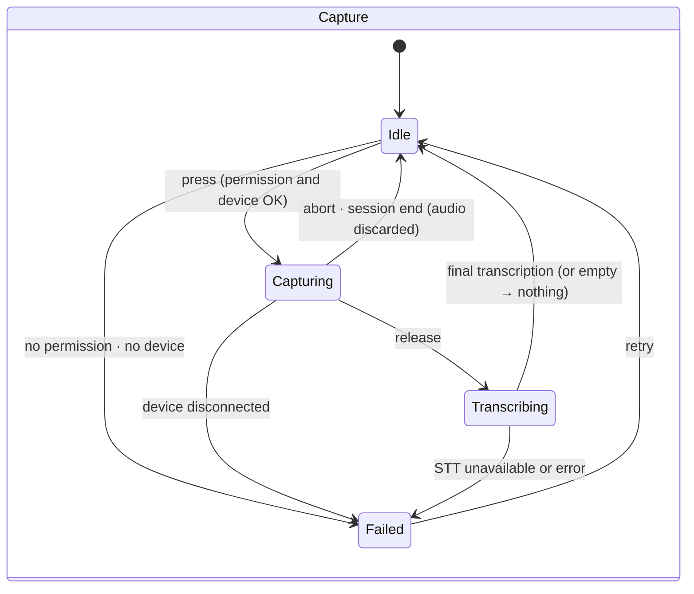
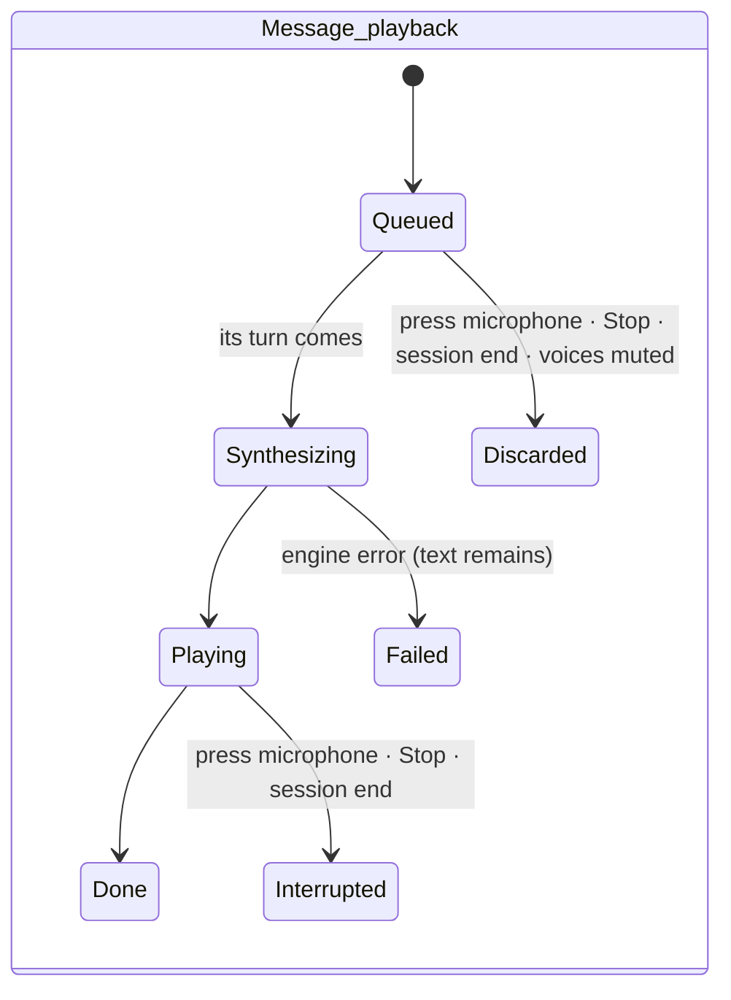

# Voice engine: capture, STT, TTS and playback

> **Status:** proposal, **not implemented**. There is no audio dependency in the project. This document does not pick a final technology: it compares options, recommends an order and defines the spikes required before any implementation. Product: [voice-meetings.md](../product/voice-meetings.md). Conversation engine: [conversation-engine.md](conversation-engine.md). Decisions: [decisions.md](../product/decisions.md).
>
> **Sources:** data marked **(V)** was verified against official documentation or the repositories on 2026-11-18 (the cloud voice APIs were re-verified that day; see §13); data marked **(I)** is inference or unverified, and is confirmed in the spikes. Versions and dates change fast: they are reviewed before implementing.

## 0. MVP implementation (2026-11-20, D57)

Built on macOS only; everything below §1 remains the reference for the full engine.

| Piece | Module | Notes |
|---|---|---|
| Capture | `system/audio_capture.rs` | `cpal` default input on a dedicated thread (the stream is not `Send`), f32 or i16, at most 60 s, mixed to mono and resampled to 16 kHz with the anti-aliased FFT resampler of `rubato` and peak-normalized (gain capped at 10×, silence left untouched) in `domain/speech.rs`; audio never leaves memory. Starting and cancelling run off the main thread, so the window stays responsive while macOS shows the permission dialog |
| Silence and denied permission | `domain/speech.rs` | macOS gives a denied app a stream of exact zeros instead of an error: a capture whose samples are all zero fails with `microphone_unavailable`, one whose peak stays under 0.003 with `nothing_heard`, so whisper never transcribes silence (it invents phrases on it). Recognizer annotations in brackets or parentheses (`[BLANK_AUDIO]`, «(música)») are removed from the transcript |
| STT | `system/speech_recognition.rs` | `whisper-rs` 0.16 with Metal, greedy decoding in the profile language, whisper logs silenced; the context is loaded once per session (first load ~8 s with shader compilation, later ~0.1 s; a sentence decodes in 0.1–0.7 s on an M1 Max) |
| Model | `services/voice.rs`, `domain/speech_model.rs`, `system/machine.rs` | chosen per machine (D60): `ggml-large-v3-turbo-q5_0.bin` (574,041,195 bytes) on Apple Silicon with comfortable memory, else `ggml-small-q5_1.bin` (190,085,487 bytes), both SHA-256 pinned; the dialog shows the detected chip and memory and the recommended model. Downloaded from Hugging Face into `<app data>/models/` only after the user accepts it; size cap while streaming, checksum, `.part` file removed on failure; the bytes written are emitted as the `voice:download_progress` event (one per whole percent) and the voice dialog shows a progress bar, then «Checking the model…» at 100 % |
| TTS | `system/speech_synthesis.rs` | `/usr/bin/say -v <voice> -f -` with the text on stdin (never an argument), `kill_on_drop`; voices from `say -v ?`, one stable voice per agent and language, novelty voices excluded; markdown and code blocks removed and at most 1,200 characters read |
| Queue | `services/voice.rs` | one reply at a time in arrival order; «stop» cancels the current and the queued ones; events `voice:playback` (room, message, agent, speaking) |
| Commands | `commands/voice.rs` | `get_voice_status` everywhere (`available: false` outside macOS); `download_voice_model`, `start_voice_capture`, `finish_voice_capture`, `cancel_voice_capture`, `speak_message`, `stop_speaking` registered on macOS only |

**Verified:** the model download and checksum and the transcription of Spanish speech generated by `say` (large-v3 turbo on an M1 Max, word for word, 2026-11-20) (opt-in test `downloads_and_verifies_the_model_then_transcribes_spoken_spanish`); `say` reading from stdin with a chosen voice. **Not verified:** capture from a real microphone, which needs the macOS permission dialog (S-01 in [stabilization-backlog.md](../product/stabilization-backlog.md)). The check is done with the app bundle, not with `pnpm tauri dev`: under `tauri dev` macOS asks for the permission on behalf of the terminal that launched it, not Meelting. On a machine whose `node_modules` are x64 (Rosetta), build it with rustup's `cargo` first in `PATH` and the native target, leaving out `icon.icon` (`actool` fails on it under Rosetta), then sign the bundle ad hoc so the permission is kept for `app.meelting.desktop`:

```sh
PATH=$HOME/.cargo/bin:/usr/local/bin:$PATH pnpm tauri build --debug --bundles app --target aarch64-apple-darwin \
  --config '{"bundle":{"icon":["icons/32x32.png","icons/128x128.png","icons/128x128@2x.png","icons/icon.icns"]}}'
codesign --force --deep -s - src-tauri/target/aarch64-apple-darwin/debug/bundle/macos/Meelting.app
```

## 1. Starting decisions

Approved:
- Push-to-talk in the first version.
- Local and cloud engines configurable by the user, with no mandatory preference.
- Per-agent voice independent of its LLM provider.
- Text is the source of truth.

Consequences:
- **STT and TTS do not depend on the agent's LLM provider.** An agent using Claude can speak with an OS voice and be heard with whisper.cpp. If a cloud engine comes from the same provider as an LLM (OpenAI, Groq), it only shares the keychain **key** (`<workspace>/<provider>`), not the configuration.
- **Main cascade architecture:** audio → STT → text → `AgentRun` → text → TTS → audio (§6).
- **No anticipatory abstractions:** no STT or TTS trait is created until two real implementations exist in the code. While there is only one, it is a function in `system/`.

## 2. Where audio lives

| Option | Advantages | Drawbacks |
|---|---|---|
| **Rust core** (capture with `cpal`, playback with `cpal` or `rodio`) | A single owner of audio: cancellation, exclusivity and shutdown when leaving the room live in Rust. Audio does not cross IPC. Avoids the `getUserMedia` problems in webviews | Native code per platform. macOS permissions and entitlements. C dependencies (ALSA on Linux) |
| **Webview** (`getUserMedia`, Web Audio) | No native audio code. The browser's echo cancellation might help (I) | Two permission dialogs on macOS 14 (V, wry #1195); WebRTC unsupported in WebKitGTK (V, wry #85); the webview permission handler arrived in Tauri 2.12 (V, PR #14865); audio would have to cross IPC to the core's STT |

**Recommendation:** capture and playback in the core. Only states, texts and, optionally, a low-frequency microphone level travel over IPC. Confirmed with spike S1. If some engine forced playback in the webview, audio would use `tauri::ipc::Channel` (ordered streaming) rather than JSON events (I: confirm performance in S6).

- **Capture:** `cpal` 0.18.x (V):
  - Apache-2.0.
  - CoreAudio, WASAPI and ALSA/PulseAudio/PipeWire backends.
  - `DeviceChanged` and `DeviceNotAvailable` errors.
  - On WASAPI, default-device streams are rerouted automatically.
  - Does not provide echo cancellation.
- **Playback:** `rodio` 0.23 (V, built on `cpal`), with the README warning that its engine is being rewritten, or `cpal` directly. Some OS engines play audio themselves (§4).
- **macOS:**
  - `NSMicrophoneUsageDescription` in `src-tauri/Info.plist` (V, Tauri merges it into the bundle);
  - the entitlements `com.apple.security.device.audio-input` (V) and `com.apple.security.device.microphone`, the latter pointed out in Tauri issue #9928;
  - without the entitlements, signed builds do not show the permission dialog (V, tauri #9928).
  - Requires the Phase 7 signing setup.

## 3. Speech recognition (STT)

| Option | Quality and latency | CPU/GPU | Model size | License | Offline | macOS / Win / Linux | Rust/Tauri fit | Maintenance |
|---|---|---|---|---|---|---|---|---|
| **whisper.cpp + `whisper-rs`** | Whisper quality in es and en. No real partials: decodes in chunks (V) | CPU; Metal, CUDA, Vulkan, Core ML (V) | tiny 75 MiB · base 142 MiB · small 466 MiB · large-v3-turbo-q5_0 547 MiB (V) | MIT; `whisper-rs` Unlicense (V) | Yes | Yes / Yes / Yes | Good. Building needs CMake and libclang (MSVC + LLVM on Windows) (V) | whisper.cpp active (v1.9.5, 2026-10); `whisper-rs` 0.16 (2026-03) moved to Codeberg and lags behind (V) |
| **sherpa-onnx** | Real streaming with partials (Zipformer); offline Parakeet v3 includes Spanish (V). Official Spanish streaming unconfirmed (I) | CPU (ONNX Runtime) | Tens to hundreds of MB (I) | Apache-2.0; models vary (Parakeet CC-BY-4.0) (V) | Yes | Yes / Yes / Yes | Official crate `sherpa-onnx` 2.0.1, static linking by default; downloads binaries at build time unless `SHERPA_ONNX_LIB_DIR` (V) | Very active |
| **macOS SpeechAnalyzer / SFSpeechRecognizer** | Good, with partial results | Apple on-device | Managed by the OS | OS | SpeechAnalyzer on-device (macOS 26+); `SFSpeechRecognizer` without `requiresOnDeviceRecognition` may send audio to Apple (V) | macOS only | Swift/ObjC bridge | Apple |
| **Windows AI Speech Recognition** | Streaming | NPU or CPU | Windows Update | OS | Yes | Windows only | Experimental, requires MSIX, English only (V) | Preview |
| **Web Speech API in the webview** | Variable | — | — | — | Mostly no | Unreliable on all three (V/I) | Ruled out | — |
| **OpenAI (transcription)** | `gpt-transcribe` on `/v1/audio/transcriptions`, with deltas if `stream=true`; live audio with `gpt-live-transcribe` only in Realtime transcription sessions (V) | Cloud | — | Commercial | No | All | HTTP, key in the keychain | **Models** are retired, not the endpoint: `whisper-1`, `gpt-4o-transcribe`, `gpt-4o-mini-transcribe` and `gpt-4o-transcribe-diarize` on 2027-02-26 (announced 2026-08-26); the `gpt-4o-mini-transcribe-2025-03-20` snapshot earlier, on 2027-01-20. `/v1/audio/transcriptions` continues with `gpt-transcribe`; the one being retired is `/v1/audio/translations` (V) |
| **Groq (Whisper)** | `whisper-large-v3` and `-turbo`, fast; no documented streaming (V) | Cloud | — | Commercial, 10 s minimum billed (V) | No | All | OpenAI-compatible endpoint (V) | Active |
| **Anthropic** | Does not accept audio in the Messages API (V) | — | — | — | — | — | Not applicable | — |

**Recommendation to validate:**
- **Local:** whisper.cpp with a downloadable multilingual model (S2).
- **Cloud:** an OpenAI-compatible transcription endpoint (OpenAI or Groq), behind a single HTTP function, since they share a format (I: confirm). Two adapters are not created if the format is the same.
- **Later:** sherpa-onnx, if real partials are needed for natural conversation.
- **Push-to-talk:** with push-to-talk neither VAD nor partials are needed: the chunk is transcribed on release.
- **Natural conversation:** Silero VAD (MIT, ~2 MB, <1 ms per 30 ms chunk on a CPU (V)), already included in whisper.cpp and sherpa-onnx (V).

**Language:** by default, the profile's. Whisper can detect the language automatically (I: measure reliability with short phrases in S2).

## 4. Speech synthesis (TTS)

| Option | es/en voices | Quality | Added size | License | Offline | macOS / Win / Linux | Rust/Tauri fit |
|---|---|---|---|---|---|---|---|
| **macOS `AVSpeechSynthesizer`** | Many; enhanced or premium voices are downloaded by the user (I) | Good (I) | 0 | OS | Yes | macOS only | With `objc2`; `write(_:toBufferCallback:)` returns PCM (V) |
| **Windows `SpeechSynthesizer` (WinRT)** | Microsoft-signed voices (V); OneCore es/en (I) | Robotic to acceptable (I) | 0 | OS | Yes | Windows only | `windows` crate; `SynthesizeTextToStreamAsync` returns a stream (V) |
| **Linux speech-dispatcher / espeak-ng** | Yes | Robotic (I) | 0 | System package (espeak-ng GPL-3) | Yes | Linux only | Process or `tts` crate |
| **`tts` crate** 0.26.3 | The OS's | The OS's | Minimal | (I) | Yes | All three | Only `speak()`, does not return buffers (V); last release July 2024 |
| **Piper** (`piper1-gpl` 1.8) | es_ES, es_MX, es_AR, en_US, en_GB | Good, natural (I) | 21–114 MB per voice (V) | **GPL-3 engine** (V); license per voice | Yes | All three | Via sherpa-onnx (VITS models) |
| **sherpa-onnx TTS** 2.0.1 | Piper, Kokoro, Matcha models | Depends on the model | Runtime + model | Apache-2.0 (V) | Yes | All three | Official crate; per-chunk callback that can stop generation (V). **2.0 removed espeak-ng**: Spanish needs an external phonemizer (V) |
| **Kokoro-82M** | 3 Spanish voices, 28 English (V) | English good; Spanish limited (I) | 86–326 MB ONNX (V) | Apache-2.0 (weights) (V); Spanish G2P uses espeak-ng (GPL) | Yes | All three | Via sherpa-onnx |
| **OpenAI `/v1/audio/speech`** | Yes | Very good (I) | 0 | Commercial | No | All | The endpoint is **not** listed as retired, but **its three models** (`tts-1`, `tts-1-hd`, `gpt-4o-mini-tts` and their snapshots) shut down on 2027-01-06 (announced 2026-10-01) and the documentation names no model that keeps working on it. The official replacement, `gpt-realtime-2.1-mini`, is not compatible with this endpoint (V): do not design on it |
| **OpenAI Realtime** (`gpt-realtime-2.1[-mini]`) | Yes | Very good (I) | 0 | Commercial | No | All | Only `v1/realtime` (WebRTC, WebSocket or SIP); it is the official replacement for the earlier TTS models. The voice cannot change once audio has been emitted in the session (V), so one session per voice is needed (I) |
| **OpenAI Chat Completions with audio** (`gpt-audio-1.5`) | Yes | (I) | 0 | Commercial | No | All | Audio output only through `v1/chat/completions`, with no retirement notice (V). It is OpenAI's other HTTP TTS route after 2027-01-06 |
| **Groq TTS** (`canopylabs/orpheus-v1-english`, `canopylabs/orpheus-arabic-saudi`) | **No Spanish** (English and Arabic) (V) | — | 0 | Commercial | No | All | Not usable for es. The earlier PlayAI models were retired on 2025-12-31 (V) |
| **Ollama TTS** (since 0.40.11, OpenAI-compatible `/v1/audio/speech`) | `phonon:40m-es` licensed CC BY-NC 4.0; the default English `phonon` is Apache-2.0 (V) | (I) | Model | Spanish non-commercial | Yes | Only macOS with Apple Silicon for now; Windows and Linux announced (V) | Not suitable for distribution with an es voice. TTS only, no STT (V) |
| **Anthropic** | Has no audio API (V) | — | — | — | — | — | Not applicable |
| **Web Speech `speechSynthesis`** | OS voices, filtered | Variable | 0 | — | Partial | WKWebView yes; in WebView2 natural voices only online; WebKitGTK depends on the distribution (V/I) | No access to the audio; ruled out as a base |

**License and distribution risks:**
- **GPL:** the Piper engine (`piper1-gpl`), espeak-ng and piper-phonemize. Linking them into an FSL-1.1-MIT app is probably incompatible (I, **requires legal review**). Alternatives: a separate GPL process, lexicon-based G2P, or engines without espeak.
- **Piper voice licenses:** the es_ES voices suitable for commercial use are `davefx` (CC0) and `sharvard` (CC BY 3.0, with attribution) (V). **There is no commercial es_MX or es_AR voice** (V).
- **Size:** any neural voice multiplies the current installer (3–4 MB). It is downloaded on demand, never bundled.

**Recommendation to validate:**
1. **First output voice:** each OS's native engine, called directly (not through the `tts` crate) to get buffers and control the queue and cancellation in the core. Linux, with limited quality, is accepted for v1 (S3).
2. **Optional local neural voices:** sherpa-onnx with voices suitable for commercial use, after solving the phonemizer (S4).
3. **Optional cloud:** after 2027-01-06, OpenAI TTS goes through Realtime (`gpt-realtime-2.1-mini`) or Chat Completions with audio (`gpt-audio-1.5`), not through `/v1/audio/speech` with the current models; choose the route in S5. Other TTS providers are evaluated only if the user asks for them; they are not added in advance.

### Agent voices

- **Approved decision:** the voice belongs to the **agent's configuration**, in a separate table (`agent_voices`), not to the session or the engine. Proposed schema in [conversation-engine.md](conversation-engine.md#12-persistence-and-data-model).
- **No configuration:** a stable default voice, chosen by a hash of the agent id among the voices available for the engine and language. Two agents in the same room try not to share a voice.
- **Voice unavailable on another machine or engine:** the default voice is used and a warning is shown, without deleting the configuration.
- **Language:** one voice per language (es/en), **pending**.

### Voice streaming

| Option | First audio | Complexity | Risks |
|---|---|---|---|
| **A. TTS once the text is complete** (recommended first) | Late: waits for the whole response | Low | Latency with long responses |
| B. Sentence-by-sentence TTS while tokens arrive | Early | High | Segmentation, abbreviations and decimals, markdown and code, fragment ordering, stale audio if the run is retried or cancelled |

For the natural conversation stage (option B):
- tokens are accumulated and cut at `. ? ! … :` followed by a space or newline, with protection for abbreviations and decimals and a maximum length;
- the first fragment is kept short to lower latency, but Kokoro performs poorly with fewer than 10–20 tokens (V);
- markdown and code are stripped; a code block is read as "(see the code block in the transcript)";
- this is the technique used by Pipecat or Gradium (V);
- each fragment carries `message_id` or `run_id` and an index, and fragments from a cancelled or restarted run are discarded.

## 5. Audio states





Invariants that prevent contradictory states:
- `Capturing` ⇒ no message in `Playing` or `Synthesizing`.
- At most one message in `Playing` per session.
- Each `message_id` is queued at most once per session.
- Session end ⇒ capture in `Idle` and empty queue.
- Voice activity detection (VAD) has no state of its own with push-to-talk; it appears in natural conversation.

## 6. Direct speech-to-speech

| Criterion | A. Cascade STT → AgentRun → TTS (recommended) | B. Real-time audio → audio model | C. Hybrid by provider |
|---|---|---|---|
| Existing agents | All, with any provider | Only those of a provider with a real-time API (today OpenAI or Google; Anthropic has none (V)) | Mix |
| Own instructions | Yes | Yes, in the session (V) | Yes |
| Shared context | Same history and `BuildPrompt` | The history must be injected into each session and the transcripts extracted | Two paths |
| Multiple voices | Per agent | One session per voice (I) | — |
| Switching provider | Free | Tied to the provider | Partial |
| Offline | With local engines | No practical local option (V/I) | Partial |
| Transcript | It is the source | The API provides it (V) | — |
| Interruptions | Our own (§5) | Native (`response.cancel`, truncate) (V) | Two interruption models |
| Cost | LLM + STT/TTS | Expensive audio tokens (V) | — |
| Privacy | Selectable per engine | All audio goes to the cloud | — |
| Tools and approvals | Those of `AgentRun` | Provider tools outside our approvals: they would have to be disabled | Risk |
| History | Messages and `AgentRun` | Must be rebuilt from the events | — |
| Complexity | Medium | High | Very high |

**Recommendation:** A as the main architecture. B and C are documented as an optional per-agent evolution ("real-time voice engine"), only if a spike shows the latency improvement is worth it. In that case the result must come back into the conversation as normal messages and never enable provider tools. No interfaces for B are created in advance.

## 7. Concurrency, resources and lifecycle

- **Threads:** `cpal` callbacks run on real-time audio threads. They must not block or allocate memory; chunks are passed through a bounded channel to a `tokio` task. If the channel fills up, chunks are dropped and logged (backpressure).
- **Memory:** captured audio is kept as 16 kHz mono PCM in memory (I: ~1.9 MB per minute at 16 bits). A maximum duration per press is set (**pending**, e.g. 2 minutes) and the audio is discarded after transcription.
- **Local inference:** whisper.cpp and the TTS models run in `spawn_blocking` or on a dedicated thread. A loaded model is reused during the session and released when it ends or after a period of inactivity (**pending**).
- **Resource contention:** a local LLM, Whisper and a neural TTS on the same machine compete for CPU, GPU and memory. This is measured in the spikes and concurrency is limited (sequential generation in a meeting).
- **Devices:** when a device changes or disconnects (Bluetooth), capture moves to `Failed` with the reason and playback reopens on the default device. The microphone is **never** reopened automatically.
- **Echo:** with push-to-talk, playback stops when the microphone opens, so no echo cancellation is needed in v1. For continuous listening: `webrtc-audio-processing` (BSD-3; documented for Linux and macOS, Windows unconfirmed (V)) or OS echo cancellation (S8).
- **Shutdown and cleanup:** leaving the room, switching workspace, closing the window, deleting the room or stopping the app end the session (§5 of [conversation-engine.md](conversation-engine.md#5-states-and-lifecycles)). System sleep invalidates the streams: on wake, playback is discarded and capture returns to `Idle`. Reopening the app recovers no audio: nothing is persisted to recover.

## 8. Model distribution

- **No voice model ships in the installer.**
- An embedded read-only catalog of engines, models and voices is proposed: key, language, size, URL, `sha256`, license and attribution. The catalog does not orchestrate: downloading is a service.
- **Download:**
  - always with explicit consent, showing size, origin and license;
  - into the app's data directory;
  - with `sha256` verification and resume;
  - once downloaded, it works offline.
- Deleting a downloaded model is done from Settings › Voice.
- Voices with attribution licenses (CC BY, CC-BY-4.0) show the credit in Settings.
- **Pending decision:** confirm this policy against the alternative of guiding the user to install models outside the app.

## 9. Spikes

Before approving the voice implementation. Each spike produces real measurements; no target figure in this document is a guarantee.

| # | Spike | Question | Exit evidence |
|---|---|---|---|
| S1 | Capture with `cpal` on the 3 OSes | Permissions, macOS entitlements in a signed bundle, device change, Bluetooth | 10 s capture on the 3 OSes; correct permission dialog; recovery on disconnect |
| S2 | whisper.cpp via `whisper-rs` | Build in CI (MSVC + LLVM), added size, es/en latency with base, small and turbo-q5 | Latency and memory usage table per model on reference hardware; installer size |
| S3 | Native TTS | Buffers on macOS and Windows; Linux with speech-dispatcher; available es/en voices | Playback and cancellation within a target to be measured; voice list per OS |
| S4 | Local neural TTS | sherpa-onnx + commercial es_ES Piper voice; non-GPL phonemizer; size and latency | Legal and technical decision on the phonemizer |
| S5 | Cloud voice | OpenAI STT (`gpt-transcribe`) or Groq (Whisper); OpenAI TTS via Realtime or Chat Completions with audio; format and streaming | Contract tested with `wiremock`; optional manual test with a key |
| S6 | Playback | Core vs webview; barge-in latency | Measurement of the time between press and silence |
| S7 | AI coordinator | JSON reliability with a small local model and with a cloud one | Percentage of valid suggestions over a fixed set of questions |
| S8 | Continuous listening (later) | VAD and echo cancellation per OS | False positives with speakers |

## 10. Performance and observability

Local metrics, with no content: no text, no audio, no keys. They are recorded in the local debug log or aggregated in memory. No telemetry is sent.

| Metric | From | To |
|---|---|---|
| Capture start | Press | First chunk received |
| Transcription | Release | Final text |
| First token | Run `running` | First token |
| First audio | Message persisted (or first fragment) | First sample played |
| Intervention latency | Release | First audio of the response |
| Between turns | End of agent N's audio | Start of agent N+1's audio |
| Barge-in | Press | Silence |
| Resources | — | Memory and CPU per loaded engine |
| Counts | — | Cancellations, empty transcriptions, errors per engine and provider, tokens per intervention |

**Experience targets (hypotheses to validate with the spikes):**
- Near-instant barge-in, the most important target.
- First audio of a short response within a few seconds with cloud engines.
- With local engines, it depends on the hardware: what is measured gets documented.

## 11. Compatibility and testing

| Topic | macOS | Windows | Linux |
|---|---|---|---|
| Capture | CoreAudio; Info.plist + entitlements | WASAPI | ALSA/PulseAudio/PipeWire (`libasound2-dev`) |
| Microphone permission | OS dialog | OS privacy settings (I) | Usually no dialog (I) |
| Native TTS | AVSpeechSynthesizer | WinRT SpeechSynthesizer | speech-dispatcher (low quality) |
| Local STT | whisper.cpp (Metal) | whisper.cpp (CPU, CUDA or Vulkan) | whisper.cpp (CPU or Vulkan) |
| Device change | `StreamInvalidated` (V) | Automatic rerouting (V) | Depends on the backend |

**Tests:**
- **Automated, without real devices or APIs:**
  - capture and playback state machines;
  - queue (order, deduplication by `message_id`, discard);
  - sentence segmentation;
  - default voice selection;
  - simulated engine errors;
  - cloud STT and TTS with `wiremock`.
- **With local services (opt-in):** whisper.cpp with a test WAV in the test repository (compatible license) and a local TTS.
- **Manual with devices**, matrix on the 3 OSes:
  - permission denied;
  - microphone missing;
  - Bluetooth connected and disconnected;
  - silence and noise;
  - interruption;
  - system sleep;
  - fully offline operation;
  - switching workspace while audio is playing.
- **Real providers:** optional, manual, behind an environment variable; never in CI.

## 12. Risks

| Risk | Prob. | Impact | Mitigation | Stage | Evidence |
|---|---|---|---|---|---|
| Coupling the architecture to a voice provider | Medium | High | Cascade; voice independent of the LLM; no real-time APIs as the base | R3–R4 | Design review |
| Accumulated STT + LLM + TTS latency | High | High | Push-to-talk, sentence-level TTS later, prefetching the next turn | R5 | S2, S5, S6 |
| Audio that keeps playing after leaving | Medium | High | The session owns the audio; idempotent shutdown | R3 | Lifecycle tests + manual test |
| Local model resources | High | Medium | Sequential generation; release models; choose the size | R3–R4 | S2, S4 |
| Differences between OSes | High | Medium | Audio in the core; test matrix | R3–R4 | S1, S3 |
| Model distribution and updates | Medium | Medium | Catalog with `sha256`; download with consent | R3 | S2, S4 |
| GPL licenses in Spanish TTS | High | High | Native TTS first; legal review before Piper or Kokoro | R3 | S4 |
| Native dependencies hard to package | High | Medium | Spikes in CI on the 3 OSes before approval | R3–R4 | S1, S2 |
| Cloud APIs being retired | High | Medium | Check the status when implementing; one HTTP function per format | R3–R4 | S5 |
| Responses generated but not heard | High | Low | Text rules; mark in the session; replay | R3 | — |
| Accidental microphone use | Low | High | Push-to-talk, visible indicator, shortcut only with the window focused | R4 | Manual test |

## 13. Cloud voice API verification (2026-11-18)

Checked against the official documentation. A distinction is made between **retired models** and **capabilities** that remain available through another route.

| Claim | Result | Official source |
|---|---|---|
| OpenAI retires `whisper-1` and `gpt-4o-*-transcribe` on 2027-02-26 | Correct. The models are retired; `/v1/audio/transcriptions` continues with `gpt-transcribe`. The `/v1/audio/translations` endpoint is retired (replacement: `/v1/realtime/translations`) | [Deprecations](https://developers.openai.com/api/docs/deprecations), [Speech to text](https://developers.openai.com/api/docs/guides/speech-to-text) |
| OpenAI shuts down `/v1/audio/speech` on 2027-01-06 | **Incorrect as written.** The `tts-1`, `tts-1-hd` and `gpt-4o-mini-tts` models shut down; the endpoint is not listed as retired, but it is left with no documented models. The capability continues through Realtime (`gpt-realtime-2.1-mini`, official replacement) or Chat Completions with audio (`gpt-audio-1.5`) | [Deprecations](https://developers.openai.com/api/docs/deprecations), [Text to speech](https://developers.openai.com/api/docs/guides/text-to-speech), [gpt-audio-1.5](https://developers.openai.com/api/docs/models/gpt-audio-1.5) |
| `gpt-transcribe` with `stream=true` and `gpt-live-transcribe` for real time | Correct. `gpt-live-transcribe` only works in Realtime transcription sessions | [gpt-transcribe](https://developers.openai.com/api/docs/models/gpt-transcribe), [gpt-live-transcribe](https://developers.openai.com/api/docs/models/gpt-live-transcribe) |
| Realtime `gpt-realtime-2.1[-mini]`; the voice cannot change after audio is emitted | Correct | [Realtime client events](https://developers.openai.com/api/reference/resources/realtime/client-events) |
| Groq: Whisper `large-v3` and `-turbo`, OpenAI-compatible, no documented streaming, 10 s minimum billed | Correct; Whisper has no retirement notice | [Groq Speech to text](https://console.groq.com/docs/speech-to-text), [Groq Deprecations](https://console.groq.com/docs/deprecations) |
| Groq TTS without Spanish | Correct in substance, with updated names: Orpheus English and Arabic; PlayAI retired on 2025-12-31 | [Groq Text to speech](https://console.groq.com/docs/text-to-speech) |
| Anthropic has no audio input nor an STT or TTS API | Correct | [Models overview](https://platform.claude.com/docs/en/about-claude/models/overview), [OpenAI SDK compatibility](https://platform.claude.com/docs/en/api/openai-sdk) |
| Ollama TTS only on macOS and Spanish model CC BY-NC | Correct (Apple Silicon; `phonon:40m-es`) | [Ollama: speech models](https://ollama.com/blog/speech-models) |

Dates and models change fast: they are re-verified in S5, before implementing any cloud voice.
