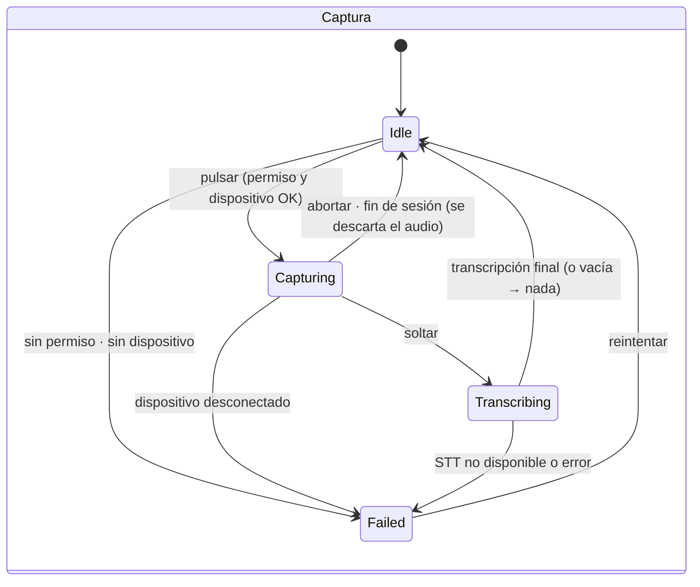
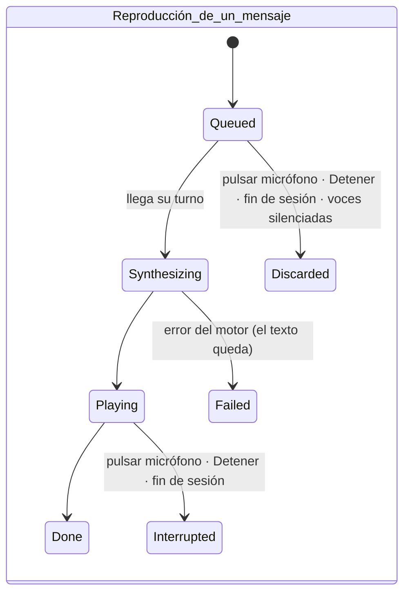

# Motor de voz: captura, STT, TTS y reproducción

> **Estado:** propuesta, **no implementada**. No hay ninguna dependencia de audio en el proyecto. Este documento no elige una tecnología definitiva: compara opciones, recomienda un orden y define los spikes previos a cualquier implementación. Producto: [voice-meetings.md](../product/voice-meetings.md). Motor conversacional: [conversation-engine.md](conversation-engine.md). Decisiones: [decisions.md](../product/decisions.md).
>
> **Fuentes:** los datos marcados **(V)** se verificaron en documentación oficial o en los repositorios el 2026-11-18 (las APIs de voz en la nube se volvieron a verificar ese día; ver §13); los marcados **(I)** son inferencias o datos sin verificar, y se confirman en los spikes. Las versiones y fechas cambian rápido: se revisan antes de implementar.

## 1. Decisiones de partida

Aprobadas:
- Push-to-talk en la primera versión.
- Motores locales y en la nube configurables por el usuario, sin preferencia obligatoria.
- Voz por agente independiente de su proveedor LLM.
- El texto es la fuente de verdad.

Consecuencias:
- **El STT y el TTS no dependen del proveedor LLM del agente.** Un agente con Claude puede hablar con una voz del SO y ser escuchado con whisper.cpp. Si un motor en la nube es del mismo proveedor que un LLM (OpenAI, Groq), solo comparte la **clave** del keychain (`<workspace>/<provider>`), no la configuración.
- **Arquitectura principal en cascada:** audio → STT → texto → `AgentRun` → texto → TTS → audio (§6).
- **Sin abstracciones anticipadas:** no se crea un trait de STT o TTS hasta que existan dos implementaciones reales en el código. Mientras haya una, es una función en `system/`.

## 2. Dónde vive el audio

| Opción | Ventajas | Inconvenientes |
|---|---|---|
| **Núcleo Rust** (captura con `cpal`, reproducción con `cpal` o `rodio`) | Un solo dueño del audio: cancelación, exclusividad y cierre al salir de la sala están en Rust. El audio no cruza IPC. Evita los problemas de `getUserMedia` en los webviews | Código nativo por plataforma. Permisos y entitlements de macOS. Dependencias C (ALSA en Linux) |
| **Webview** (`getUserMedia`, Web Audio) | Sin código nativo de audio. La cancelación de eco del navegador podría servir (I) | Dos diálogos de permiso en macOS 14 (V, wry #1195); WebRTC sin soporte en WebKitGTK (V, wry #85); el manejador de permisos del webview llegó en Tauri 2.12 (V, PR #14865); el audio tendría que cruzar IPC hacia el STT del núcleo |

**Recomendación:** captura y reproducción en el núcleo. Por IPC solo viajan estados, textos y, opcionalmente, un nivel de micrófono a baja frecuencia. Se confirma con el spike S1. Si algún motor obligara a reproducir en el webview, el audio usaría `tauri::ipc::Channel` (streaming ordenado) y no eventos JSON (I: confirmar rendimiento en S6).

- **Captura:** `cpal` 0.18.x (V):
  - Apache-2.0.
  - Backends CoreAudio, WASAPI y ALSA/PulseAudio/PipeWire.
  - Errores `DeviceChanged` y `DeviceNotAvailable`.
  - En WASAPI, los streams del dispositivo por defecto se redirigen solos.
  - No ofrece cancelación de eco.
- **Reproducción:** `rodio` 0.23 (V, sobre `cpal`), con el aviso del README de que su motor se está reescribiendo, o `cpal` directo. Algunos motores del SO reproducen ellos mismos (§4).
- **macOS:**
  - `NSMicrophoneUsageDescription` en `src-tauri/Info.plist` (V, Tauri lo fusiona en el bundle);
  - los entitlements `com.apple.security.device.audio-input` (V) y `com.apple.security.device.microphone`, este último señalado en el issue de Tauri #9928;
  - sin los entitlements, las compilaciones firmadas no muestran el diálogo de permiso (V, tauri #9928).
  - Requiere la configuración de firma de la Fase 7.

## 3. Reconocimiento de voz (STT)

| Opción | Calidad y latencia | CPU/GPU | Tamaño de modelo | Licencia | Offline | macOS / Win / Linux | Encaje Rust/Tauri | Mantenimiento |
|---|---|---|---|---|---|---|---|---|
| **whisper.cpp + `whisper-rs`** | Calidad Whisper en es y en. Sin parciales reales: decodifica por bloques (V) | CPU; Metal, CUDA, Vulkan, Core ML (V) | tiny 75 MiB · base 142 MiB · small 466 MiB · large-v3-turbo-q5_0 547 MiB (V) | MIT; `whisper-rs` Unlicense (V) | Sí | Sí / Sí / Sí | Bueno. Compilar necesita CMake y libclang (MSVC + LLVM en Windows) (V) | whisper.cpp activo (v1.9.5, 2026-10); `whisper-rs` 0.16 (2026-03) se mudó a Codeberg y va por detrás (V) |
| **sherpa-onnx** | Streaming real con parciales (Zipformer); Parakeet v3 offline incluye español (V). Streaming oficial en español sin confirmar (I) | CPU (ONNX Runtime) | Decenas a cientos de MB (I) | Apache-2.0; los modelos varían (Parakeet CC-BY-4.0) (V) | Sí | Sí / Sí / Sí | Crate oficial `sherpa-onnx` 2.0.1, enlace estático por defecto; descarga binarios al compilar salvo `SHERPA_ONNX_LIB_DIR` (V) | Muy activo |
| **macOS SpeechAnalyzer / SFSpeechRecognizer** | Buena, con resultados parciales | Apple en el dispositivo | Gestionado por el SO | SO | SpeechAnalyzer en el dispositivo (macOS 26+); `SFSpeechRecognizer` sin `requiresOnDeviceRecognition` puede enviar audio a Apple (V) | Solo macOS | Puente Swift/ObjC | Apple |
| **Windows AI Speech Recognition** | Streaming | NPU o CPU | Windows Update | SO | Sí | Solo Windows | Experimental, exige MSIX, solo inglés (V) | Preview |
| **Web Speech API en el webview** | Variable | — | — | — | Mayormente no | No fiable en los tres (V/I) | Descartado | — |
| **OpenAI (transcripción)** | `gpt-transcribe` en `/v1/audio/transcriptions`, con deltas si `stream=true`; audio en vivo con `gpt-live-transcribe` solo en sesiones de transcripción de Realtime (V) | Nube | — | Comercial | No | Todos | HTTP, clave en el keychain | Se retiran **modelos**, no el endpoint: `whisper-1`, `gpt-4o-transcribe`, `gpt-4o-mini-transcribe` y `gpt-4o-transcribe-diarize` el 2027-02-26 (anunciado el 2026-08-26); la instantánea `gpt-4o-mini-transcribe-2025-03-20` antes, el 2027-01-20. `/v1/audio/transcriptions` sigue con `gpt-transcribe`; el que se retira es `/v1/audio/translations` (V) |
| **Groq (Whisper)** | `whisper-large-v3` y `-turbo`, rápido; sin streaming documentado (V) | Nube | — | Comercial, mínimo de 10 s facturados (V) | No | Todos | Endpoint compatible con OpenAI (V) | Activo |
| **Anthropic** | No acepta audio en la Messages API (V) | — | — | — | — | — | No aplica | — |

**Recomendación a validar:**
- **Local:** whisper.cpp con un modelo multilingüe descargable (S2).
- **Nube:** un endpoint de transcripción compatible con OpenAI (OpenAI o Groq), detrás de una única función HTTP, ya que comparten formato (I: confirmar). No se crean dos adaptadores si el formato es el mismo.
- **Más adelante:** sherpa-onnx, si se necesitan parciales reales para la conversación natural.
- **Push-to-talk:** con push-to-talk no hacen falta VAD ni parciales: se transcribe el bloque al soltar.
- **Conversación natural:** Silero VAD (MIT, ~2 MB, <1 ms por bloque de 30 ms en una CPU (V)), que ya incluyen whisper.cpp y sherpa-onnx (V).

**Idioma:** por defecto, el del perfil. Whisper puede detectar el idioma automáticamente (I: medir la fiabilidad con frases cortas en S2).

## 4. Síntesis de voz (TTS)

| Opción | Voces es/en | Calidad | Tamaño añadido | Licencia | Offline | macOS / Win / Linux | Encaje Rust/Tauri |
|---|---|---|---|---|---|---|---|
| **macOS `AVSpeechSynthesizer`** | Muchas; las mejoradas o premium las descarga el usuario (I) | Buena (I) | 0 | SO | Sí | Solo macOS | Con `objc2`; `write(_:toBufferCallback:)` devuelve PCM (V) |
| **Windows `SpeechSynthesizer` (WinRT)** | Voces firmadas por Microsoft (V); OneCore es/en (I) | Robótica a aceptable (I) | 0 | SO | Sí | Solo Windows | Crate `windows`; `SynthesizeTextToStreamAsync` devuelve un stream (V) |
| **Linux speech-dispatcher / espeak-ng** | Sí | Robótica (I) | 0 | Paquete del sistema (espeak-ng GPL-3) | Sí | Solo Linux | Proceso o crate `tts` |
| **Crate `tts`** 0.26.3 | Las del SO | La del SO | Mínimo | (I) | Sí | Los tres | Solo `speak()`, no devuelve buffers (V); última versión de julio de 2024 |
| **Piper** (`piper1-gpl` 1.8) | es_ES, es_MX, es_AR, en_US, en_GB | Buena, natural (I) | 21–114 MB por voz (V) | **Motor GPL-3** (V); licencia por voz | Sí | Los tres | Vía sherpa-onnx (modelos VITS) |
| **sherpa-onnx TTS** 2.0.1 | Modelos Piper, Kokoro, Matcha | Según el modelo | Runtime + modelo | Apache-2.0 (V) | Sí | Los tres | Crate oficial; callback por bloque que puede detener la generación (V). **La 2.0 quitó espeak-ng**: el español necesita un fonemizador externo (V) |
| **Kokoro-82M** | 3 voces en español, 28 en inglés (V) | Inglés bueno; español limitado (I) | 86–326 MB ONNX (V) | Apache-2.0 (pesos) (V); el G2P en español usa espeak-ng (GPL) | Sí | Los tres | Vía sherpa-onnx |
| **OpenAI `/v1/audio/speech`** | Sí | Muy buena (I) | 0 | Comercial | No | Todos | El endpoint **no** figura como retirado, pero **sus tres modelos** (`tts-1`, `tts-1-hd`, `gpt-4o-mini-tts` y sus instantáneas) se apagan el 2027-01-06 (anunciado el 2026-10-01) y la documentación no nombra ningún modelo que siga funcionando en él. El reemplazo oficial, `gpt-realtime-2.1-mini`, no es compatible con este endpoint (V): no se diseña sobre ella |
| **OpenAI Realtime** (`gpt-realtime-2.1[-mini]`) | Sí | Muy buena (I) | 0 | Comercial | No | Todos | Solo `v1/realtime` (WebRTC, WebSocket o SIP); es el reemplazo oficial de los modelos TTS anteriores. La voz no cambia una vez emitido audio en la sesión (V), así que hace falta una sesión por voz (I) |
| **OpenAI Chat Completions con audio** (`gpt-audio-1.5`) | Sí | (I) | 0 | Comercial | No | Todos | Salida de audio solo por `v1/chat/completions`, sin aviso de retirada (V). Es la otra vía HTTP de TTS de OpenAI tras el 2027-01-06 |
| **Groq TTS** (`canopylabs/orpheus-v1-english`, `canopylabs/orpheus-arabic-saudi`) | **Sin español** (inglés y árabe) (V) | — | 0 | Comercial | No | Todos | No sirve para es. Los modelos PlayAI anteriores se retiraron el 2025-12-31 (V) |
| **Ollama TTS** (desde 0.40.11, `/v1/audio/speech` compatible con OpenAI) | `phonon:40m-es` con licencia CC BY-NC 4.0; el `phonon` inglés por defecto es Apache-2.0 (V) | (I) | Modelo | Español no comercial | Sí | Solo macOS con Apple Silicon por ahora; Windows y Linux anunciados (V) | No apto para distribuir con voz es. Solo TTS, sin STT (V) |
| **Anthropic** | No tiene API de audio (V) | — | — | — | — | — | No aplica |
| **Web Speech `speechSynthesis`** | Voces del SO, filtradas | Variable | 0 | — | Parcial | WKWebView sí; en WebView2 las voces naturales solo en línea; WebKitGTK depende de la distribución (V/I) | Sin acceso al audio; descartado como base |

**Riesgos de licencia y distribución:**
- **GPL:** el motor Piper (`piper1-gpl`), espeak-ng y piper-phonemize. Enlazarlos en una app FSL-1.1-MIT probablemente es incompatible (I, **requiere revisión legal**). Alternativas: proceso GPL separado, G2P por léxico, o motores sin espeak.
- **Licencias de voces Piper:** las voces es_ES aptas para uso comercial son `davefx` (CC0) y `sharvard` (CC BY 3.0, con atribución) (V). **No hay voz comercial es_MX ni es_AR** (V).
- **Tamaño:** cualquier voz neuronal multiplica el instalador actual (3–4 MB). Se descarga bajo demanda, nunca se incluye.

**Recomendación a validar:**
1. **Primera voz de salida:** el motor nativo de cada SO, llamado directamente (no con el crate `tts`) para obtener buffers y controlar la cola y la cancelación en el núcleo. Linux, con calidad limitada, queda como aceptable para la v1 (S3).
2. **Voces neuronales locales opcionales:** sherpa-onnx con voces aptas para uso comercial, después de resolver el fonemizador (S4).
3. **Nube opcional:** tras el 2027-01-06, el TTS de OpenAI pasa por Realtime (`gpt-realtime-2.1-mini`) o por Chat Completions con audio (`gpt-audio-1.5`), no por `/v1/audio/speech` con los modelos actuales; elegir la vía en S5. Otros proveedores de TTS se evalúan solo si el usuario los pide; no se añaden por adelantado.

### Voces de agentes

- **Decisión aprobada:** la voz pertenece a la **configuración del agente**, en una tabla aparte (`agent_voices`), no a la sesión ni al motor. Esquema propuesto en [conversation-engine.md](conversation-engine.md#12-persistencia-y-modelo-de-datos).
- **Sin configuración:** voz por defecto estable, elegida por un hash del id del agente entre las voces disponibles del motor y del idioma. Dos agentes de la misma sala intentan no compartir voz.
- **Voz no disponible en otra máquina u otro motor:** se usa la voz por defecto y se avisa, sin borrar la configuración.
- **Idioma:** una voz por idioma (es/en), **pendiente**.

### Streaming de voz

| Opción | Primer audio | Complejidad | Riesgos |
|---|---|---|---|
| **A. TTS al terminar el texto** (recomendada primero) | Tarde: espera toda la respuesta | Baja | Latencia con respuestas largas |
| B. TTS por frases mientras llegan los tokens | Temprano | Alta | Segmentación, abreviaturas y decimales, markdown y código, orden de fragmentos, audio obsoleto si el run se reintenta o cancela |

Para la etapa de conversación natural (opción B):
- se acumulan tokens y se corta en `. ? ! … :` seguidos de espacio o salto, con protección para abreviaturas y decimales y una longitud máxima;
- el primer fragmento se hace corto para bajar la latencia, pero Kokoro rinde mal con menos de 10–20 tokens (V);
- se quita el markdown y el código; un bloque de código se lee como «(ver el bloque de código en la transcripción)»;
- es la técnica de Pipecat o Gradium (V);
- cada fragmento lleva `message_id` o `run_id` y un índice, y se descartan los de un run cancelado o reiniciado.

## 5. Estados de audio

Invariantes que evitan estados contradictorios:
- `Capturing` ⇒ ningún mensaje en `Playing` ni `Synthesizing`.
- Como máximo un mensaje en `Playing` por sesión.
- Cada `message_id` se encola como máximo una vez por sesión.
- Fin de sesión ⇒ captura en `Idle` y cola vacía.
- La detección de voz (VAD) no tiene estado propio con push-to-talk; aparece en la conversación natural.

## 6. Speech-to-speech directo

| Criterio | A. Cascada STT → AgentRun → TTS (recomendada) | B. Modelo en tiempo real audio → audio | C. Híbrida según proveedor |
|---|---|---|---|
| Agentes existentes | Todos, con cualquier proveedor | Solo los de un proveedor con API en tiempo real (hoy OpenAI o Google; Anthropic no tiene (V)) | Mezcla |
| Instrucciones propias | Sí | Sí, en la sesión (V) | Sí |
| Contexto compartido | Mismo historial y `BuildPrompt` | Hay que inyectar el historial en cada sesión y extraer las transcripciones | Doble camino |
| Varias voces | Por agente | Una sesión por voz (I) | — |
| Cambiar de proveedor | Libre | Atado al proveedor | Parcial |
| Offline | Con motores locales | No hay opción local práctica (V/I) | Parcial |
| Transcripción | Es la fuente | La API la entrega (V) | — |
| Interrupciones | Propias (§5) | Nativas (`response.cancel`, truncar) (V) | Dos modelos de interrupción |
| Coste | LLM + STT/TTS | Tokens de audio caros (V) | — |
| Privacidad | Elegible por motor | Todo el audio va a la nube | — |
| Herramientas y aprobaciones | Las de `AgentRun` | Herramientas del proveedor fuera de nuestras aprobaciones: deberían desactivarse | Riesgo |
| Historial | Mensajes y `AgentRun` | Hay que reconstruirlo desde los eventos | — |
| Complejidad | Media | Alta | Muy alta |

**Recomendación:** A como arquitectura principal. B y C se documentan como evolución opcional por agente («motor de voz en tiempo real»), solo si un spike demuestra que la mejora de latencia compensa. En ese caso el resultado debe volver a la conversación como mensajes normales y nunca habilitar herramientas del proveedor. No se crean interfaces para B por adelantado.

## 7. Concurrencia, recursos y ciclo de vida

- **Hilos:** los callbacks de `cpal` corren en hilos de audio de tiempo real. No se bloquean ni se reserva memoria en ellos; se pasan bloques por un canal acotado a una tarea `tokio`. Si el canal se llena, se descartan bloques y se registra (backpressure).
- **Memoria:** el audio capturado se guarda en PCM 16 kHz mono en memoria (I: ~1,9 MB por minuto en 16 bits). Se fija una duración máxima por pulsación (**pendiente**, p. ej. 2 minutos) y se descarta tras transcribir.
- **Inferencia local:** whisper.cpp y los modelos TTS se ejecutan en `spawn_blocking` o en un hilo dedicado. Un modelo cargado se reutiliza durante la sesión y se libera al terminarla o tras un tiempo sin uso (**pendiente**).
- **Competencia por recursos:** un LLM local, Whisper y un TTS neuronal en la misma máquina compiten por CPU, GPU y memoria. Se mide en los spikes y se limita la concurrencia (generación secuencial en reunión).
- **Dispositivos:** al cambiar o desconectarse un dispositivo (Bluetooth), la captura pasa a `Failed` con el motivo y la reproducción se reabre en el dispositivo por defecto. El micrófono **nunca** se reabre solo.
- **Eco:** con push-to-talk la reproducción se detiene al abrir el micrófono, así que no hace falta cancelación de eco en la v1. Para la escucha continua: `webrtc-audio-processing` (BSD-3; documentado para Linux y macOS, Windows sin confirmar (V)) o cancelación de eco del SO (S8).
- **Cierre y limpieza:** salir de la sala, cambiar de workspace, cerrar la ventana, eliminar la sala o detener la app terminan la sesión (§5 de [conversation-engine.md](conversation-engine.md#5-estados-y-ciclos-de-vida)). La suspensión del equipo invalida los streams: al volver, la reproducción se descarta y la captura vuelve a `Idle`. Al reabrir la app no se recupera ningún audio: no hay nada persistido que recuperar.

## 8. Distribución de modelos

- **Ningún modelo de voz va en el instalador.**
- Se propone un catálogo embebido de solo lectura con motores, modelos y voces: clave, idioma, tamaño, URL, `sha256`, licencia y atribución. El catálogo no orquesta: la descarga es un servicio.
- **Descarga:**
  - siempre bajo consentimiento explícito, mostrando tamaño, origen y licencia;
  - al directorio de datos de la app;
  - con verificación de `sha256` y reanudación;
  - después de descargado, funciona offline.
- Borrar un modelo descargado se hace desde Ajustes › Voz.
- Las voces con licencia de atribución (CC BY, CC-BY-4.0) muestran el crédito en Ajustes.
- **Decisión pendiente:** confirmar esta política frente a la alternativa de guiar al usuario para instalar los modelos fuera de la app.

## 9. Spikes

Antes de aprobar la implementación de voz. Cada spike produce mediciones reales; ninguna cifra objetivo de este documento es una garantía.

| # | Spike | Pregunta | Evidencia de salida |
|---|---|---|---|
| S1 | Captura con `cpal` en los 3 SO | Permisos, entitlements de macOS en un bundle firmado, cambio de dispositivo, Bluetooth | Captura de 10 s en los 3 SO; diálogo de permiso correcto; recuperación al desconectar |
| S2 | whisper.cpp vía `whisper-rs` | Compilación en CI (MSVC + LLVM), tamaño añadido, latencia es/en con base, small y turbo-q5 | Tabla de latencia y uso de memoria por modelo en hardware de referencia; tamaño del instalador |
| S3 | TTS nativo | Buffers en macOS y Windows; Linux con speech-dispatcher; voces es/en disponibles | Reproducción y cancelación en menos de un objetivo a medir; lista de voces por SO |
| S4 | TTS neuronal local | sherpa-onnx + voz Piper es_ES comercial; fonemizador sin GPL; tamaño y latencia | Decisión legal y técnica sobre el fonemizador |
| S5 | Voz en la nube | STT de OpenAI (`gpt-transcribe`) o Groq (Whisper); TTS de OpenAI por Realtime o por Chat Completions con audio; formato y streaming | Contrato probado con `wiremock`; prueba manual opcional con clave |
| S6 | Reproducción | Núcleo frente a webview; latencia de barge-in | Medición del tiempo entre pulsar y silencio |
| S7 | Coordinador IA | Fiabilidad del JSON con un modelo local pequeño y con uno en la nube | Porcentaje de sugerencias válidas sobre un conjunto fijo de preguntas |
| S8 | Escucha continua (más adelante) | VAD y cancelación de eco por SO | Falsos positivos con altavoces |

## 10. Rendimiento y observabilidad

Métricas locales, sin contenido: ni texto, ni audio, ni claves. Se registran en el log de depuración local o se agregan en memoria. No se envía telemetría.

| Métrica | Desde | Hasta |
|---|---|---|
| Inicio de captura | Pulsar | Primer bloque recibido |
| Transcripción | Soltar | Texto final |
| Primer token | Run `running` | Primer token |
| Primer audio | Mensaje persistido (o primer fragmento) | Primera muestra reproducida |
| Latencia de una intervención | Soltar | Primer audio de la respuesta |
| Entre turnos | Fin de audio del agente N | Inicio de audio del agente N+1 |
| Barge-in | Pulsar | Silencio |
| Recursos | — | Memoria y CPU por motor cargado |
| Recuentos | — | Cancelaciones, transcripciones vacías, errores por motor y proveedor, tokens por intervención |

**Objetivos de experiencia (hipótesis a validar con los spikes):**
- Barge-in casi instantáneo, el objetivo más importante.
- Primer audio de una respuesta corta en pocos segundos con motores en la nube.
- Con motores locales, depende del hardware: se documenta lo medido.

## 11. Compatibilidad y pruebas

| Tema | macOS | Windows | Linux |
|---|---|---|---|
| Captura | CoreAudio; Info.plist + entitlements | WASAPI | ALSA/PulseAudio/PipeWire (`libasound2-dev`) |
| Permiso de micrófono | Diálogo del SO | Ajustes de privacidad del SO (I) | Normalmente sin diálogo (I) |
| TTS nativo | AVSpeechSynthesizer | WinRT SpeechSynthesizer | speech-dispatcher (calidad baja) |
| STT local | whisper.cpp (Metal) | whisper.cpp (CPU, CUDA o Vulkan) | whisper.cpp (CPU o Vulkan) |
| Cambio de dispositivo | `StreamInvalidated` (V) | Redirección automática (V) | Según el backend |

**Pruebas:**
- **Automáticas, sin dispositivos ni APIs reales:**
  - máquinas de estado de captura y reproducción;
  - cola (orden, deduplicación por `message_id`, descarte);
  - segmentación por frases;
  - selección de la voz por defecto;
  - errores de los motores simulados;
  - STT y TTS en la nube con `wiremock`.
- **Con servicios locales (opt-in):** whisper.cpp con un WAV de prueba en el repositorio de tests (licencia compatible) y un TTS local.
- **Manuales con dispositivos**, matriz en los 3 SO:
  - permiso denegado;
  - micrófono ausente;
  - Bluetooth conectado y desconectado;
  - silencio y ruido;
  - interrupción;
  - suspensión del equipo;
  - funcionamiento offline completo;
  - cambio de workspace con audio sonando.
- **Proveedores reales:** opcionales, manuales, con variable de entorno; nunca en CI.

## 12. Riesgos

| Riesgo | Prob. | Impacto | Mitigación | Etapa | Evidencia |
|---|---|---|---|---|---|
| Acoplar la arquitectura a un proveedor de voz | Media | Alto | Cascada; voz independiente del LLM; nada de APIs en tiempo real como base | R3–R4 | Revisión de diseño |
| Latencia acumulada STT + LLM + TTS | Alta | Alto | Push-to-talk, TTS por frases después, prelectura del turno siguiente | R5 | S2, S5, S6 |
| Audio que sigue sonando al salir | Media | Alto | La sesión es dueña del audio; cierre idempotente | R3 | Tests de ciclo de vida + prueba manual |
| Recursos de los modelos locales | Alta | Medio | Generación secuencial; liberar modelos; elegir el tamaño | R3–R4 | S2, S4 |
| Diferencias entre SO | Alta | Medio | Audio en el núcleo; matriz de pruebas | R3–R4 | S1, S3 |
| Distribución y actualización de modelos | Media | Medio | Catálogo con `sha256`; descarga bajo consentimiento | R3 | S2, S4 |
| Licencias GPL en el TTS en español | Alta | Alto | TTS nativo primero; revisión legal antes de Piper o Kokoro | R3 | S4 |
| Dependencias nativas difíciles de empaquetar | Alta | Medio | Spikes en CI de los 3 SO antes de aprobar | R3–R4 | S1, S2 |
| APIs en la nube que se retiran | Alta | Medio | Revisar el estado al implementar; una función HTTP por formato | R3–R4 | S5 |
| Respuestas generadas pero no escuchadas | Alta | Bajo | El texto manda; marca en la sesión; reproducir de nuevo | R3 | — |
| Uso accidental del micrófono | Baja | Alto | Push-to-talk, indicador visible, atajo solo con la ventana enfocada | R4 | Prueba manual |

## 13. Verificación de APIs de voz en la nube (2026-11-18)

Contrastado con la documentación oficial. Se distingue entre **modelos retirados** y **capacidades** que siguen disponibles por otra vía.

| Afirmación | Resultado | Fuente oficial |
|---|---|---|
| OpenAI retira `whisper-1` y `gpt-4o-*-transcribe` el 2027-02-26 | Correcta. Se retiran los modelos; `/v1/audio/transcriptions` sigue con `gpt-transcribe`. Se retira el endpoint `/v1/audio/translations` (sustituto: `/v1/realtime/translations`) | [Deprecations](https://developers.openai.com/api/docs/deprecations), [Speech to text](https://developers.openai.com/api/docs/guides/speech-to-text) |
| OpenAI apaga `/v1/audio/speech` el 2027-01-06 | **Incorrecta como estaba escrita.** Se apagan los modelos `tts-1`, `tts-1-hd` y `gpt-4o-mini-tts`; el endpoint no figura como retirado, pero queda sin modelos documentados. La capacidad sigue por Realtime (`gpt-realtime-2.1-mini`, reemplazo oficial) o por Chat Completions con audio (`gpt-audio-1.5`) | [Deprecations](https://developers.openai.com/api/docs/deprecations), [Text to speech](https://developers.openai.com/api/docs/guides/text-to-speech), [gpt-audio-1.5](https://developers.openai.com/api/docs/models/gpt-audio-1.5) |
| `gpt-transcribe` con `stream=true` y `gpt-live-transcribe` para tiempo real | Correcta. `gpt-live-transcribe` solo funciona en sesiones de transcripción de Realtime | [gpt-transcribe](https://developers.openai.com/api/docs/models/gpt-transcribe), [gpt-live-transcribe](https://developers.openai.com/api/docs/models/gpt-live-transcribe) |
| Realtime `gpt-realtime-2.1[-mini]`; la voz no cambia tras emitir audio | Correcta | [Realtime client events](https://developers.openai.com/api/reference/resources/realtime/client-events) |
| Groq: Whisper `large-v3` y `-turbo`, compatible con OpenAI, sin streaming documentado, mínimo facturado de 10 s | Correcta; Whisper no tiene aviso de retirada | [Groq Speech to text](https://console.groq.com/docs/speech-to-text), [Groq Deprecations](https://console.groq.com/docs/deprecations) |
| Groq TTS sin español | Correcta en el fondo, con nombres actualizados: Orpheus inglés y árabe; PlayAI retirado el 2025-12-31 | [Groq Text to speech](https://console.groq.com/docs/text-to-speech) |
| Anthropic sin entrada de audio ni API de STT o TTS | Correcta | [Models overview](https://platform.claude.com/docs/en/about-claude/models/overview), [OpenAI SDK compatibility](https://platform.claude.com/docs/en/api/openai-sdk) |
| Ollama TTS solo en macOS y modelo español CC BY-NC | Correcta (Apple Silicon; `phonon:40m-es`) | [Ollama: speech models](https://ollama.com/blog/speech-models) |

Las fechas y modelos cambian rápido: se vuelven a verificar en S5, antes de implementar cualquier voz en la nube.
