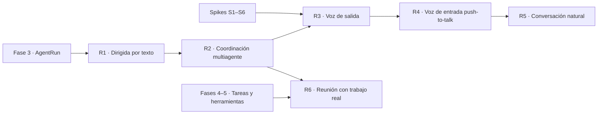

# Alcance y roadmap

> Las fases son una **propuesta**, pendiente de aprobación. Estimaciones orientativas para 1–2 personas; se ajustan tras la Fase 0.

## Estado actual

Fase 0 completada (2026-11-17): scaffold Tauri 2 (React + TypeScript + Vite), spikes de keychain, de `git worktree` + PTY con salida en vivo y de streaming SSE (Chat Completions), validados en los tres SO desde CI y con pruebas reales contra Ollama y DeepSeek. Fase 1 completada (2026-11-17): SQLite con `profile` y `workspaces`, primer arranque (idioma y workspace), shell (riel + topbar), cambio y creación de workspace, tokens Grafito e i18n `es`/`en`. Fase 2 completada (2026-11-18): equipos, agentes personalizados, catálogo de plantillas y contratación con asistente; ya se pueden editar (incluido el equipo) y eliminar agentes con confirmación y arrastrar los nodos del organigrama con posiciones persistidas; ya se detectan los modelos locales (Ollama y LM Studio). Fase 3 en curso (2026-11-18): salas, participantes y chat persistente construidos; `AgentRun` construido (motor con estados persistidos, streaming, reintentos, cancelación y expiración al arrancar; adaptadores de los cinco proveedores probados con `wiremock`; «Pedir a» en la sala) y probado con un modelo real de Ollama; la pantalla «Claves de IA» sigue sin construir. Ver [../architecture/overview.md](../architecture/overview.md).

## Fase 0 — Spike de validación (1 semana)

**Objetivo:** probar lo más riesgoso antes de comprometerse.

- Proyecto Tauri 2 con UI mínima.
- Llamada con streaming a Ollama y a un proveedor en la nube.
- Crear un `git worktree`, ejecutar un comando con PTY y mostrar la salida en vivo.
- Guardar y leer una clave en el keychain.
- Compilar e instalar en macOS, Windows y Linux desde CI.

**Criterios de salida:** funciona en los tres SO; arranque en frío < 2 s; instalador < 30 MB; sin bloqueos en Windows (ConPTY, rutas, WebView2) ni Linux (WebKitGTK). Si Linux falla, se evalúa Electron.

**Resultado:** cumplidos. CI verde en macOS, Windows y Ubuntu (lint, tests y bundle). Instaladores: `.dmg` 3.4 MB, `.msi` 3.5 MB, `.exe` 2.6 MB, `.deb` 3.7 MB; el criterio de 30 MB se mide con estos, no con el AppImage (79 MB), que empaqueta GTK y WebKit. Arranque: ventana visible en 0.24–0.7 s con el binario de release en macOS (caché de disco caliente; no se midió el render del contenido). Streaming probado con Ollama (`qwen2.5:0.5b`) y DeepSeek, con la clave guardada en el keychain.

## Fase 1 — Fundamentos (2 semanas)

- CI en la matriz de 3 SO, `clippy`, `rustfmt`, lint y plantilla de commits.
- SQLite, migraciones y repositorios con los `CHECK` del modelo de datos.
- Tokens de diseño Grafito, atoms y molecules base, i18n `es`/`en`.
- Primer arranque (idioma y workspace), shell (riel + topbar) y cambio de workspace.

**Resultado:** cumplido. Crear y cambiar de workspace con persistencia y ambos idiomas; CI verde, `clippy`, `rustfmt`, tests de Rust (45) y de frontend (15).

## Fase 2 — Equipos y agentes (2 semanas)

- ✅ Organigrama con nodos arrastrables y posiciones persistidas.
- ✅ Catálogo de plantillas, contratar, crear, editar, eliminar y mover agentes.
- ✅ Selector de proveedor y modelo desde `llm.yml` (nube o equipo, con buscador).

**Resultado:** cumplido. Los pendientes menores de [agent-catalog.md](agent-catalog.md) (contratar con los datos de la plantilla, advertencia de proveedor sin clave, minimapa, fijados, estado de agente, equipo «General») quedan fuera de la fase.

## Fase 3 — Salas y ejecución con streaming (3 semanas)

- ✅ Salas, participantes y chat persistente ([rooms.md](rooms.md)).
- ✅ Adaptadores para los cinco proveedores del catálogo real: `anthropic`, `openai`, `groq`, `ollama` y `lmstudio` (decisión aprobada D9). Verificados con `wiremock`; con proveedor real, solo Ollama hasta ahora.
- ✅ `AgentRun` con estados, reintentos, idempotencia, expiración al arrancar y cancelación, con los ajustes que necesitan las reuniones: prompt construido en `claim` y tokens con secuencia ([agent-run.md](../architecture/agent-run.md), aprobado y construido).
- Cambio explícito de proveedor y modelo de un agente (D18), entrega pequeña e independiente del motor.
- Claves de IA en keychain con verificación previa (pantalla «Claves de IA», entrega separada de `AgentRun`).

**Resultado esperado:** todos los criterios de [agent-execution.md](agent-execution.md), más streaming y cancelación; funciona sin conexión con un proveedor local en ejecución.

## Pista R — Reuniones conversacionales

> **Propuesta**, no aprobada para implementación. El orden (texto primero, después voz) está aprobado ([decisions.md](decisions.md) D1). Depende de la Fase 3 y avanza en paralelo a las Fases 4–6 salvo R6. Producto: [voice-meetings.md](voice-meetings.md). Arquitectura: [conversation-engine.md](../architecture/conversation-engine.md) y [voice-engine.md](../architecture/voice-engine.md). Sin estimaciones en semanas: el tamaño de R3–R5 depende de los spikes de voz.

### R1 — Conversación dirigida por texto
- **Objetivo:** que el usuario hable con un agente concreto en una conversación que conserva el contexto.
- **Incluye:** selector de destinatario y menciones `@`; ambigüedad; destinatario por defecto (P5); prompt de reunión con nombre y rol de cada emisor; estado visual de los agentes; disponibilidad real por agente.
- **Módulos:** servicio de intervención (sucede a `message_send`), dominio de menciones, `BuildPrompt`, `useRoom`, `MessageComposer`, `ParticipantTile`.
- **Base de datos:** ningún cambio más allá de `agent_runs` (Fase 3).
- **Riesgos:** recorte de contexto con modelos locales; resolución de nombres.
- **Pruebas:** dominio de menciones, prompt, aislamiento por workspace, eventos.
- **Aceptación:** criterios «Conversación dirigida» de [voice-meetings.md](voice-meetings.md#9-criterios-de-aceptación-por-etapa-ver-roadmapmd).
- **Excluye:** respuestas de varios agentes, voz.
- **Siguiente etapa si:** las respuestas de seguimiento usan el contexto anterior sin reiniciar la conversación.

### R2 — Coordinación multiagente (texto)
- **Objetivo:** preguntas al equipo, rondas y discusiones acotadas.
- **Incluye:** coordinador híbrido (D2), sugerencia por IA con un modelo de Ajustes, ronda fija, «pasar» (P7), presupuesto de 4 (D3), sesión en memoria, «Detener», cancelación por intervención.
- **Módulos:** dominio de planificación, registro de sesiones, servicios de intervención y cancelación, Ajustes (modelo coordinador), `useMeeting`.
- **Base de datos:** `settings` (planificada, alcance P9); `agent_runs` con C1/P7. Requieren aprobación.
- **Riesgos:** coste en la nube, JSON inválido del coordinador (S7), bucles.
- **Pruebas:** presupuesto, «ningún mensaje de agente crea runs», cancelación idempotente, eventos tardíos, sugerencia inválida.
- **Aceptación:** criterios «Coordinación» de [voice-meetings.md](voice-meetings.md).
- **Excluye:** voz; agentes que convocan a otros.
- **Siguiente etapa si:** las discusiones terminan siempre dentro del presupuesto y «Detener» deja la sala en reposo.

### R3 — Voz de salida
- **Objetivo:** escuchar a cada agente con su voz.
- **Incluye:** TTS nativo por plataforma (recomendado, S3); cola de reproducción con una sola voz a la vez; silenciar, subtítulos y «reproducir de nuevo»; voz por agente (D8); marcas «interrumpido» y «no reproducido» en memoria (D7).
- **Módulos:** `system/` de TTS y reproducción, servicio de cola, Ajustes › Voz, `useVoice`.
- **Base de datos:** `agent_voices` (esquema pendiente) y claves de `settings`.
- **Riesgos:** calidad en Linux, licencias de las voces neuronales (P24), audio al salir.
- **Pruebas:** máquina de reproducción, deduplicación, cierre de sesión, manual en los 3 SO.
- **Aceptación:** criterios «Voz de salida».
- **Excluye:** micrófono, TTS en streaming, voces neuronales si S4 no las aprueba.
- **Siguiente etapa si:** S1 y S2 están aprobados.

### R4 — Voz de entrada (push-to-talk) · MVP de reunión hablada
- **Objetivo:** hablar a los agentes.
- **Incluye:** captura en el núcleo, push-to-talk (D5), STT local o en la nube configurable (D6), permisos e indicador, envío o borrador (P4), detener la voz al pulsar.
- **Módulos:** `system/` de captura y STT, servicio de transcripción, entitlements de macOS, `useVoice`.
- **Base de datos:** claves de `settings`.
- **Riesgos:** permisos y firma en macOS, compilación nativa, latencia.
- **Pruebas:** máquina de captura, audio vacío, STT simulado, matriz manual.
- **Aceptación:** criterios «Voz de entrada».
- **Excluye:** escucha continua, cancelación de eco.
- **Siguiente etapa si:** latencias medidas y aceptadas, y uso real que pida más naturalidad.

### R5 — Conversación natural
- **Incluye:** VAD y escucha continua opcional, cancelación de eco (S8), TTS por frases, prelectura del turno siguiente (P16), menor latencia.
- **Excluye:** speech-to-speech como base (solo se evaluaría por agente tras un spike).

### R6 — Reunión con trabajo real
- **Depende de:** las Fases 4–5 (tareas, worktrees, herramientas, aprobaciones).
- **Objetivo:** crear tareas desde la reunión y que el agente explique su progreso.
- **Regla:** la conversación nunca autoriza herramientas.

## Fase 4 — Tareas y worktrees (2 semanas)

- Tareas con repositorio y rama base; creación y limpieza de worktrees; reconciliación de huérfanos; límite de concurrencia.
- Panel de tarea con diff de solo lectura.

**Resultado esperado:** dos tareas en paralelo sobre el mismo repo sin interferirse; descartar limpia worktree y rama.

## Fase 5 — Herramientas y aprobaciones (3 semanas)

- Bucle de herramientas con `tool use` nativo, path jail, entorno saneado, timeouts.
- `tool_calls`, `approvals`, diálogo de aprobación y terminal en vivo.
- Antes de empezar: propuesta en formato [feature-template.md](feature-template.md) para tareas y aprobaciones.

**Resultado esperado:** el agente completa una tarea simple pidiendo aprobación; ninguna escritura sale del worktree.

## Fase 6 — Docker opcional (1–2 semanas)

- Detección, ejecución en contenedor con el worktree montado, sin red por defecto, limpieza al descartar.

## Fase 7 — Endurecimiento y lanzamiento (2 semanas)

- Firma y notarización, instaladores, actualizador opcional.
- Pruebas manuales en los tres SO, accesibilidad y rendimiento.
- Exportar y borrar datos desde Ajustes.

## Qué NO construir

- Cuentas, login, sincronización, colaboración multiusuario y backend remoto.
- Integraciones externas (GitHub, Slack, ClickUp) y delegación de tareas entre agentes. La conversación coordinada entre agentes ya no está excluida: pasa a la Pista R, acotada y siempre iniciada por el usuario.
- Facturación, créditos y marketplace.
- Videollamadas reales (video, cámaras, WebRTC entre personas), avatares hiperrealistas, animaciones 3D. La reunión con agentes es visual, con texto y voz opcional.
- Automatizaciones sin permisos ni supervisión.

Prioridad: validar que el usuario obtiene valor real trabajando con agentes de IA sobre su propio código.
