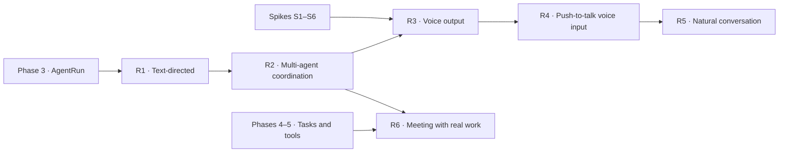

# Scope and roadmap

> The phases are a **proposal**, pending approval. Rough estimates for 1–2 people; adjusted after Phase 0.

## Current status

Phase 0 complete (2026-11-17): Tauri 2 scaffold (React + TypeScript + Vite), spikes for the keychain, `git worktree` + PTY with live output and SSE streaming (Chat Completions), validated on the three OSes from CI and with real tests against Ollama and DeepSeek. Phase 1 complete (2026-11-17): SQLite with `profile` and `workspaces`, first launch (language and workspace), shell (rail + topbar), workspace switching and creation, Grafito tokens and `es`/`en` i18n. Phase 2 complete (2026-11-18): teams, custom agents, template catalog and hiring with a wizard; agents can now be edited (including the team) and deleted with confirmation, and org chart nodes can be dragged with persisted positions; local models (Ollama and LM Studio) are now detected. Phase 3 in progress (2026-11-18): rooms, participants and persistent chat built; `AgentRun` built (engine with persisted states, streaming, retries, cancellation and expiry at startup; adapters for the five providers tested with `wiremock`; "Ask" in the room) and tested with a real Ollama model; Phase 3 complete (2026-11-18) with the "AI providers" screen in Settings (keys verified before saving, per workspace, in the keychain). See [../architecture/overview.md](../architecture/overview.md).

## Meeting MVP (product phase)

Since 2026-11-20 the priority is the meeting itself: a room like a video call where the supervisor talks by voice and chat with a team of agents that can work on tasks (decisions D57–D59). The goal is a functional product with essential safety; deferred work is in [stabilization-backlog.md](stabilization-backlog.md).

| Delivery | Status | What exists |
|---|---|---|
| A — Meeting view | ✅ built | Participant tiles with avatar, role, engine and state (available, queued, working, current tool operation, speaking with bars, listening, transcribing, problem with reason), main area, chat with tasks tab, control bar (talk, replies aloud, invite, create task, check again, hang up) |
| B — Voice turns | ✅ built, microphone check pending (S-01) | Push-to-talk → local whisper.cpp → message → agent → system voice; one-time model download with consent; stop listening and stop speaking; errors for microphone, model and transcription. macOS only |
| C — Several agents | ✅ built (reused R1/R2) | Selection, `@` mentions, a spoken or typed vocative («Ana, …») and «Team» rounds; one agent at a time |
| D — Tools in the meeting | ✅ built | Agent tools switch (D56), also turned on from the room when it is off; «No tools» on tiles whose model cannot use them; activity of each call under the request and on the tile; environment preparation and «View changes» from the room's Tasks tab |

**Criterion for the phase:** open Meelting, enter a room, talk by text and voice with a real agent, take turns with other agents, delegate a task and review its result from the meeting. Everything is in place; the voice part needs the manual microphone check (S-01) on a machine with a person at the screen, with the debug app bundle (under `tauri dev` macOS asks the permission for the terminal).

**Not in this phase:** Windows and Linux voice and tools, cloud voice, autonomous coordination, simultaneous conversation, continuous listening, approvals for commands and commits (see the backlog).

## Phase 0 — Validation spike (1 week)

**Goal:** prove the riskiest parts before committing.

- Tauri 2 project with a minimal UI.
- Streaming call to Ollama and to a cloud provider.
- Create a `git worktree`, run a command with a PTY and show the output live.
- Save and read a key in the keychain.
- Build and install on macOS, Windows and Linux from CI.

**Exit criteria:** works on the three OSes; cold start < 2 s; installer < 30 MB; no blockers on Windows (ConPTY, paths, WebView2) or Linux (WebKitGTK). If Linux fails, Electron is evaluated.

**Result:** met. CI green on macOS, Windows and Ubuntu (lint, tests and bundle). Installers: `.dmg` 3.4 MB, `.msi` 3.5 MB, `.exe` 2.6 MB, `.deb` 3.7 MB; the 30 MB criterion is measured with these, not with the AppImage (79 MB), which bundles GTK and WebKit. Startup: window visible in 0.24–0.7 s with the release binary on macOS (warm disk cache; content rendering was not measured). Streaming tested with Ollama (`qwen2.5:0.5b`) and DeepSeek, with the key stored in the keychain.

## Phase 1 — Foundations (2 weeks)

- CI on the 3-OS matrix, `clippy`, `rustfmt`, lint and commit template.
- SQLite, migrations and repositories with the data model's `CHECK`s.
- Grafito design tokens, base atoms and molecules, `es`/`en` i18n.
- First launch (language and workspace), shell (rail + topbar) and workspace switching.

**Result:** met. Creating and switching workspaces with persistence and both languages; CI green, `clippy`, `rustfmt`, Rust tests (45) and frontend tests (15).

## Phase 2 — Teams and agents (2 weeks)

- ✅ Org chart with draggable nodes and persisted positions.
- ✅ Template catalog, hiring, creating, editing, deleting and moving agents.
- ✅ Provider and model picker from `llm.yml` (cloud or on this computer, with search).

**Result:** met. The minor pending items in [agent-catalog.md](agent-catalog.md) (hiring with the template data, warning for a provider without a key, minimap, pinning, agent status, "General" team) stay outside the phase.

## Phase 3 — Rooms and streaming execution (3 weeks) ✅

- ✅ Rooms, participants and persistent chat ([rooms.md](rooms.md)).
- ✅ Adapters for the six providers of the real catalog: `anthropic`, `openai`, `groq`, `deepseek`, `ollama` and `lmstudio` (approved decision D9; DeepSeek reuses the Chat Completions adapter). Verified with `wiremock`; with a real provider, only Ollama so far.
- ✅ `AgentRun` with states, retries, idempotency, expiry at startup and cancellation, with the adjustments meetings need: prompt built on `claim` and tokens with a sequence ([agent-run.md](../architecture/agent-run.md), approved and built).
- ✅ Explicit change of an agent's provider and model (D18), a delivery independent of the engine.
- ✅ AI keys in the keychain with prior verification ("AI providers" screen in Settings, a delivery separate from `AgentRun`, D26).

**Expected result:** all the criteria in [agent-execution.md](agent-execution.md), plus streaming and cancellation; works offline with a local provider running.

## Track R — Conversational meetings

> **Proposal**, not approved for implementation. The order (text first, then voice) is approved ([decisions.md](decisions.md) D1). Depends on Phase 3 and proceeds in parallel with Phases 4–6 except R6. Product: [voice-meetings.md](voice-meetings.md). Architecture: [conversation-engine.md](../architecture/conversation-engine.md) and [voice-engine.md](../architecture/voice-engine.md). No estimates in weeks: the size of R3–R5 depends on the voice spikes.

### R1 — Text-directed conversation ✅
- **Status:** implemented (D19–D23). Details in [conversation-engine.md](../architecture/conversation-engine.md#r1-built).
- **Goal:** let the user talk to a specific agent in a conversation that keeps context.
- **Includes:** recipient picker and `@` mentions; ambiguity; default recipient (P5); meeting prompt with each speaker's name and role; visual agent status; real availability per agent.
- **Modules:** intervention service (succeeds `message_send`), mentions domain, `BuildPrompt`, `useRoom`, `MessageComposer`, `ParticipantTile`.
- **Database:** no change beyond `agent_runs` (Phase 3).
- **Risks:** context trimming with local models; name resolution.
- **Tests:** mentions domain, prompt, workspace isolation, events.
- **Acceptance:** "Directed conversation" criteria in [voice-meetings.md](voice-meetings.md#9-acceptance-criteria-per-stage-see-roadmapmd).
- **Excludes:** responses from several agents, voice.
- **Next stage if:** follow-up responses use the previous context without restarting the conversation.

### R2 — Multi-agent coordination (text)
- **Goal:** questions to the team, rounds and bounded discussions.
- **Includes:** hybrid coordinator (D2), AI suggestion with a model from Settings, fixed round, "pass" (P7), budget of 4 (D3), in-memory session, "Stop", cancellation per intervention.
- **Modules:** planning domain, session registry, intervention and cancellation services, Settings (coordinator model), `useMeeting`.
- **Database:** `settings` (planned, scope P9); `agent_runs` with C1/P7. Require approval.
- **Risks:** cloud cost, invalid JSON from the coordinator (S7), loops.
- **Tests:** budget, "no agent message creates runs", idempotent cancellation, late events, invalid suggestion.
- **Acceptance:** "Coordination" criteria in [voice-meetings.md](voice-meetings.md).
- **Excludes:** voice; agents that summon others.
- **Next stage if:** discussions always end within the budget and "Stop" leaves the room idle.

### R3 — Voice output
- **Status (2026-11-20):** MVP built on macOS by D57 (system voices, one per agent, queue, stop); subtitles are the chat itself; `agent_voices` and Settings › Voice are not built (S-16).
- **Goal:** hear each agent with its own voice.
- **Includes:** native TTS per platform (recommended, S3); playback queue with a single voice at a time; mute, subtitles and "play again"; per-agent voice (D8); "interrupted" and "not played" marks in memory (D7).
- **Modules:** TTS and playback `system/`, queue service, Settings › Voice, `useVoice`.
- **Database:** `agent_voices` (schema pending) and `settings` keys.
- **Risks:** quality on Linux, neural voice licenses (P24), audio on exit.
- **Tests:** playback state machine, deduplication, session close, manual on the 3 OSes.
- **Acceptance:** "Voice output" criteria.
- **Excludes:** microphone, streaming TTS, neural voices if S4 does not approve them.
- **Next stage if:** S1 and S2 are approved.

### R4 — Voice input (push-to-talk) · spoken meeting MVP
- **Status (2026-11-20):** MVP built on macOS by D57 (local whisper.cpp, push-to-talk button, transcript sent as a message); cloud STT, the keyboard shortcut and other OSes are deferred (F-01, S-12, S-10).
- **Goal:** talk to the agents.
- **Includes:** capture in the core, push-to-talk (D5), configurable local or cloud STT (D6), permissions and indicator, send or draft (P4), stop the voice on press.
- **Modules:** capture and STT `system/`, transcription service, macOS entitlements, `useVoice`.
- **Database:** `settings` keys.
- **Risks:** permissions and signing on macOS, native compilation, latency.
- **Tests:** capture state machine, empty audio, mocked STT, manual matrix.
- **Acceptance:** "Voice input" criteria.
- **Excludes:** continuous listening, echo cancellation.
- **Next stage if:** latencies measured and accepted, and real usage asking for more naturalness.

### R5 — Natural conversation
- **Includes:** VAD and optional continuous listening, echo cancellation (S8), per-sentence TTS, prefetch of the next turn (P16), lower latency.
- **Excludes:** speech-to-speech as the foundation (it would only be evaluated per agent after a spike).

### R6 — Meeting with real work
- **Status (2026-11-20):** first version built (D58): tasks are created and linked from the meeting, the agent's file and Git operations show live in the room, and the changes open from it; commands and commits wait for approvals.
- **Depends on:** Phases 4–5 (tasks, worktrees, tools, approvals).
- **Goal:** create tasks from the meeting and have the agent explain its progress.
- **Rule:** the conversation never authorizes tools.

## Phase 4 — Tasks and worktrees (2 weeks)

Specification: [tasks.md](tasks.md); decisions D27–D39.

- **4A — Domain, repositories and tasks** ✅: repository registration, tasks with status, priority, optional repository and base branch, several agents per task, creation from rooms.
- **4B — Git environments** ✅ (implemented; verified within the scope tested on macOS, Ubuntu and Windows, limits in [tasks.md §7.1](tasks.md#71-verification-evidence)): worktree root setting, fixed local storage checks, explicit preparation from an exact commit, local file copies, technical states, per-repository serialization, recovery at startup, safe removal without `--force`.
- **4C — Review and interface:** environment detail, Git status, read-only diff, drift warnings (not built in 4B: nothing compares the base branch yet), recovery screens, E2E on Linux and Windows.

**Expected result:** two tasks on the same repo get independent worktrees without touching the original working directory; completing a task keeps its worktree and branch, and only clean worktrees are removed.

## Phase 5 — Tools and approvals (3 weeks)

- Tool loop with native `tool use`, path jail, sanitized environment, timeouts.
- `tool_calls`, `approvals`, approval dialog and live terminal.
- Before starting: a proposal in [feature-template.md](feature-template.md) format for tasks and approvals.

**Expected result:** the agent completes a simple task asking for approval; no write leaves the worktree.

## Phase 6 — Optional Docker (1–2 weeks)

- Detection, execution in a container with the worktree mounted, no network by default, cleanup on discard.

## Phase 7 — Hardening and launch (2 weeks)

- Signing and notarization, installers, optional updater.
- Manual testing on the three OSes, accessibility and performance.
- Export and delete data from Settings.

## What NOT to build

- Accounts, login, sync, multi-user collaboration and a remote backend.
- External integrations (GitHub, Slack, ClickUp) and task delegation between agents. Coordinated conversation between agents is no longer excluded: it moves to Track R, bounded and always initiated by the user.
- Billing, credits and marketplace.
- Real video calls (video, cameras, WebRTC between people), hyperrealistic avatars, 3D animations. The meeting with agents is visual, with text and optional voice.
- Automations without permissions or supervision.

Priority: validate that the user gets real value working with AI agents on their own code.
